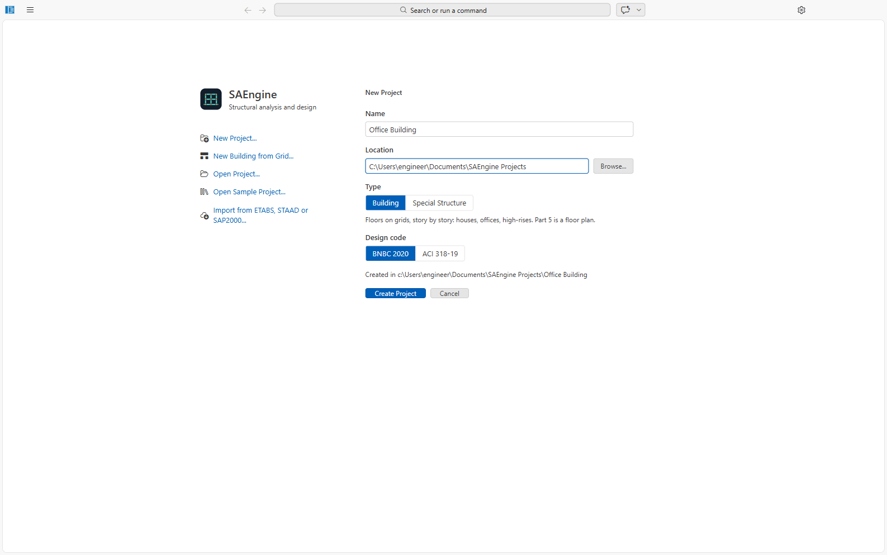
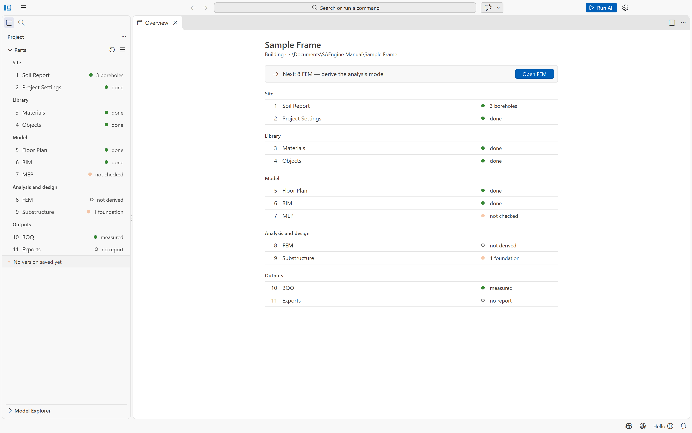
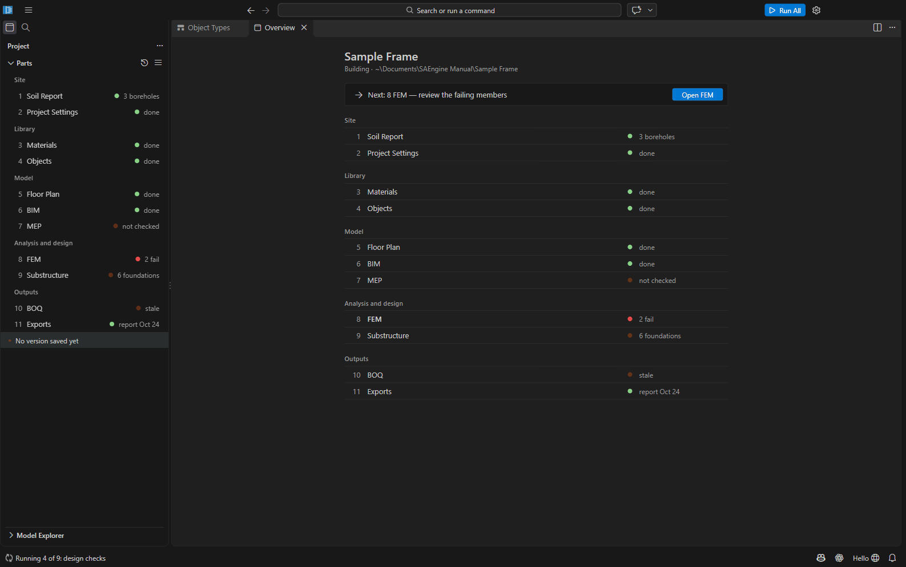

# Getting started

This chapter explains the parts of the SAEngine window that every project shares: the start
page, the Project sidebar, the Overview, **Run All**, Versions and project archives. The eleven
parts each have their own chapter.

SAEngine is a desktop program for the structural analysis and design of buildings and special
structures to **BNBC 2020** (ACI 318-19 and AISC 360-22 can be chosen instead). It works in fixed
SI units: millimetres for geometry, metres for site positions and levels, kN and kN/m² for loads,
MPa for strengths. There is no unit setting.

> Installing SAEngine is described in [docs/install](../install/README.md). The Python backend
> (analysis, design, reports, drawings) comes with the installer. If a command says *"The SAEngine
> Python backend is not available"*, run **Check Python Runtime** from the Command Palette; it
> reports the Python, OpenSeesPy and opensees-studio versions it found.

## The start page

When SAEngine starts without a project, the start page fills the window.



| Button | What it does |
| --- | --- |
| **New Project...** | Shows the New Project form on the right (below). |
| **New Building from Grid...** | Opens the New Building wizard: a whole RC building from a grid in one step ([Part 5](05-floor-plan.md#new-building-from-grid)). |
| **Open Project...** | Picks a project folder (default `Documents\SAEngine Projects`). If the folder is not a project, SAEngine offers **Create Project Structure**; existing files are kept. |
| **Open Sample Project...** | Copies the *Sample Frame* project to a folder you choose and opens the copy. If a copy is already there, it offers to open that copy. |
| **Import from ETABS, STAAD or SAP2000...** | Creates a project from a text export of another program ([Importing models](12-importing.md)). |

**Recent Projects** on the right lists up to eight recently opened projects.

### New Project

| Field | Meaning |
| --- | --- |
| Name | The project name; it becomes the folder name and cannot contain `\ / : * ? " < > \|`. |
| Location | The parent folder (default `Documents\SAEngine Projects`), with **Browse...**. |
| Type | **Building**: floors on grids, storey by storey; Part 5 is a floor plan. **Special Structure**: drawn in 3D (roofs, stadiums, towers, bridges); Part 5 is a 3D structural model. |
| Design code | **BNBC 2020** (default) or **ACI 318-19**. BNBC 2020 sets concrete to *BNBC 2020 Part 6 Chapter 6* and steel to *Part 6 Chapter 10*; ACI 318-19 sets ACI 318-19 and AISC 360-22. Both can be changed later in Project Settings. |

**Create Project** creates the folder and opens it in the same window.

## What a project is

A project is a folder with a `<name>.saengine` manifest and one folder per part:

```
Office Building/
├─ Office Building.saengine
├─ 01 Soil Report/soil-report.json
├─ 02 Project Settings/project-settings.json
├─ 03 Materials/materials.json
├─ 04 Objects/objects.json
├─ 05 Floor Plan/floor-plan.json        (05 Structural Model/structure.json for a special structure)
├─ 06 BIM/bim.json
├─ 07 MEP/mep.json
├─ 08 FEM/model.osmodel                  (derived, with its results in model.results/)
├─ 09 Substructure/substructure.json
├─ 10 BOQ/boq.json
└─ 11 Exports/                           (report, drawings, IFC, DXF, CSV)
```

The manifest, the part folders and each part's main file are protected: SAEngine refuses to
delete, rename or move them and recreates them if they are removed outside the program. You can
add other files (for example architect's DXF underlays) freely.

Every editor saves to its file like a document: **Ctrl+S** saves, **Ctrl+Z / Ctrl+Y** undo and
redo, and each change in a form or on a plan is one undoable step.

## The Project sidebar



The **Project** sidebar lists the eleven parts in five groups. Click a part to open its editor.

| Group | Parts |
| --- | --- |
| Site | 1 Soil Report, 2 Project Settings |
| Library | 3 Materials, 4 Objects |
| Model | 5 Floor Plan (or Structural Model), 6 BIM, 7 MEP |
| Analysis and design | 8 FEM, 9 Substructure |
| Outputs | 10 BOQ, 11 Exports |

Each part shows a status dot and a short text, for example *done*, *in progress*, *not
started*, *out of date* ("stale"), *checks fail* or *invalid file*, or a count such as
*3 boreholes* or *1 foundation*.

Below the parts, a line summarises the [versions](#versions) (for example *No version saved yet*
or *2 parts changed since v3*); click it to open Versions.

The sidebar's **≡** menu holds **Project Overview**, **Project Settings**, **Versions**,
**Save Version...**, **New Building from Grid...**, **Open Folder in File Explorer**,
**Export Project...** and **Open Project Archive...**.

The second sidebar, **Model**, holds the **Model Explorer**: the members of the model in a
tree. Selecting a member there selects it in the floor plan and the 3D view too.

## The Overview

**Project Overview** opens when a project opens. It shows the project type and path, a
**Next:** line with the part that needs attention next and a button to open it (for example
*Next: 8 FEM — derive the analysis model* / **Open FEM**), and the same part list as the sidebar.
When nothing is left to do it says *Every part is up to date.*

## How the parts depend on each other

```
1 Soil Report ─┐
2 Project Settings ─┤
3 Materials ─┤
4 Objects ─┼─► 5 Floor Plan ─► 6 BIM ─► 8 FEM (derive ► analyse ► design) ─► 9 Substructure
7 MEP ─────┘                    │                                       │
                                └──────────────► 10 BOQ ◄───────────────┘
                                                   │
                                     11 Exports (report, drawings, IFC, DXF, CSV)
```

- The **building model** (6 BIM) is built from the floor plan when you click **Build from Floor
  Plan** / **Rebuild from Floor Plan** in the BIM editor. Run All does **not** rebuild it.
- The **analysis model** (8 FEM) is derived from the building model, Project Settings, Object
  Types and Materials (and the soil report, MEP and substructure where they matter). It is
  never edited by hand.
- Every derived file remembers what it was made from. When a source changes, the part shows
  **Out of date** with a link to derive, measure or build it again.

## Run All

**Run All** (the blue button in the title bar, or *SAEngine: Run All* in the Command Palette)
runs the analysis and design of the whole project. It first saves any unsaved edits of the
part files, then runs these steps in order, skipping those that are not needed:

| Step | What it does | Skipped when |
| --- | --- | --- |
| 1 analysis model | Derives `08 FEM/model.osmodel` from the building model | it is up to date |
| 2 analysis | Runs every analysis case with OpenSeesPy | — |
| 3 fixed-base run for the soil springs | A second run on fixed supports, used by the foundation design | supports are not soil springs |
| 4 design checks | Checks every member against the load combinations, then the steel each needs | — |
| 5 foundation design | Checks the foundations of 9 Substructure | there are no foundations |
| 6 MEP coordination, plumbing, HVAC and electrical checks | Openings, clashes, plumbing, HVAC and electrical results | MEP is empty |
| 7 bill of quantities | Measures 10 BOQ | it is up to date |
| 8 report | Prints `11 Exports/report.pdf` | — |
| 9 drawings | Regenerates the structural drawings | none were generated yet, or they are current |

While it runs, the left of the status bar shows *Running 2 of 9: analysis*. **Click that entry
to cancel.** When it finishes, a notification sums up the result, for example *Done: 15 pass,
2 fail; steel short in 2 element(s) · foundations 1 pass, 0 fail · BOQ updated · report
written*, with **Open Report**.

If a step cannot be done, Run All stops there: *Run All stopped at step 2 of 9 (analysis): ...*
(with **Show Log** for analysis errors). **Failing design checks do not stop Run All**: they are
results, shown in 8 FEM and the report.

Run All does not:

- rebuild 6 BIM from the floor plan (do that in the BIM editor after editing the plan);
- generate the first drawing set (start it once from [11 Exports](11-exports.md));
- change any section size (see [8 FEM, design proposal](08-fem.md#design-reinforcement-the-design-proposal)).

Run All took four to ten minutes for the sample on the PC used for this manual, and 20 to 35
minutes for the six-storey building of Tutorial 2; the design checks take most of the time.

## Versions

A *version* is a snapshot of all the part files that you save at a milestone. SAEngine keeps
versions inside the project folder (in a hidden `.git` folder, written by SAEngine itself; Git
does not need to be installed). Computed results are not stored in versions.

Open **Versions** from the sidebar line, the History button in the sidebar title or the ≡ menu.

| Action | What it does |
| --- | --- |
| **Save Version...** | Asks for a message (e.g. *Column sizes after the wind check*) and optionally marks it **Issued** (a submission or a drawing issue). Unsaved editors are saved first. |
| **Compare with Current** | Lists the parts and values changed since the selected version. Ctrl+click a second version to compare two versions. |
| **Restore...** | Pick the parts to restore. Before restoring, unsaved changes are saved as a version *Before restoring ...*; the restore itself becomes a new version. History is never rewritten. |
| **Mark as Issued...** | Labels a version, e.g. *Rev A, Issued for Approval*. |

The author name of versions is the setting `saengine.versions.author` (empty: *SAEngine user*).
A project that lies inside another Git repository cannot keep versions; the sidebar then says
*Versions are not kept for this project*.

## Project archives (.civil)

**Export Project...** writes the whole project into one `.civil` file (a zip with a manifest
and the part files), for sending or archiving. Options: **Include Versions** and **Include
Results**; by default computed results are left out (they are recomputed) and `11 Exports` is
included. **Open Project Archive...** (or double-clicking a `.civil` file) unpacks it into a
folder you choose and opens it.

## Useful settings

Open them with the gear in the title bar (*Settings*), and search for `saengine`.

| Setting | Meaning |
| --- | --- |
| `saengine.python.path` | The Python interpreter of the backend (empty: the one bundled by the installer). |
| `saengine.cad.program` | The CAD program DXF drawings open in (empty: the bundled LibreCAD, then an installed LibreCAD, then the Windows default for DXF). |
| `saengine.map.tileUrl`, `saengine.map.tileAttribution` | The map tiles of the soil-report site map (default OpenStreetMap). |
| `saengine.qgis.program` | QGIS, for **Open in QGIS** on the site map. |
| `saengine.versions.author` | The name saved with versions, as `Name <email>`. |
| `saengine.developerMode` | Shows the code-editor features of the underlying Code - OSS (Explorer, terminal, ...). Off by default. **Toggle Developer Mode** is in the Help menu. |

There are **no SAEngine keyboard shortcuts** beyond the ones listed in each part (editor keys
such as Ctrl+S, Ctrl+Z, Delete, Esc). Every command can be found in the Command Palette
(**Ctrl+Shift+P**, or the search box in the title bar) under the category *SAEngine*.

## Language: English or Bangla

SAEngine's own screens are available in Bangla (বাংলা) through the built-in *Bangla Language
Pack for SAEngine*. Run **Configure Display Language** from the Command Palette, choose
Bangla (বাংলা) and restart SAEngine. The rest of the underlying Code - OSS workbench stays in
English, and the `saengine` command line always writes English. This manual uses the English
names.

## Light and dark

SAEngine follows the colour theme of the window (gear → *Themes* → *Color Theme*). All editors,
plans and the 3D views have light and dark variants.


