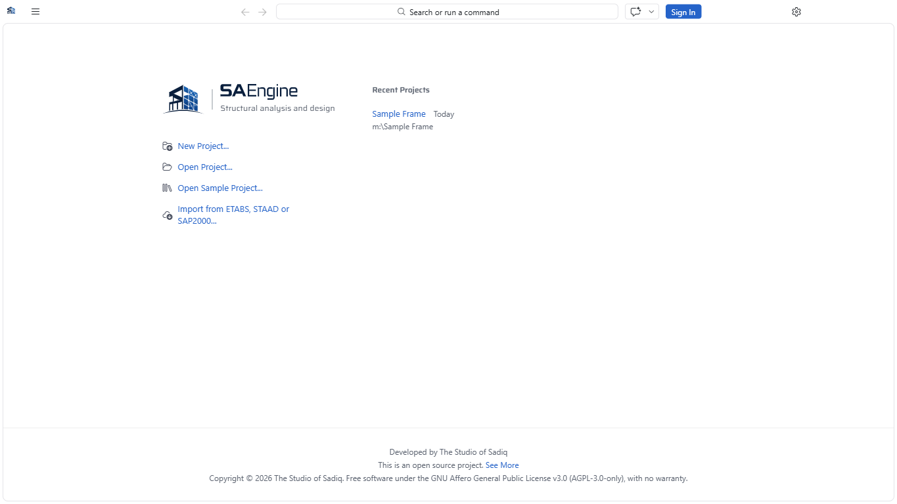
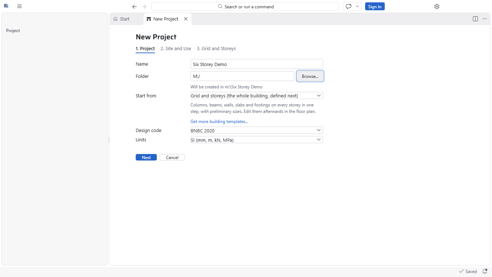
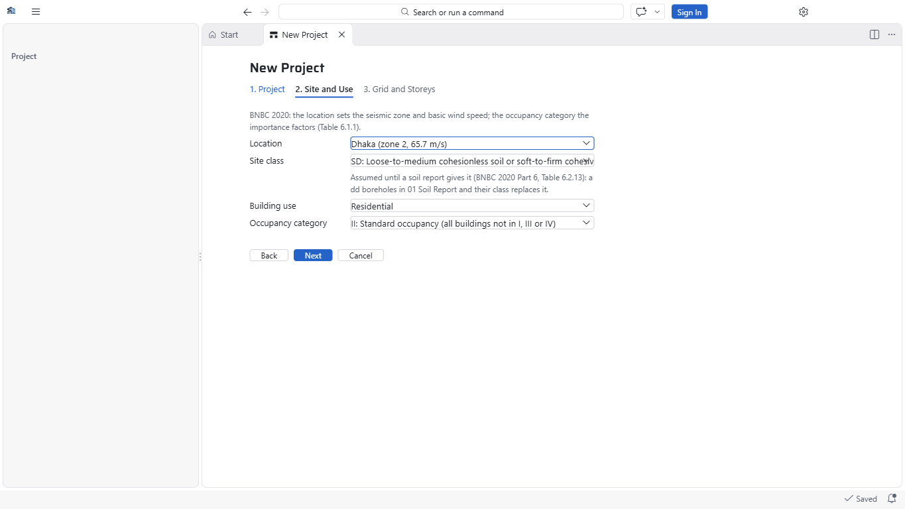
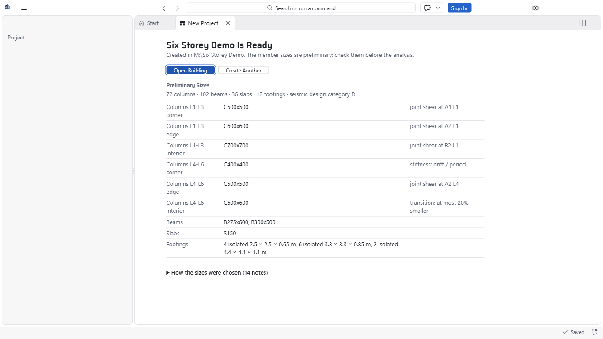
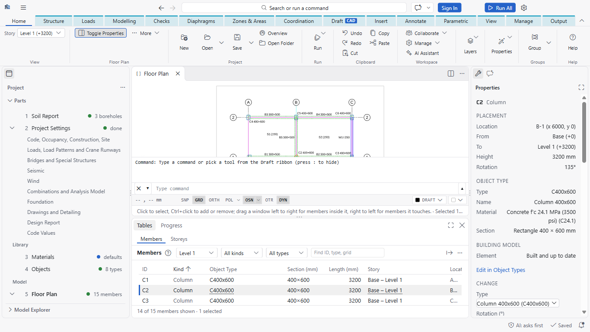
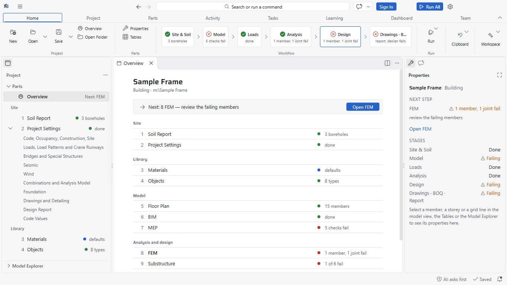
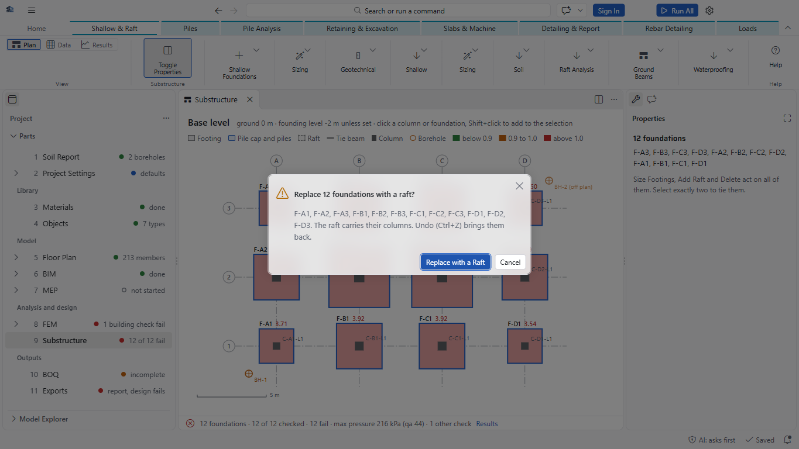
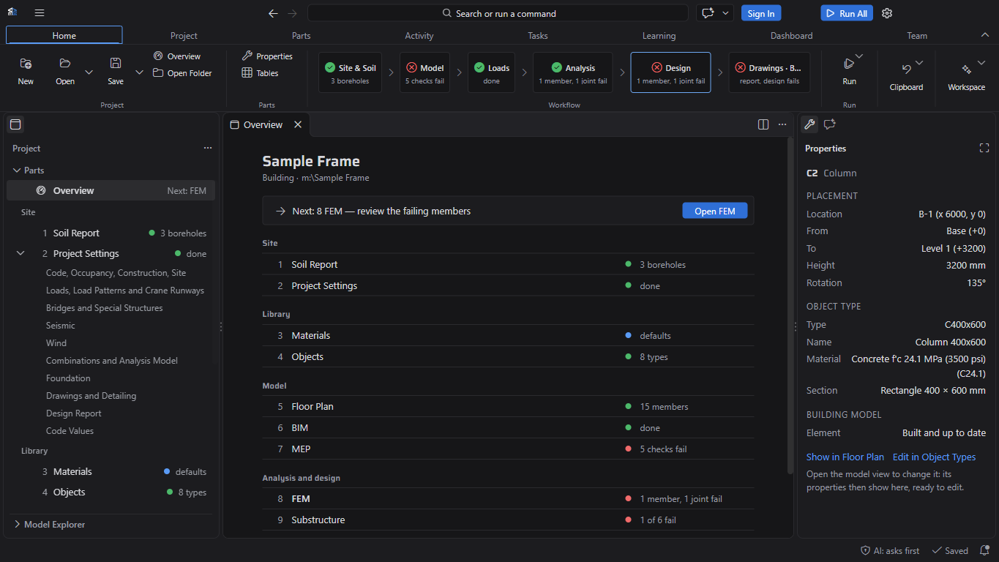

# Getting started

This chapter covers what every project shares: the Start page, the New Project wizard, the
SAEngine window, **Run All**, versions, archives, working together and the settings. Each of the
eleven parts has its own chapter.

SAEngine is a desktop program for the structural analysis and design of buildings and special
structures. The design code is a setting: **BNBC 2020** is the default code pack, and 34 others
can be chosen (ACI 318 with ASCE 7, the Eurocodes, the Indian Standards and more; see
[Packages](14-packages.md)). A project works in SI or US customary units.

> Installing SAEngine is described in [docs/install](../install/README.md). The Python backend
> (analysis, design, reports, drawings) comes with the installer. If a command says *"The SAEngine
> Python backend is not available"*, run **Check Python Runtime** from the command search; it
> reports the Python, OpenSeesPy and opensees-studio versions it found.

## The Start page

When SAEngine starts without a project, the Start page fills the window. There is no ribbon
until a project is open.



| Link | What it does |
| --- | --- |
| **New Project...** | Opens the New Project wizard (below): the one way to start a project. |
| **Open Project...** | Picks a project folder (default `Documents\SAEngine Projects`). If the folder is not a project, SAEngine offers **Create Project Structure**; existing files are kept. |
| **Open Sample Project...** | Copies the *Sample Frame* project to a folder you choose and opens the copy. If a copy is already there, it offers to open that copy. |
| **Import from ETABS, STAAD or SAP2000...** | Creates a project from a text export of another program ([Importing models](12-importing.md)). |

**Recent Projects** on the right lists the projects you opened last, with their folders.

## New Project

**New Project...** (Start page, **≡ › File**, or **New** on the Home ribbon) opens one wizard for
every new project. Its three steps are shown at the top. **Next** goes on, **Back** or a step's
name goes back, **Cancel** stops. The defaults make a working building at once.



**1. Project**

| Field | Meaning |
| --- | --- |
| Name | The project name. It becomes the folder name. |
| Folder | The parent folder, with **Browse...**. The line below says where the project will be created. |
| Start from | **Grid and storeys** (default): the whole building, defined on the next pages. **Empty building**: no grids or members yet; you draw them in 05 Floor Plan. **Special structure**: a 3D model without a grid (roofs, stadiums, towers, bridges). Installed packages add their building specifications and full templates here. **Get more building templates...** opens the Packages page. |
| Design code | The code packs installed, BNBC 2020 first. The site fields of the next page follow the pack. |
| Units | **SI (mm, m, kN, MPa)** or **US customary (ft, in, kip, ksi, psf)**. The grid, storeys and wind speed are typed in them. |

**2. Site and Use.** The **Location** (for BNBC 2020, the district towns with their seismic zone
and basic wind speed), the **Site class** assumed until a soil report gives one, the **Building
use** and the **Occupancy category**. A pack without towns asks for the hazard values instead.
The wind exposure and the rest are set later in Project Settings › Site.



**3. Grid and Storeys** (for *Grid and storeys* only): the bays, storeys, structural system,
materials and footings. See
[New Project from the grid](05-floor-plan.md#new-project-from-the-grid).

**Create Project** writes the project. A building from the grid then shows the page
*\<name\> Is Ready* with its **Preliminary Sizes** and **How the sizes were chosen**; click **Open
Building**. An empty project opens at once. A full template is checked and unpacked into the
folder.



## What a project is

A project is a folder with a `<name>.saengine` manifest and one folder per part:

```
Office Building/
├─ Office Building.saengine
├─ 01 Soil Report/soil-report.json
├─ 02 Project Settings/project-settings.json
├─ 03 Materials/materials.json
├─ 04 Objects/objects.json
├─ 05 Floor Plan/floor-plan.json        (05 Structural Model/structure.json for a special structure)
├─ 06 BIM/bim.json
├─ 07 MEP/mep.json
├─ 08 FEM/model.osmodel                  (derived, with its results in model.results/)
├─ 09 Substructure/substructure.json
├─ 10 BOQ/boq.json
└─ 11 Exports/                           (report, drawings, IFC, DXF, CSV)
```

The manifest, the part folders and each part's main file are protected: SAEngine refuses to
delete, rename or move them and recreates them if they are removed outside the program. You can
add other files (for example the architect's DXF underlays) freely.

Every window saves to its file like a document: **Ctrl+S** saves, **Ctrl+Z / Ctrl+Y** undo and
redo, and each change in a form or on a plan is one undoable step. The status bar shows
**Saved** or **Unsaved changes (n)**.

## The window



The SAEngine window has six areas.

| Area | What it holds |
| --- | --- |
| **Title bar** | **≡** (the menus **File**, **Edit**, **View** and **Help**), back and forward, the command search (*Search or run a command*, also **Ctrl+Shift+P**), the AI chat, **Sign In**, **Run All** and the gear (settings and colour theme). |
| **Ribbon** | Tabs and groups of buttons, like Office or Revit. **Home** is always first; the other tabs belong to the window you are working in. The arrow at the right end folds the ribbon away. |
| **Project sidebar** (left) | The eleven parts and their sub-windows, each with a status. **Model Explorer** at the bottom lists the members of the model. |
| **Model view** (centre) | The open windows as tabs: the floor plan, the 3D views, the forms and tables of each part. |
| **Properties** (right) | The properties of the selection, ready to edit, or of the open window when nothing is selected. The speech-bubble tab beside it is the AI chat. |
| **Tables** (below) | **Members** and **Storeys** tables of the model, and **Progress** for Run All. Each table has filters and a search box. |

**One selection everywhere.** Select a member in the floor plan, a 3D view, the Tables or the
Model Explorer, and it is selected in all of them. Properties shows it. Selecting a member on
another storey switches the plan to that storey.

**Show and hide the panels.** **Home › Parts › Properties** and **Tables** (or **Toggle
Properties** in a part's Home tab) show and hide them. Each panel has its own close button.

### The ribbon follows the active window

The ribbon shows only the tools of the window you are working in. Open the soil report and you
see its tabs (**Investigation**, **Lab Tests**, **Bearing & Settlement**, ...); open the floor
plan and you see **Structure**, **Loads**, **Draft**, **Annotate** and the rest. A sub-window
(Grids & Stories, the Design Reinforcement proposal, a drawing sheet) has its own tabs. No tool
appears twice in one window.

On a narrow window a group folds into one button with a ▾: click it for the group's commands.

Every ribbon button works. The ribbons hold 5,340 buttons. Many open an **input panel**: the
inputs with their units and defaults, a **Run** button, and the result with its tables and
notes. When the project lacks the data a button needs, the panel says what is missing instead of
showing blank results. Treat these panels as calculators: check their inputs and read their
notes.

### The Overview and the stage bar

**Overview** (first in the sidebar, or **Home › Project › Overview**) shows the project's name,
type and folder, a **Next:** line with the part that needs attention and a button to open it
(for example *Next: 8 FEM — review the failing members* / **Open FEM**), and every part with
its status.



The **stage bar** on the Overview's Home ribbon (group **Workflow**) shows where the project
stands:

**Site & Soil › Model › Loads › Analysis › Design › Drawings · BOQ · Report**

Each stage shows its state under its name: done (✓), failing (✗ with what fails, for example
*14 members fail*), out of date, in progress or not started. A stage after the analysis never
shows as done while the analysis is not done or out of date. Click a stage to open the part
behind it. Properties (with nothing selected) lists the same stages.

### Part status in the sidebar

Each part in the sidebar shows a coloured dot and a short text, for example *done*, *defaults*,
*not started*, *stale* (out of date), *14 members fail*, *invalid file*, or a count such as
*3 boreholes* or *1 foundation*. The sidebar's **...** menu and the clock icon give the project
commands and the [versions](#versions).

### The status bar

At the bottom: on the left, what the engine is doing (*Engine working 15 s: Design checks...*,
or Run All's step); on the right, **AI: asks first** (see [AI](#ai-and-your-data)), **Saved**
or **Unsaved changes**, and the notifications bell. The output log stays closed unless you open
it or a run asks for it.

## How the parts depend on each other

```
1 Soil Report ─┐
2 Project Settings ─┤
3 Materials ─┤
4 Objects ─┼─► 5 Floor Plan ─► 6 BIM ─► 8 FEM (derive ► analyse ► design) ─► 9 Substructure
7 MEP ─────┘                    │                                       │
                                └──────────────► 10 BOQ ◄───────────────┘
                                                   │
                                     11 Exports (report, drawings, IFC, DXF, CSV)
```

- The **building model** (6 BIM) is built from the floor plan: by **Rebuild** in 6 BIM, or by Run
  All, which builds it again when the floor plan changed.
- The **analysis model** (8 FEM) is derived from the building model, Project Settings, Object
  Types and Materials (and the soil report, MEP and substructure where they matter). It is never
  edited by hand.
- Every derived file remembers what it was made from. When a source changes, the part shows
  **stale** and its window offers to build, derive or measure it again.

## Input guardrails

SAEngine refuses input that cannot be right and says why, for example a negative thickness, a
storey below the one under it, or a live load below the code minimum for the use (flagged with
the clause). A field that cannot be applied keeps its old value.

Deleting or replacing important data asks first and names what goes, for example *Replace 12
foundations with a raft?* Undo (Ctrl+Z) still brings it back.



## Run All

**Run All** (the blue button in the title bar, **Home › Run**, or **F5**) runs the analysis and
design of the whole project. It first saves any unsaved edits of the part files. Then it runs
these steps in order and skips those that are not needed:

| Step | What it does | Skipped when |
| --- | --- | --- |
| 1 building model | Builds 06 BIM from the floor plan | it is up to date |
| 2 analysis model | Derives `08 FEM/model.osmodel` from the building model | it is up to date |
| 3 analysis | Runs every analysis case with OpenSeesPy | the results are current |
| 4 fixed-base run for the soil springs | A second run on fixed supports, for the foundation design | the supports are not soil springs |
| 5 foundation design | Checks the foundations of 9 Substructure | there are no foundations |
| 6 design checks | Checks every member against the load combinations | — |
| 7 pushover | The pushover cases | none is asked for in Project Settings |
| 8 MEP checks | Openings, clashes, plumbing, HVAC and electrical results | there is nothing in 07 MEP |
| 9 bill of quantities | Measures 10 BOQ | there is no bill |
| 10 report | Prints `11 Exports/report.pdf` | — |
| 11 drawings | Regenerates the structural drawings | none were generated yet |

While it runs, the status bar shows *Run All 6/11: design checks · 0:29*, and **Tables ›
Progress** lists the steps. Click the status bar entry to cancel. When it finishes, a
notification sums up the result, for example *Run All done in 0:59: design 17 pass, 1 fail ·
joints 1 fail · foundations 1 of 6 fail*, with **Show Steps**, **Show Results** and **Open
Report**.

If a step cannot be done, Run All stops there and says why, for example *Run All: step 6 of 11
(design checks) failed: The design checks checked nothing: the object types B275x600, ... have
no bars (8 FEM, Design Reinforcement proposes them).* The notification then has a
**Design Reinforcement** button. **Failing design checks do not stop Run All**: they are
results, shown in 8 FEM and the report.

Run All does not:

- write member bars or change a section (see
  [8 FEM, the design proposal](08-fem.md#design-reinforcement-the-design-proposal));
- generate the first drawing set (start it once from [11 Exports](11-exports.md)).

The sample project takes about a minute on a typical PC; a ten-storey building a few minutes.

## Versions

A *version* is a snapshot of all the part files that you save at a milestone. SAEngine keeps
versions inside the project folder (in a hidden `.git` folder, written by SAEngine itself; Git
does not need to be installed). Computed results are not stored in versions.

Open **Versions** from the clock icon in the sidebar, **Home › Workspace › Collaborate ›
Versions**, or the command search.

| Action | What it does |
| --- | --- |
| **Save Version...** | Asks for a message (e.g. *Column sizes after the wind check*) and optionally marks it **Issued** (a submission or a drawing issue). Unsaved windows are saved first. |
| **Compare with Current** | Lists the parts and values changed since the selected version. Ctrl+click a second version to compare two versions. |
| **Restore...** | Pick the parts to restore. Unsaved changes are first saved as a version *Before restoring ...*; the restore itself becomes a new version. History is never rewritten. |
| **Mark as Issued...** | Labels a version, e.g. *Rev A, Issued for Approval*. |

The author name of versions is the setting `saengine.versions.author` (empty: *SAEngine user*).
A project that lies inside another Git repository cannot keep versions.

## Working together

**Home › Workspace › Collaborate** holds **Share Project**, **Sync**, **Open Shared**, **Lock
Part**, **Live Co-Editing**, **Versions** and **Save Version**. Everything goes through a folder
or a git server of your own office; no outside service is used.

- **Share Project** puts an office copy of the project's versions in a shared folder. Colleagues
  open it with **Open Shared**. **Sync** brings in their versions and sends yours, part by part;
  where both changed the same part, you choose **Keep Mine** or **Take Theirs**.
- **Lock Part** stops a sync from overwriting a part you are editing.
- **Live Co-Editing** lets several engineers edit one part at the same moment over a relay on the
  office network. A colleague's edit appears as they make it, and the members each colleague has
  selected are outlined on the plan in their colour. The status bar shows who is in the parts you
  have open.

The details are in [docs/collaboration.md](../collaboration.md).

## Project archives (.civil)

**≡ › File › Export Project...** writes the whole project into one `.civil` file (a zip with a
manifest and the part files), for sending or archiving. Options: **Include Versions** and
**Include Results**; by default computed results are left out (they are recomputed) and
`11 Exports` is included. **Open Project Archive...** (or double-clicking a `.civil` file)
unpacks it into a folder you choose and opens it.

## AI and your data

The AI chat (the speech-bubble button in the title bar) can build and change projects through
the same actions as the command line. Every change shows as a change set to accept or undo, and
every run asks first. No project data goes to an AI provider until you agree: the status bar
shows **AI: asks first** until then; click it for the data-sharing settings.

**Help › Report a Bug...** and **Send Feedback...** send a report as a public GitHub issue or
privately by e-mail. An anonymised diagnostics bundle is attached only if you turn it on; it is
off by default.

## Useful settings

Open them with the gear in the title bar, and search for `saengine`.

| Setting | Meaning |
| --- | --- |
| `saengine.python.path` | The Python interpreter of the backend (empty: the one bundled by the installer). |
| `saengine.cad.program` | The CAD program DXF drawings open in (empty: the bundled LibreCAD, then an installed LibreCAD, then the Windows default for DXF). |
| `saengine.map.tileUrl`, `saengine.map.tileAttribution` | The map tiles of the soil report's site map (default OpenStreetMap). |
| `saengine.qgis.program` | QGIS, for **Open in QGIS** on the site map. |
| `saengine.versions.author` | The name saved with versions, as `Name <email>`. |
| `saengine.developerMode` | Shows the code-editor features of the underlying Code - OSS (Explorer, terminal, ...). Off by default. **Help › Toggle Developer Mode** switches it. |

Every command can be found with the command search (**Ctrl+Shift+P**, or the search box in the
title bar) under the category *SAEngine*. **Help › User Manual** opens this manual.

## Language: English or Bangla

SAEngine's own screens are available in Bangla (বাংলা) through the built-in *Bangla Language
Pack for SAEngine*. Run **Configure Display Language** from the command search, choose Bangla
(বাংলা) and restart SAEngine. Not every screen is translated yet. The `saengine` command line
always writes English. This manual uses the English names.

## Light and dark

SAEngine follows the colour theme of the window (gear › *Themes* › *Color Theme*: **SAEngine
Light** or **SAEngine Dark**). All windows, plans and 3D views have light and dark variants, in
the SAEngine colours and typeface.


