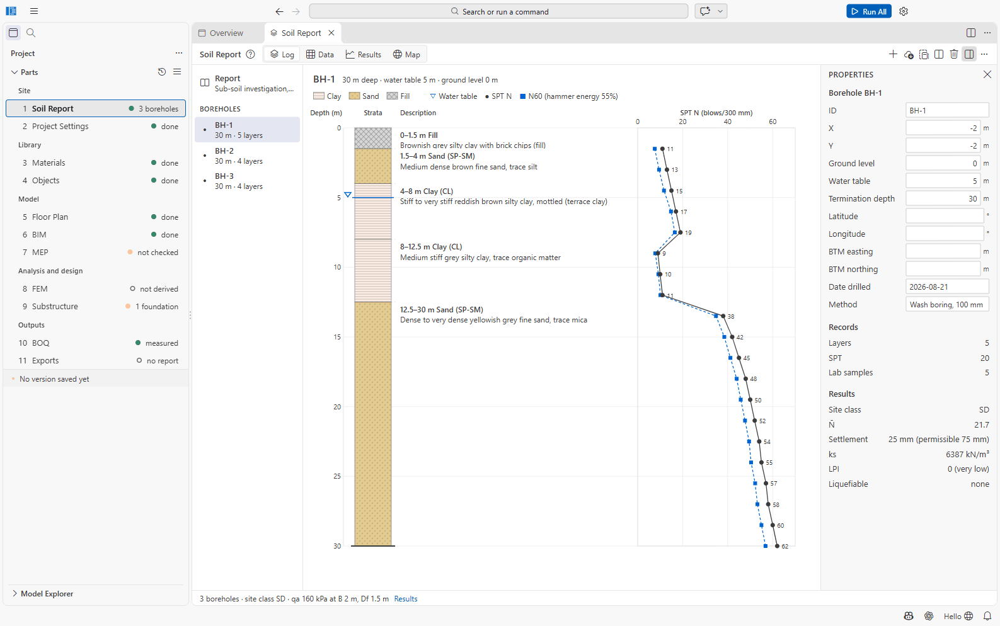
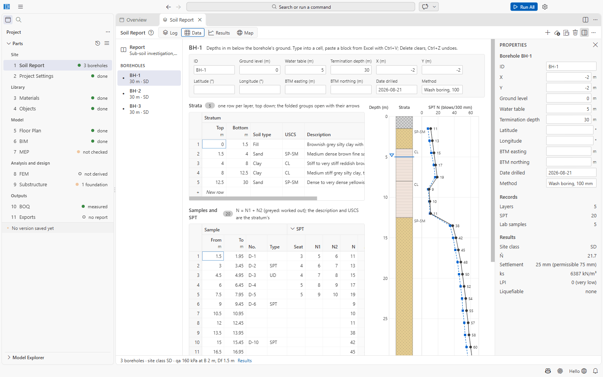
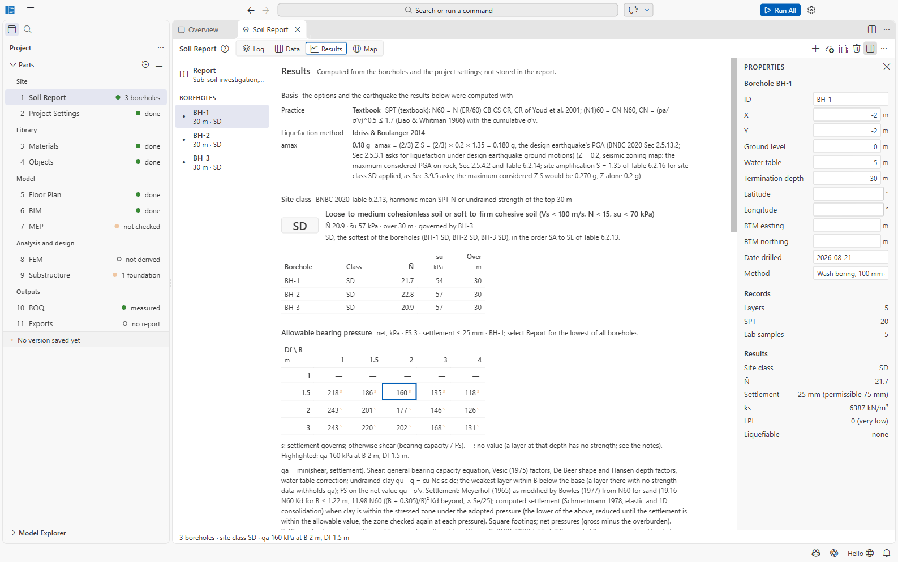
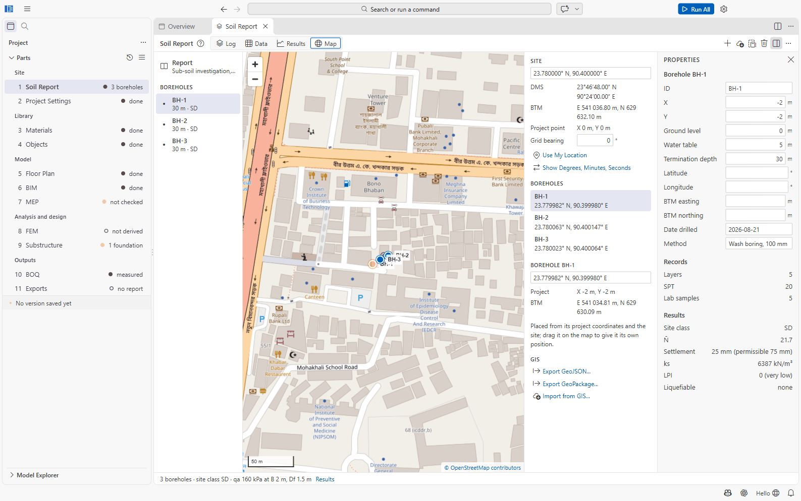

# Part 1: Soil Report

The soil report holds the boreholes of the site investigation: strata, SPT blow counts and lab
test results. From them SAEngine works out the BNBC site class, allowable bearing pressures,
settlements, liquefaction, the modulus of subgrade reaction and pile design parameters. These
results feed Project Settings (site class), 8 FEM (soil springs) and 9 Substructure (bearing
capacity, pile capacity).

The soil report is optional: without one, the site class and allowable bearing pressure entered
in [Project Settings](02-project-settings.md) apply.

File: `01 Soil Report/soil-report.json`. Open it with **1 Soil Report** in the sidebar.

## Layout

- **Left:** the borehole list. *Report* at the top (the whole report), then each borehole with
  its depth and number of layers (or its site class once the results are computed). A warning
  icon marks a borehole with errors. Up/Down arrows move through the list.
- **Middle:** four views, **Log**, **Data**, **Results** and **Map**.
- **Right:** the Properties panel.
- **Toolbar:** **Add Borehole**, **Import CSV/Excel...**, **Save Template...**, **Show All
  Boreholes Side by Side** (Log view, two or more boreholes), **Delete**; under **...**:
  **Duplicate Borehole** and **Compute Results Again**.
- **Status line:** e.g. *3 boreholes · site class SD · qa 160 kPa at B 2 m, Df 1.5 m*.

An empty report shows *No boreholes yet* with **Add Borehole**, **Import CSV/Excel...** and
**Save a template to fill in**.

## Report properties

Select **Report** in the list. The Properties panel shows:

- **Report:** Title, Consultant, Report number, Date, Ground level (m).
- **Design** (the basis of the computed results):

| Field | Choices / default |
| --- | --- |
| Practice | **Textbook** (default) or **Bangladesh consultant practice** (see [SPT corrections](#spt-corrections)) |
| Liquefaction method | **Idriss & Boulanger 2014** (default) or **BNBC 2020 Sec 3.9.5** |
| Hammer energy | % of theoretical, default 60 (30 to 100) |
| Factor of safety | on bearing, default 3 |
| Allowable settlement | mm, default 25 |
| Earthquake magnitude Mw | default 7.5 |
| PGA | g; empty = taken from Project Settings (Z × S) |

Empty values use the defaults.

## Entering a borehole log sheet (Data view)

1. Click **Add Borehole**. The new borehole gets the next ID, 10 m to the right of the last one,
   copies its water table, is 10 m deep and starts with one clay layer from 0 to 10 m.
2. Fill in the **header strip**: ID, Ground level (m), Water table (m, depth below ground),
   Termination depth (m), X and Y (m, in the project's coordinates), or Latitude/Longitude (°),
   or BTM easting/northing (m); Date drilled, Method. When latitude/longitude or BTM are given,
   X and Y are worked out from them and become read-only.
3. Fill in the **Strata** grid, one row per layer from the top: *Top* and *Bottom* (m), *Soil
   type* (Clay, Silt, Sand, Gravel, Organic, Fill, Rock), *USCS*, *Description*, and as far as
   known: unit weights γ, γsat (kN/m³), strength cu, c′ (kPa), φ′ (°), E (MPa), index values
   FC, PI, LL (%), and consolidation Cc, Cr, e0, OCR. The column groups *Unit weight*,
   *Strength*, *Index* and *Consolidation* start folded; click a group heading to unfold it.
4. Fill in the **Samples and SPT** grid, one row per test depth: *From* / *To* (m; To defaults to
   From + 0.45 m), sample *No.* and *Type*, the SPT blow counts *Seat*, *N1*, *N2* (N is worked
   out as N1 + N2 and shown greyed unless you type N), *Ref.* for refusal (`R`, or e.g.
   `50/100`), recovery and the rod energy ratio *ER* if measured, then the index and strength
   results of the sample (w, γ, LL, PL, FC, cu, c′, φ′, Cc, e0; PI is computed). SAEngine shows
   the corrected **N60** and **(N1)60** in the last columns.
5. For a row with a sample, the **Lab tests** panel below takes the raw test data:
   - **Grain size:** sieve size (mm) and % passing; draws the curve, and **Use** buttons take
     the fines content, D10/D30/D60, Cu and Cc from it.
   - **Consolidation:** load steps σ′v (kPa) and void ratio e; gives Cc, Cr, e0 and the
     preconsolidation pressure σ′p (Casagrande).
   - **Triaxial:** UU, CU or CD specimens (σ3, σ1−σ3, u); gives cu, or c′ and φ′.
   - **Direct shear:** σn and τ; gives c′ and φ′ by least squares.

The grids work like a spreadsheet: **Ctrl+V pastes a block copied from Excel**, Delete clears,
Ctrl+Z undoes. A compact log next to the sheet updates as you type, and results recompute
about a second after each change.

SAEngine checks the sheet as you type and lists problems, for example *BH-1: a gap between 4 m
and 4.5 m.*, *layers overlap*, *an SPT at 31.5 m is below the termination depth*, *two SPT
records at 6 m*, or *N 20 is entered, but N1 + N2 = 18; N 20 is used. Delete it to use N1 + N2.*
A silt without PI or cu gets the hint *is it plastic? Give PI or cu*.

## Importing boreholes from CSV or Excel

**Save Template...** writes `boreholes-template.xlsx` (or a .csv) next to the soil report: a
sheet *Soil data* with an example borehole and a *Read me* sheet. Fill it in and import it with
**Import CSV/Excel...**.

- Accepted files: **.csv / .txt** and **.xlsx / .xlsm**. (The file dialog also lists .xls, but
  old .xls files are refused: save them as .xlsx first.)
- One flat table, one record per row. Column `Borehole` is required; `Record` says whether a row
  is a `layer`, `spt` or `sample`; then Top, Bottom, Depth, N (or Seat/N1/N2) and the property
  columns. An Excel workbook is read from the sheet *Soil data*, else the first sheet.
- Lengths are in metres unless the header names mm, cm or ft; densities and pressures are
  converted from g/cc, t/m³, pcf, kg/cm², tsf, psi and other common units.
- **A borehole whose ID already exists is replaced**; new IDs are added.

## The Log view

Draws the borehole log: depth, strata hatching by soil type, descriptions, the water table ▽,
and SPT N against depth with the corrected N60 points. **Show All Boreholes Side by Side**
draws all logs on the project datum (elevations); click one to open it.

## Results

The Results view is computed from the boreholes and the project settings; **results are not
stored in the report file**. Sections:

- **Basis:** the practice, the liquefaction method and the peak ground acceleration used, with
  its derivation.
- **Site class:** BNBC 2020 Table 6.2.13 from the harmonic mean SPT N (N̄) or undrained
  strength (s̄u) of the top 30 m, per borehole and for the site (the softest governs). Flags for
  S1/S2 soils are shown when they apply.
- **Allowable bearing pressure:** a table of net qa (kPa) against footing width B (1, 1.5, 2, 3,
  4 m) and depth Df (1, 1.5, 2, 3 m), with the factor of safety and allowable settlement. A
  superscript *s* marks values governed by settlement; — means a layer without strength lies
  under the base. With *Report* selected the table shows the lowest of all boreholes,
  otherwise the selected borehole.
- **Settlement:** immediate, consolidation and total settlement of a reference footing, with
  the permissible value of BNBC Table 6.3.8.
- **Liquefaction screening:** factor of safety against depth, minimum FS, the liquefaction
  potential index LPI (Iwasaki) and the risk class, per borehole.
- **Modulus of subgrade reaction** ks (kN/m³) per borehole.
- **Pile design parameters:** skin friction fs and end bearing qb per layer, with the method.
- **Notes**.

### How the values are worked out

| Quantity | Method |
| --- | --- |
| Allowable bearing qa | The lower of shear capacity (general bearing capacity equation with Vesic factors, De Beer shape and Hansen depth factors; undrained cu·Nc in clay; FS on the net value) and the pressure giving the allowable settlement (Meyerhof as modified by Bowles from N60 in sand; computed settlement where clay is in the stressed zone). |
| Settlement | Schmertmann (1978) in granular soil; elastic (Steinbrenner) plus 1D consolidation in clay. |
| Site class | BNBC 2020 Table 6.2.13, harmonic N̄ or s̄u over 30 m. |
| Liquefaction | Idriss & Boulanger (2014), or BNBC 2020 Sec 3.9.5; LPI after Iwasaki et al. Saturated, non-clay-like soil above 20 m is screened. |
| Piles | Bored piles: O'Neill & Reese (1999). Driven piles: API RP 2A (clay) and Meyerhof (1976) (sand). Rock is not covered. |
| ks | qa divided by the settlement under qa, for a 2 m footing at 1.5 m. |

### SPT corrections

- **Textbook:** N60 = N · ER/60 · CB · CS · CR (Youd et al. 2001); (N1)60 with CN of Liao &
  Whitman (≤ 1.7) on the cumulative effective stress.
- **Bangladesh consultant practice:** effective stress at mid-depth of each SPT; CN =
  0.77 log10(2000/σ′v) (Peck, Hanson & Thornburn); Skempton's rod-length factors; CB = CS = 1;
  the dilatancy correction N′ = 15 + ((N1)60 − 15)/2 below the water table when (N1)60 > 15 (Terzaghi & Peck). Bearing from settlement
  then uses N′.

## The site map

The **Map** view shows the site on a street map (OpenStreetMap tiles by default; see the
`saengine.map.*` settings). Offline, the boreholes are drawn on the project grid instead.

- **Site:** type the latitude/longitude of the project point (decimal, e.g. `23.8103, 90.4125`,
  or degrees-minutes-seconds), and the **Grid bearing** (°) between the project's X axis and
  east. The DMS and BTM (Bangladesh Transverse Mercator) coordinates are shown. **Use My
  Location** fills in the computer's location.
- **Boreholes:** a borehole placed by X/Y is drawn from the project point and bearing. **Drag a
  marker** to give it its own latitude/longitude, or type them under *Borehole BH-n*.
- **BNBC location:** when the nearest BNBC town's seismic zone or wind speed differ from those
  Project Settings use, a banner names them with **Apply to Project Settings**, which writes them
  into the site of Project Settings (save the settings to keep it).
- **GIS:** **Export GeoJSON...** and **Export GeoPackage...** write layers *site*,
  *site_boundary*, *boreholes* (with depth, water table, N̄ and site class) and *building* (the
  outline from 6 BIM) in WGS 84, by default into `11 Exports`. **Import from GIS...** reads
  points (boreholes) and a boundary polygon from .gpkg or .geojson. **Open in QGIS** appears
  when QGIS is installed (setting `saengine.qgis.program`). Export reads the saved file: save
  the soil report first.

### Planning compliance

Under the plot, **Check Planning Rules** checks the plot and the building against the planning
rules of the code pack's `planning` table. For BNBC 2020 these are the rules BNBC Part 3 defers
to the planning authority; the pack holds Dhaka's (RAJUK), the *Dhaka Mohanagar Imarat Nirman
Bidhimala 2008*: Table 2 and Rule 46 (setbacks), Rule 50 (maximum ground coverage, MGC) and Rule
51 with Tables 3(A)-3(F) (FAR and MGC by use, plot size and road width). A project's own copy of
the pack can change the table, or hold another authority's.

Choose the **use** (residential A1-A4, residential hotel A5, educational B1 and B2,
institutional C, health care D, assembly E, office F1, mercantile F2-F5, industry, storage and
others G-K) and type the **road width**. The height, storeys, ground coverage and gross floor
area come from the building model (each storey's area is that of the slabs over it; the
coverage is the slabs on plan); type a value to use it instead, and the floor area the rules
leave out of FAR (stair and lift rooms over the roof, parking, services: Rule 51(5)).

The panel shows the plot-size row, the FAR and MGC permitted, the area statement (plot area,
ground coverage, open space, each storey's floor area, gross floor area, the floor area counted
in FAR, and the limits) and the checks: FAR, ground coverage, front, rear and side setbacks
against Table 2 (the high-rise row above 33 m or 10 storeys, and the front at least 4.5 m from
the road's centre, Rule 46(3)) and any part of the building outside the setbacks.

- On a road narrower than the plot's row asks for (6 m and more), the largest plot-size row the
  road qualifies for applies (SAEngine's reading of Rule 51); below 6 m Rule 51(9) and (10).
- On a wider road, the rows "any plot size" for 18 m and 24 m roads apply where higher, and Rule
  51(11) adds 0.05 to the FAR for each 0.30 m of road above the row's width, up to the next
  row's FAR.
- "NR" (not restricted): the tables set no FAR limit there.

The design report prints the check in its **Planning compliance** section (after the design
basis) when the plot has a planning entry.

## Commands

| Command (category SAEngine) | Does |
| --- | --- |
| Add Borehole to the Soil Report | Adds a borehole |
| Import Boreholes from CSV/Excel... | Imports a file |
| Save Borehole Template... | Writes the template |

## Not confirmed / limitations

- Old Excel **.xls** files are offered by the file dialog but refused by the importer.
- Some options exist only in the JSON file (open it with *Reopen Editor With... → Text Editor*):
  the SPT correction factors CB, CS and rod length, the pile type used for Part 1 pile
  parameters, the widths and depths of the bearing table, and sample permeability and
  chemistry.
- GeoPackage export has not been confirmed in QGIS by the developers; BNBC town coordinates are
  approximate.
