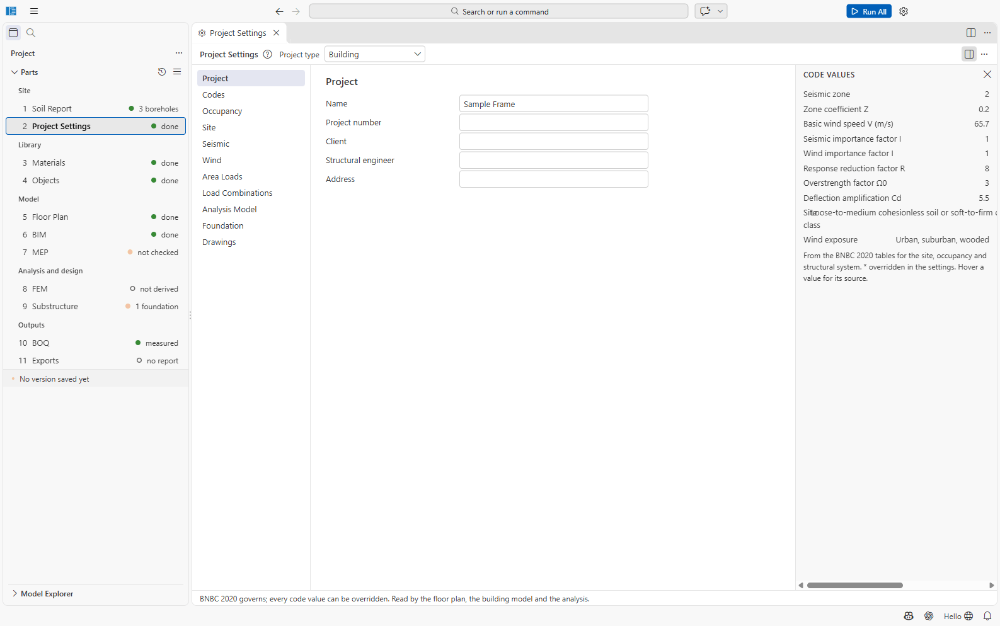

# Part 2: Project Settings

Project Settings hold the codes, occupancy, site, loads, load combinations and analysis options
of the project. BNBC 2020 governs; every code value can be overridden. The floor plan, the
building model and the analysis read these settings.

File: `02 Project Settings/project-settings.json`. Open it with **2 Project Settings** in the
sidebar or *SAEngine: Project Settings*.

## Layout

- **Toolbar:** the **Project type** (Building / Special Structure). Changing it asks *Make this
  project a ...?*; the old Part 5 folder is kept but no longer used. **Reset Combinations to
  BNBC 2020...** replaces the combinations (with confirmation; undoable).
- **Left:** the sections. **Middle:** the form of the section. **Right:** the **Code Values**
  panel: the values SAEngine takes from the BNBC tables for your site, occupancy and system.
  Values you override are marked *; hover a value for its source.

## Sections and fields

### Project
Name, Project number, Client, Structural engineer, Address. They appear in the report and in
the drawing title block.

### Codes
| Field | Choices |
| --- | --- |
| Loads and general | BNBC 2020 (fixed) |
| Concrete | **BNBC 2020 Part 6 Chapter 6** (default) or ACI 318-19 |
| Steel | **BNBC 2020 Part 6 Chapter 10** (default) or AISC 360-22 |
| Design method | Strength design (LRFD), fixed |

The design checks use ACI 318-19 clauses and factors. BNBC 2020 Part 6 Chapter 6 is based on an
earlier ACI 318 and gives the same or less strict values (for example one-way shear
Vc = 0.17λ√f'c bw d, Eq 6.6.49, without the size factor).

### Occupancy
- **Building use:** Residential (default), Office, Educational, Health care, Assembly, Retail,
  Industrial, Storage, Parking, Mixed use.
- **Occupancy category:** I to IV (BNBC Table 6.1.1), default II. It sets the importance
  factors and the allowable storey drift.

### Site
- **Location:** one of ten BNBC towns, which give the seismic zone and the basic wind speed, or
  *Custom (enter Z and V)*:

| Town | Zone | Z | V (m/s) |
| --- | --- | --- | --- |
| Dhaka | 2 | 0.20 | 65.7 |
| Chattogram | 3 | 0.28 | 80.0 |
| Cox's Bazar | 3 | 0.28 | 80.0 |
| Khulna | 1 | 0.12 | 73.3 |
| Rajshahi | 1 | 0.12 | 49.2 |
| Sylhet | 4 | 0.36 | 61.1 |
| Barishal | 1 | 0.12 | 78.7 |
| Rangpur | 3 | 0.28 | 65.3 |
| Mymensingh | 4 | 0.36 | 67.4 |
| Cumilla | 2 | 0.20 | 61.4 |

- **Site class source:** *From the soil report* (default; the softest class of the
  boreholes, see [Part 1](01-soil-report.md)) or *Entered*.
- **Site class:** SA to SE (default SD), used when entered or when there is no soil report.
- **Seismic zone coefficient Z** and **Basic wind speed**: optional overrides.

The site can also be filled from the soil report's map (**Apply to Project Settings**).

### Seismic
**Structural system** (BNBC Table 6.2.19), which sets R, Ω0 and Cd:

| System | R | Ω0 | Cd |
| --- | --- | --- | --- |
| RC special moment frame | 8 | 3 | 5.5 |
| RC intermediate moment frame (default) | 5 | 3 | 4.5 |
| RC ordinary moment frame | 3 | 3 | 2.5 |
| Building frame with RC special shear walls | 6 | 2.5 | 5 |
| Building frame with RC ordinary shear walls | 5 | 2.5 | 4.25 |
| Dual: RC special moment frame and special shear walls | 7 | 2.5 | 5.5 |
| Steel special moment frame | 8 | 3 | 5.5 |
| Steel ordinary moment frame | 3.5 | 3 | 3 |
| Steel special concentrically braced frame | 6 | 2 | 5 |

R, Ω0 and Cd can each be overridden.

### Wind
**Exposure** A (urban, suburban, wooded; default), B or C (BNBC Part 6 Sec 2.4.6.3).

### Area Loads
The floor loads of the project, in kN/m². Each area load has an ID, a name, a **use** (BNBC
Table 6.2.3, which sets the minimum live load), **live**, **Floor finish** and **partitions**.
**Floors** and **Roof** choose which area load applies to every floor and to the roof.

| Default | Use | Live | Finish | Partitions |
| --- | --- | --- | --- | --- |
| FL Floors | Residential | 2.0 | 1.2 | 1.0 |
| ST Stairs | Stairs | 4.8 | 1.2 | — |
| RF Roof | Roof | 1.0 | 1.5 | — |

A live load below the BNBC minimum for its use is flagged (*FL: live load 1.5 kN/m² is below the
BNBC 2020 minimum of 2.0 kN/m² for residential*).

> **Where loads come from.** Self-weight is computed from the object types and material
> densities. Floor finish and partitions become the superimposed dead case SD, the live load the
> case L (Lr on the roof). Non-structural walls become line loads on the beams under them. MEP
> equipment and tanks add their weights (Part 7). The floor plan editor has **no per-slab load
> entry**: one area load applies to all floors and one to the roof. A slab can carry its own area
> load (`areaLoad` in `floor-plan.json`, written by the importers when a model's slabs have
> different loads); there is no field for it in the editor in this version.

### Load Combinations
Each combination has a name and the factors of the cases **D, L, Lr, WX, WY, EX, EY, T, F**
(D also applies to SD; F follows D when left empty). New projects get the BNBC 2020
strength combinations (Part 6, 2.7.3), expanded to ±X and ±Y for wind and earthquake:

- 1.4D
- 1.2D + 1.6L + 0.5Lr
- 1.2D + 1.6Lr + 1.0L
- 1.2D + 1.6Lr + 0.8W
- 1.2D + 1.6W + 1.0L + 0.5Lr
- 1.2D + 1.0E + 1.0L
- 0.9D + 1.6W
- 0.9D + 1.0E

Combinations are formed from the case results (exact for the linear analysis). The service
combinations used for foundation bearing are built in by 9 Substructure.

### Analysis Model

| Field | Default | Meaning |
| --- | --- | --- |
| Slabs | Loads to beams | Slab loads go to the beams by the 45° rule as triangles and trapezoids (since 0.0.45; before, a uniform load of the same total), and the slabs are designed by BNBC's coefficient methods (Sec 6.5.8, 6.1.4.3); *Shells* models the slabs as shell elements |
| Floor diaphragm | Rigid | or flexible |
| Mesh size | 500 mm | for shells, and the largest beam element with slabs as loads to beams (1000 mm before version 0.0.44) |
| Mesh by slab span | On | shell slabs no coarser than their shorter span / 8 |
| Mesh convergence check | On | Run All solves the gravity cases again on a mesh twice as coarse and warns when a beam end moment changes by more than 5 % |
| Seismic mass | Lumped at the story levels | each node's weight to the nearest level; the lower half of the first storey (the supports' own share included) goes to the base and does not take part (as the usual analysis programs lump it); a node exactly half way between two levels gives half to each, so W hardly depends on the mesh. *Each node's own* is the convention before 0.0.44: the whole first storey counts with the first level. Since 0.0.44 it also counts the supports' own share (the lower half of the elements at the supports), which 0.0.43 left out, so its W no longer changes with the mesh |
| Mass source | D ×1, SD ×1, live load by the code | the code's live share is 25 %, 50 % for live loads above 3 kN/m² (BNBC 2020 Part 6 Sec 2.5.7.3, p. 628); extra masses per story |
| Wind torsional cases | On | WTX, WTY and the four design wind load cases of BNBC 2020 Part 6 Figure 6.2.9 (Sec 2.4.11.3) for every one-direction wind combination; off: Cases 1 and 3 |
| Live load arrangement | BNBC 6.1.12.2 | cases LP1, LP2 ...: live load on adjacent spans (each floor alone) and on alternate spans (a checkerboard over the floors) of the column grid, each gravity combination with live load checked with each; or adjacent spans on alternate floors (fewer cases, support moments up to about 2 % lower), alternate spans only, or off |
| Beam deflection limits | Partitions likely to be damaged | Table 6.6.2: l/360 (l/180 roofs) live load, l/480 after attachment; *not likely to be damaged*: l/240, and beams as deep as Table 6.6.1 asks are not computed; or off |
| Sustained share of the live load | 0.25 | for the long-term deflection (SAEngine assumption) |
| Eccentric static earthquake cases | On | EXP, EXN, EYP, EYN: EX and EY with the story masses shifted ±5 % across the force (Sec 2.5.7.6.2); with equivalent static design every E combination is checked with both |
| Period for the static base shear | Approximate Ta | or *From the modal analysis*, at most 1.4 Ta (Sec 2.5.7.2 (a), p. 627) and not below Ta |
| End offsets (rigid zones) | On | beams end at the column faces, columns at the beam soffit; the part inside the joint is rigid over the rigid zone factor |
| Rigid zone factor | 0.5 | 0: the whole length flexible (forces still read at the faces); 1: fully rigid |
| Columns at any angle | On | a column turned by an angle that is not a multiple of 90° is analysed and designed on its own axes |
| Response spectrum | On | adds the response-spectrum cases RX, RY (BNBC design spectrum, CQC, 5 % damping) |
| Section stiffness | Cracked (ACI) for lateral cases | |
| Second-order analysis | None (moment magnification) | or P-Delta analysis |
| Earthquake design forces | Response spectrum, scaled (BNBC 2.5.9.4) | or Equivalent static (EX, EY) |
| Orthogonal effects (100 % + 30 %) | Auto | by Seismic Design Category |
| Accidental torsion | On | ±5 % |
| Vertical earthquake component | On | |
| Redundancy factor ρ (drift) | 1.0 | |
| Construction sequence, time histories, pushover, temperature | Off | advanced analyses |
| Column supports | Fixed | or **Soil springs** from the soil report and 9 Substructure |

### Foundation
**Allowable bearing override qa** (kPa; empty: from the soil report), **Soil unit weight γ**
(18 kN/m³) and **Ground level** (0 mm).

### Drawings
Firm, Engineer, Drawn by, Checked by, Approved by, Project number, status (default *FOR
REVIEW*), revisions, **Sheet size** (A1, A2, A3; default A1), scales (plans 1:100, slab plans
1:50, elevations 1:50, details 1:25), development length (*simplified*), **Cut off beam top
bars** (on) and **BOQ reinforcement** (*Measured by the BOQ's rules* or *From the bar bending
schedule*).

## Code Values panel

Seismic zone, Z (Table 6.2.14), basic wind speed V (Table 6.2.8), seismic and wind importance
factors (Tables 6.2.17 and 6.2.9), R, Ω0, Cd (Table 6.2.19), the site class (Table 6.2.13, *from
1 Soil Report* when used) and the wind exposure.

| Occupancy category | Seismic I | Wind I |
| --- | --- | --- |
| I | 1.00 | 0.87 |
| II | 1.00 | 1.00 |
| III | 1.25 | 1.15 |
| IV | 1.50 | 1.15 |

## Not confirmed

- The section names are shown as rendered in the app (*Project, Codes, Occupancy, Site,
  Seismic, Wind, Area Loads, Load Combinations, Analysis Model, Foundation, Drawings*); some field
  labels inside the advanced analysis options were read from the schema and may be worded
  slightly differently on screen.
- Per-slab area loads (*Floors* applies "unless the floor plan says otherwise") can only be set by
  the importers or in the JSON file; the floor plan editor shows no field for them.
