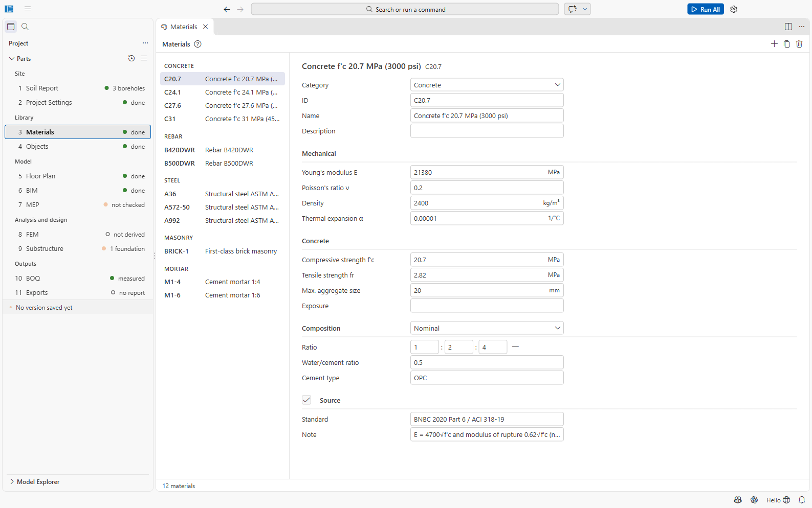

# Part 3: Materials

The materials library holds the physical materials of the project: concrete, reinforcement,
structural steel, masonry, mortar and others. Object types (Part 4) refer to them; the
analysis takes E, ν and the density from them, the design f′c and fy, and the bill of
quantities the concrete and mortar mixes.

File: `03 Materials/materials.json`. Open it with **3 Materials**.

## Using the editor

- **Left:** the materials grouped by category. Up/Down arrows move through them; right-click
  for **Duplicate** and **Delete**.
- **Right:** the form of the selected material, with units, dropdowns and per-field
  validation. Only valid values are written to the file; each change can be undone with Ctrl+Z.
- **Toolbar:** **+** (**Add Material**, by category), **Duplicate** (creates *name (copy)* with a
  new ID), **Delete** (asks *Delete 'name'?*; Ctrl+Z restores it).
- The status line counts the materials and the problems to fix, with a **Show** link to the
  first problem.

## Fields

| Group | Fields |
| --- | --- |
| General | Category (Concrete, Rebar, Steel, Masonry, Mortar, Other), ID (letters, digits, `. _ -`), Name, Description |
| Mechanical | Young's modulus E (MPa), Poisson's ratio ν, Density (kg/m³), Thermal expansion α (1/°C) |
| Concrete | Compressive strength f′c, tensile strength fr (MPa), max. aggregate size (mm), exposure |
| Rebar / Steel | Grade, fy, fu (MPa), elongation, actual fy and fu from mill tests |
| Masonry | Unit, unit strength, f′m, mortar (a mortar material), mortar grade of the code pack (empty: from the mortar's mix), unit kind, solid or hollow units, grouting, bond, special inspection and prism tests (without them, or with f′m estimated from the unit strength, the walls are checked at the code pack's reduced allowable stresses) |
| Composition (concrete and mortar) | *None*, *Nominal* (volume ratio such as 1:1.5:3, water/cement ratio, cement type) or *Design* (cement, water, fine and coarse aggregate in kg/m³, admixtures) |
| Source | Standard, note |

Rules: concrete, rebar and steel need E; fu must not be below fy; a nominal mix has three parts
for concrete and two for mortar; IDs are unique; a masonry mortar must exist.

> The **composition** is what the bill of quantities uses to work out cement (kg and 50 kg
> bags), sand and stone chips (cft). A concrete without a mix gets no cement/sand/stone
> take-off.

## Default materials of a new project

| ID | Material | Main values |
| --- | --- | --- |
| C20.7 | Concrete f′c 20.7 MPa (3000 psi) | E 21 380 MPa, nominal mix 1:2:4, w/c 0.5 |
| C24.1 | Concrete f′c 24.1 MPa (3500 psi) | E 23 070 MPa, nominal mix 1:1.5:3, w/c 0.45 |
| C27.6 | Concrete f′c 27.6 MPa (4000 psi) | E 24 690 MPa |
| C31 | Concrete f′c 31 MPa (4500 psi) | E 26 170 MPa |
| B420DWR | Rebar B420DWR | fy 420 MPa, BDS ISO 6935-2:2016 |
| B500DWR | Rebar B500DWR | fy 500 MPa |
| A36 | Structural steel ASTM A36 | fy 250, fu 400 MPa |
| A572-50 | Structural steel ASTM A572 Grade 50 | fy 345, fu 450 MPa |
| A992 | Structural steel ASTM A992 | fy 345, fu 450 MPa |
| BRICK-1 | First-class brick masonry | density 1920 kg/m³, mortar M1-4 |
| M1-4, M1-6 | Cement mortar 1:4 and 1:6 | |

For all concrete: E = 4700√f′c, fr = 0.62√f′c, density 2400 kg/m³, ν = 0.2. Each value records
its standard or code formula in *Source*.

A new material copies the first default of its category.
