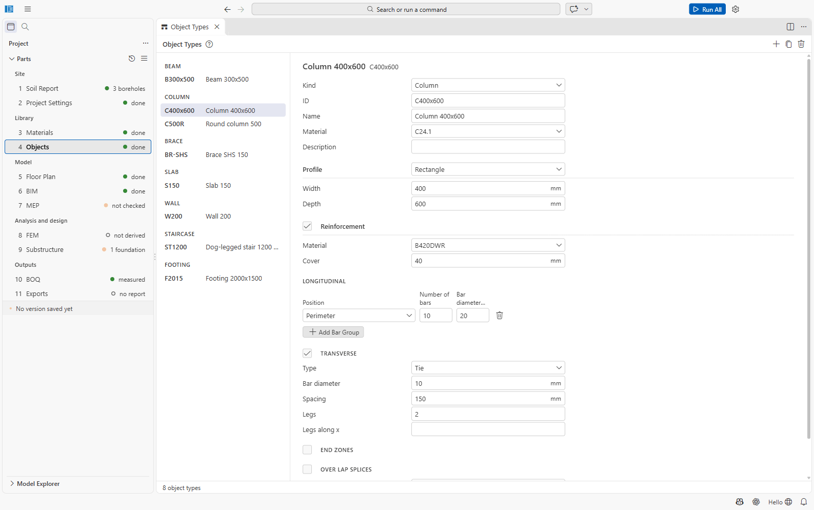

# Part 4: Objects (Object Types)

Object types are the sections of the project, what ETABS calls *frame sections* and *shell
properties*: a column type, a beam type, a slab type, with their material, profile and
reinforcement. Every member on the floor plan refers to one object type. **To change the size of
a member, change its object type here** (or assign another type to the member on the floor
plan).

File: `04 Objects/objects.json`. Open it with **4 Objects** (also **Open Object Types** in the
floor plan and the design proposal).

The editor works like the [Materials](03-materials.md) editor: a list grouped by kind on the
left, a form on the right, **+** (**Add Object Type**, by kind), **Duplicate** and **Delete**.

## Kinds

| Kind | Main fields | New-type default |
| --- | --- | --- |
| Beam | Material, profile, reinforcement, seismic role, Ω0 combinations; steel beams: fin-plate or end-plate connection | B, 250×450, C24.1 |
| Column | Material, profile, reinforcement, seismic role | C, 400×400 |
| Brace | Material, profile, gusset connection | BR, L75×75×6, A36 |
| Slab | Thickness, system (one-way, two-way, flat), planar reinforcement, punching reinforcement | S, 150 mm two-way |
| Wall | Thickness, structural or not, reinforcement (incl. boundary elements), braced, restrained ends, basement | W, 200 mm |
| Staircase | Waist, riser, tread, flight width, arrangement (straight or dog-legged), landings, supports, headroom | ST, 150/150/250/1200 |
| Footing | Isolated, combined or strip; length, width, thickness | F, 2000×2000×450 |
| Pile cap | Size, the pile type it uses | PC, 2400×2400×900 |
| Pile | Bored, driven or precast; diameter, length | P, bored, 600 mm, 18 m |
| Solid | Material only | MASS |

**Profiles** follow IFC: Rectangle, Circle, Rectangular hollow (RHS), Circular hollow (CHS),
I-section, T-section, Angle (L), Channel (U). Section properties are computed from the profile.

## Reinforcement

For beams and columns:

- **Material** (a rebar) and **Cover** (mm).
- **Longitudinal** bar groups: position (Top, Bottom, Sides, Perimeter), number of bars, bar
  diameter. **Add Bar Group** adds a row.
- **Transverse**: Stirrup, Tie or Spiral; diameter, spacing, legs.
- **End zones** and **Lap splices**.

For slabs and walls: planar meshes (bar and spacing per face and direction).

You do not have to enter bars before the analysis: a type without bars is checked for the
**steel it requires**, and **Design Reinforcement** in 8 FEM proposes bars and writes them here
([Part 8](08-fem.md#design-reinforcement-the-design-proposal)).

## Seismic role

*Auto*, *Lateral* (part of the seismic force-resisting system) or *Gravity*; and **Ω0
combinations** (*Auto*, *Transfer*, *Collector*, *None*) for members that need the overstrength
combinations.

## Rules

IDs are unique; the material must exist; reinforcement must be a rebar material; a pile cap's
pile type must exist. A new project starts with no object types (New Building from Grid and the
importers create them).

## Not confirmed

- The pile template radius: the template stores r = 300 mm (600 mm diameter); the
  Substructure editor's default pile type is 500 mm (see Part 9).
