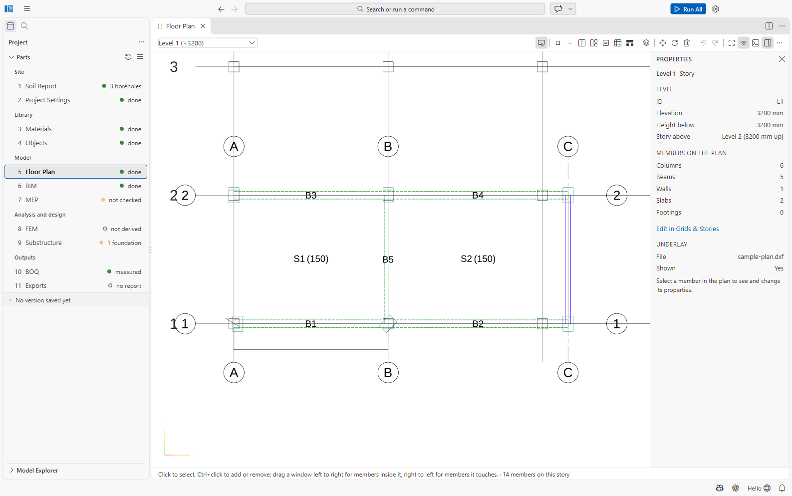
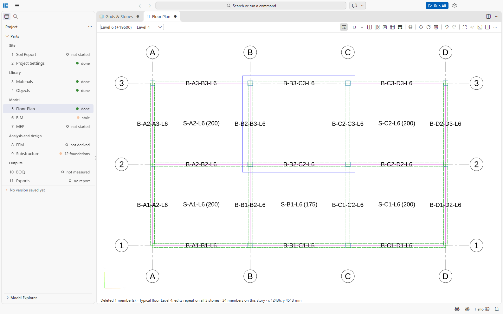
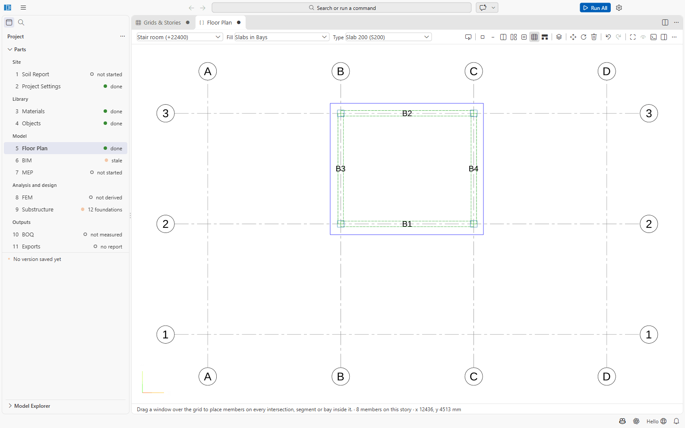
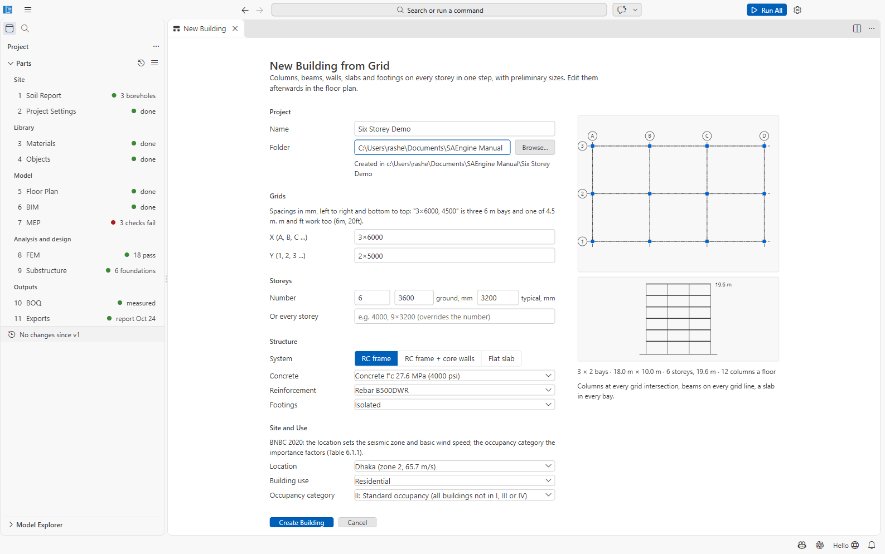

# Part 5: Floor Plan

The floor plan is where a building is laid out: grids, storeys, and the columns, beams, walls and
slabs on each storey. It is drawn on the grid, storey by storey, like a structural framing plan.
The 3D building model (Part 6) and everything after it are generated from it.

File: `05 Floor Plan/floor-plan.json`. Open it with **5 Floor Plan**. (A *special structure*
project has a 3D **Structural Model** in Part 5 instead; it is not covered by this manual.)

## The screen

- **Storey picker** (top left): one storey at a time, shown as *Level 1 (+3200)*. A storey that
  repeats a typical floor shows *= Level 2*; the typical floor itself shows *(typical)*.
- **Toolbar** (top right), in order: **Select**; **Column**, **Beam**, **Wall**, **Slab**,
  **Polygon Slab**, **Fill**; **Place Footings in 9 Substructure**; **Typical Floors...**;
  **Move**, **Rotate**, **Delete**; **Undo**, **Redo**; **Zoom Extents**, **Show/Hide Underlay**,
  **Show/Hide Command Line (:)** and the Properties panel. On a narrow window some of these move
  into the **...** menu.
- **... menu:** Select All on Story (Ctrl+A), Select by Type..., Copy Selection to Stories...,
  Mirror Selection..., Delete Selection, Members Table, Edit Grids and Stories, Open Object Types,
  Attach/Replace/Remove Underlay, Export DXF.
- **Status line:** a hint for the current tool and the member count of the storey. The cursor
  position is shown as *x ..., y ... mm*.
- **Properties panel:** the storey (nothing selected), one member, or several members.

All positions are in **mm**. Every edit is one undoable change of `floor-plan.json`
(Ctrl+Z / Ctrl+Y, or the toolbar). Save with Ctrl+S. Adding, changing or deleting a line or
point load is on the same Undo and Redo (the loads file is saved as it changes); the Undo
button's tooltip names the edit it undoes.

## Grids and storeys

Grids and storeys are not drawn on the plan. Choose **Edit Grids and Stories** (or *Edit in Grids &
Stories* in the Properties panel): a form opens beside the plan and the plan follows your edits as
you type.

- **X lines** (vertical on the plan) are labelled A, B, C, ...; **Y lines** 1, 2, 3, ...; labels
  must be unique.
- A **storey** has an ID, a name and an **elevation** (top of floor, mm). New storeys are named
  *Level n*. The lowest storey is the base: columns and walls rise *to* a storey *from the one
  below*, so nothing is placed on the base storey except footings (which belong to Part 9).
- Members are stored relative to the nearest grid intersection, so they follow the grid when you
  move a grid line.

## Placing members

Pick the object type in the **Type** picker that appears next to the tools (types come from
[Part 4](04-objects.md); if there is none of that kind: *Define a column type in Object Types
first.*).

| Tool | How |
| --- | --- |
| **Column** | Click a grid intersection. The column rises from the storey below to this storey. A second column at the same place is refused. |
| **Beam** / **Wall** | Click two intersections. Placement chains from the last point until Esc or a right-click. Walls also rise from the storey below. |
| **Slab** | Click inside a bay (the rectangle between neighbouring grid lines). |
| **Polygon Slab** | Click the corners (they snap to intersections and grid lines); finish on the first corner, with Enter or a right-click (at least three corners). A slab with a beam or structural wall across it is warned about; **Split S1 along B6** (status line or Properties → Warnings) makes two slabs that meet on it. |
| **Move** | Click a member, then click the new place, or type the displacement *Δx, Δy* in mm (e.g. `150, 0`) and press **Move**. |
| **Rotate** | Columns and footings only: click one; type an angle and press **Rotate**, or **Turn 90°**. Beams, walls and slabs follow their points. |
| **Delete** | Click a member on this storey. |

Members get automatic IDs: C1, C2... for columns, B for beams, W for walls, S for slabs, F for
footings.

## Selecting members

| Gesture | Selects |
| --- | --- |
| Click | one member |
| Ctrl+click | adds or removes one member |
| Shift+click | adds one member |
| **Drag left to right** | a **window** (solid outline): the members **fully inside** it |
| **Drag right to left** | a **crossing window** (dashed outline): every member it **touches** |
| Ctrl or Shift while dragging | adds the window's members to the selection |
| Ctrl+A | all members of the storey |
| Esc | cancels the current gesture, then clears the selection, then returns to Select |

The status line confirms *Window: 6 member(s) fully inside.* or *Crossing window: 9 member(s)
touched.* The selection is shared with the Model Explorer and the 3D view; selecting a member
there switches the plan to its storey.

With members selected, the Properties panel lets you change, for all of them at once: the
**Type** (per kind: *Type of columns*, *Type of beams*...), the **Rotation (°)**, **Move by (mm)**
and **Copy by (mm), times** (e.g. `6000, 0, 3` makes three copies 6 m apart). Press Enter to apply.
Links: **Mirror...**, **Copy to Stories...**, **Delete n Members**.

## Fill: many members at once

**Fill** places members on the grid inside a window you drag:

| Fill choice | Places |
| --- | --- |
| Columns at Intersections | a column at every grid intersection |
| Beams on Grid Segments / Beams along X / Beams along Y | a beam on every grid segment |
| Slabs in Bays | a slab in every whole bay |
| Walls on Grid Segments / Walls along X / Walls along Y | a wall on every segment |

Choose the type in **Type**, the kind in **Fill**, then drag a window over the grid. Places that
are taken are skipped: *Placed 12, skipped 3 existing.* The new members become the selection.
Fill works on the grid only; it does not look for beams around a bay.

## Copying to other storeys and typical floors

- **Copy Selection to Stories...** copies the selection to the storeys you tick (*Copied 14
  member(s) to Level 2, Level 3; skipped 0 already there.*). Columns and walls rise from the
  storey below each target. Footings are not copied. A beam copied to a storey where nothing
  holds it up (a cantilever whose column is not there) is named in a warning.
- **Ctrl+C / Ctrl+V:** copy the selection and paste it at a base point (the lower-left corner of
  the copied members), on this storey or another.
- **Typical Floors...** (three or more storeys): first pick the typical floor, then the storeys
  that repeat it. Their plans are replaced by the typical floor's plan (a confirmation first lists
  the members of theirs that are deleted or replaced), and from then on **every
  edit on any storey of the family is made on all of them** (*Typical floor Level 2: edits repeat
  on all 8 stories*). If the storeys of a family differ (for example after editing the file), the
  status line offers **Copy the typical floor to them**; edits are refused until then.
- **Mirror Selection...** mirrors about a grid line; the originals are kept.

## The command line

Press **:** (or **Show Command Line**) for a command line. Grid points are written `A-1` (or
`A/1`).

| Command | Does |
| --- | --- |
| `select all`, `select none`, `select type C400x600`, `select C1 C2` | selects |
| `fill columns`, `fill beams x`, `fill slabs A-1 C-3` | fills the whole storey, or a window between two grid points |
| `copy 6000,0 3` | copies the selection 3 times, 6 m apart |
| `array 0,5000 4` | the same, 1 to 100 copies |
| `move 150,0` | moves the selection |
| `mirror x B`, `mirror B move` | mirrors about grid line B (`move` drops the originals) |
| `rotate 90`, `rotate to 45` | rotates selected columns and footings |
| `tostories all`, `tostories L2 L3` | copies the selection to storeys |
| `delete` | deletes the selection |

Moved or copied members that would land on another member or off the grid stay where they were
(*Moved 4, kept 1 in place*).

## Underlay (architect's drawing)

**Attach Underlay...** shows a DXF drawing greyed under the plan of the current storey (the
members keep their colours and draw over it). A DXF from outside the project is copied into
`05 Floor Plan/Underlays/`. A plan exported from the floor plan can be used too: its grids,
labels and loads are left out, as the live plan draws them. **Hide/Show Underlay** toggles it; this
is a view setting, not an edit of the floor plan.
The underlay's offset, scale and rotation can only be changed in the JSON file.

## Members Table

**Members Table** (in **...**) lists every member: ID, Kind, Object Type, Story, Location, with
filters and a search box (*Find ID, type, grid*). Select rows (Ctrl/Shift/Ctrl+A) to change the
type or storey of all of them; **Export CSV...** writes the table.

## Export DXF

**Export DXF** writes the plan of every storey to `11 Exports/Floor Plan/<id> <name>.dxf`, with
layers for the grid, columns, beams (dashed), walls, slab edges, footings and labels.

## Footings

There is no footing tool on the plan: **Place Footings in 9 Substructure** opens Part 9, where
foundations are placed and designed. Footings already in the plan are shown and can be selected,
moved and rotated.

## Loads

Floor and roof loads are the area loads of
[Project Settings](02-project-settings.md#area-loads); self-weight comes from the object types. A
slab may name its own area load (`areaLoad` in the file, written by the importers); the editor
does not show or edit it in this version.

**Line and point loads on members** (brick walls on beams, a tank on a beam) are kept in
`05 Floor Plan/loads.json`, beside the floor plan. Select beams and click **Line Load on ...** in
the Properties panel: a wall type × height (125 mm and 250 mm brick walls from the code pack's
unit weights, BNBC 2020 Part 6 Table 6.2.2, less an openings percentage) or a value in kN/m, in a
load case (SD by default). The wall's height is worked out **per beam and story** by default:
the storey height above less the depth of the beam above (else of the loaded beam), and a 1 m
parapet with no openings on the top storey (or no wall there, with *No wall there*). So the
storeys of a typical floor that differ in height each get their own wall, and several selected
beams each get their own depth. Untick it to type one height for every storey; the form warns
when the storeys differ. In the Loads list type `auto` as the height to work it out again.
Partition walls drawn on the plan (non-structural wall types, drawn dashed) already load the beam
under them: the form warns when a beam has one, so a wall is not counted twice. **Point Load...** puts a load in kN on a beam at a distance from its
start, or on a column's joint. The **Loads** list of the story edits or deletes them; the plan
draws them. A load on a typical floor applies to every story like it unless *This story only*.
The analysis model applies them as member loads (they count in the seismic weight as their case
does) and the report lists their totals per story.

**Loads from the architecture.** The walls and rooms drawn in **Architecture** (6 BIM) load the
model too, worked out each time the model is derived (never copied into `loads.json`, so a wall
has one source). Each wall is a superimposed dead load (SD) where it stands (BNBC 2020 Part 6
Sec 2.2.5): along a beam, a line load of the wall type's weight × its clear height (to the beam or
slab above) less its doors and windows, averaged over the part on that beam; across a beam, a
point load; on a slab, a line load on the shell elements, or with slabs as loads to beams a
uniform load over the panel, the larger of the wall's weight over the panel and 33 % of its weight
per metre run (Sec 2.3.6). A wall over a floor-plan wall is that wall's and is not counted again.
On a story with walls drawn, the area load's partition allowance is dropped (never both). A room
with a floor finish carries the finish's weight (and a sunk slab's filling in a wet room, when the
finish type gives one) instead of the flat finish, and a room with an occupancy carries its use's
live load (Table 6.2.3) instead of the floor's. The **From the Architecture** list under Loads
shows what the last derivation applied, read-only, with a link to each wall; Analysis →
*Partition walls* → *Flat allowance* turns the walls off and keeps the allowance.

**Stiffness modifiers and design overwrites** of the selected members (Properties panel, below
the member's fields): factors on A, J, I22, I33, mass and weight (shells: membrane, bending), and
k, unbraced lengths and framing for the design. An empty field inherits the object type's value,
then the code's cracked factor. Each change is one undoable edit.

## New Building from Grid

**New Building from Grid...** (start page, ≡ menu, or File menu) creates a complete new RC
building project in one step, with preliminary member sizes you edit afterwards.

| Input | Default | Notes |
| --- | --- | --- |
| Name, Folder | | the new project folder |
| X (A, B, C ...) | `3×6000` | bay widths; shorthand like `3×6000, 4500`; units mm, cm, m, ft; 1 to 30 m per bay, at most 60 bays |
| Y (1, 2, 3 ...) | `2×5000` | |
| Number of storeys | 6 | at most 80 |
| ground, mm / typical, mm | 3600 / 3200 | storey heights (2 to 12 m) |
| Or every storey | | e.g. `4000, 9×3200`; overrides the number |
| System | RC frame | *RC frame*, *RC frame + core walls*, *Flat slab* |
| Concrete | C27.6 | |
| Reinforcement | B500DWR | |
| Footings | Isolated | *Isolated*, *Mat (raft)*, *None (add in 09 Substructure)* |
| Location | Dhaka | with zone and wind speed |
| Building use, Occupancy category | Residential, II | |

A live plan and elevation preview shows the bays, storeys and the number of columns per floor.
**Create Building** writes the project: default materials; column, beam, slab, wall and footing
types **without bars**; the floor plan with typical-floor families; the building model; footings
(or a mat) in 9 Substructure; and Project Settings with the occupancy, live load, site and the
structural system the seismic design category requires. A page *<name> Is Ready* shows the
**Generator Notes** (the sizing rules used) with **Open Building**. The sizes are preliminary and
the allowable bearing pressure defaults to 100 kPa until you enter a soil report. See also
[docs/new-building.md](../new-building.md).

## Not confirmed

- The underlay's offset, scale and rotation have no controls in the editor.
- `docs/new-building.md` calls the table command *SAEngine: Members Table*; in the app it is in
  the category *Floor Plan*.
