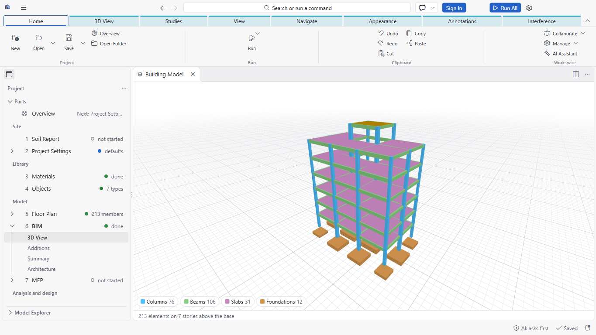
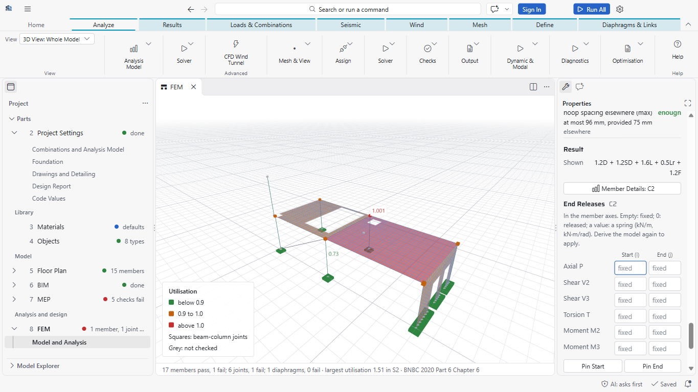

# Part 6: BIM (Building Model)

The building model is the 3D model of the building: every member of the floor plan as an element
with its storey, section and material, plus what the floor plan cannot show (openings, stairs,
inclined members). It is **generated from the floor plan**; you do not draw members here. The
analysis model, the bill of quantities, the MEP coordination and the IFC export are made from it.

File: `06 BIM/bim.json`. Open it with **6 BIM** in the sidebar; its sub-windows are **3D
View**, **Additions**, **Summary** and **Architecture**. The window is titled **Building Model**.

## Building and rebuilding

- The first time, **Build from Floor Plan** builds the model. When the floor plan changes, the
  status line says *the Floor Plan changed since it was built* with a **Rebuild** link, and the
  sidebar shows *stale*.
- **Run All builds it again** when the floor plan changed (its step 1), so you need not rebuild
  by hand before Run All. Rebuild by hand to look at the model in 3D first.
- Rebuilding keeps the *Additions* (below).
- If the floor plan is empty: *The Floor Plan has no layout yet. Open it and create it first.*

## Views

| View | Shows |
| --- | --- |
| **3D View** | The model in 3D, coloured by element class like the floor plan, with a legend that counts each class (click one to hide or show it). Drag to orbit, and pan and zoom with the mouse; a click without dragging selects an element. **Zoom to Fit** frames the model. |
| **Additions** | What the building model adds to the floor plan: slab openings (O..), wall openings and doors (D..), stairs between storeys (ST..), inclined members such as braces, sloped beams or raking columns (M..), and member end releases and point springs. They are edited in a form and kept when you rebuild; openings follow their slab or wall. |
| **Architecture** | The architecture layer: walls, curtain walls, rooms, roofs, ceilings, ramps and railings. They load the model (see [Floor Plan › Loads](05-floor-plan.md#loads)) and go into the bill. |
| **Summary** | The storeys (ID, elevation, height) and the number of elements by kind, from the floor plan and own. |

Clicking an element selects the floor-plan member it came from (also in the Tables, the Model
Explorer and the floor plan) and shows its properties. Hold **Ctrl** or **Shift** while clicking to select
several elements.

The 3D view is drawn from the same IFC file that **Export IFC** writes, so what you see is what
is exported.

### Section box and section planes

The ribbon's **3D View** tab holds the **Section**, **Measure** and **Hide / Isolate** groups
below, and the **Render & Studies** and **Export** groups.

- **Section Box** (**3D View › Section › Section Box**): places a six-sided clipping
  box around the model (or use **Section Box from Selection** around the selected elements). Drag
  any of the six face handles to cut into the building, type exact **X / Y / Z** min and max bounds
  in millimetres in the Section panel, or click **Reset** to return to the full model bounds.
- **Single section planes**: in the Section panel or **3D View › Section**, add an **X**, **Y**, or
  **Z** cut plane or choose **Section Plane from Face** and click any surface in the model. Drag
  its handle along the normal, click **Flip** to reverse the kept side, or remove individual planes.
- Section cuts apply across standard, Walk Mode, 4D playback, and phase views, and are saved per
  view in workspace storage.

### Measure

- **Measure** (**3D View › Measure**): pick **Point-to-Point Distance**,
  **Chain Distance** (right-click or click **Finish** to complete), **Point to Face**
  (perpendicular distance from a point to a picked face), or **Angle Between Two Edges**.
- Snaps under the cursor prioritise vertices, edge midpoints, edges, and faces. Dimension lines
  and labels appear in 3D in millimetres, and every measurement is listed in the Measure panel with
  one-click copy and clear controls.

### Hide and isolate

- Use the Revit-style two-key shortcuts in the 3D view (or **3D View › Hide / Isolate**):
  - **HH**: temporarily hide the selected element(s).
  - **HI**: temporarily isolate the selected element(s).
  - **HC**: temporarily hide the category (element class) of the selection.
  - **IC**: temporarily isolate the category of the selection.
  - **HR**: reset all temporary hide/isolate overrides.
- A banner over the view shows when temporary hide/isolate is active, with **Reset (HR)** and
  **Apply Permanently**.
- **Permanent hide**: **Hide Element Permanently** hides elements in the saved view state. Toggle
  **Reveal Hidden Elements** (lightbulb icon) to highlight permanently hidden elements in magenta so
  you can select and **Unhide Selected** or **Unhide All**.

## Export IFC

**3D View › Export › Export IFC** (or on the [Exports](11-exports.md) page) writes
`11 Exports/IFC/<project>.ifc` with the elements, storeys and materials, for other BIM software.

## Studies

**3D View › Render & Studies** and the **Studies** tab:

- **Render**: Standard, Daylight (sun and soft shadows), Overcast, Dusk, Clay model; **Walk
  Mode** (W/A/S/D, Q/E up and down, the arrows turn, Shift faster); **Export Still Image** (a
  PNG at twice the view's size, supersampled).
- **Sun at Noon on the Study Day**: the sun of the site (01 Soil Report's map point) on the
  day set in `06 BIM/environment.json` (default the June solstice).
- **4D Playback of the Programme**: a bar over the view with a day slider and Play; elements not
  started are hidden, those under construction drawn see-through orange.
- **Show Terrain**: the survey's surface under the building.
- **Phase**: the elements standing in a phase of `06 BIM/phasing.json` (existing grey,
  demolished red, temporary yellow).

**Studies › Daylight Study** and **Environment Study** also give the sun path, the shadows each hour and the
direct sun hours of the ground and the facades, an average daylight factor per room of the
architecture (BR 209 / CIBSE LG10 formula, side windows), and an indicative road-noise level at
the facades (CRTN form) from the roads listed in `environment.json`. **Phases and Options**
splits the bill by phase and compares saved versions (design options) side by side: quantities,
cost, carbon, and the checks of the current files.

## End releases and point springs *(after Alpha 3)*

A member's ends are fixed to the joints unless you release them. For each end of a beam,
column or brace, each of the six actions **Axial P**, **Shear V2**, **Shear V3**, **Torsion
T**, **Moment M2** and **Moment M3** is:

- **fixed** (empty field, the default),
- **released** (`0`), or
- a **spring** (a value in kN/m or kN·m/rad), for partial fixity.

A **point spring** puts six springs (and optionally a support) at a joint.

Set them in **6 BIM › Additions** (the lists *End releases* and *Point springs*), or in 8 FEM:
pick a member or a joint in the 3D view and use **Analyze › Assign › End Releases...** /
**Point Spring...**, or the **End Releases** editor in Properties (**Pin Start** and **Pin End**
release both moments of that end). Values are in the member's own axes. Derive the model again
to apply them; the 3D view of 8 FEM draws release and spring symbols.

Releases that leave a mechanism (for example a beam pinned at both ends in torsion as well) are
refused when the model is derived, with a message naming the member. Joints whose rotations no
member passes on are held automatically.

## Not confirmed

- The exact mouse buttons for orbit and pan are the defaults of the 3D library (That Open
  Components camera controls) and are not set by SAEngine.
- The many study and coordination buttons of the **Studies**, **View**, **Navigate**,
  **Appearance**, **Annotations** and **Interference** tabs were not walked for this manual.
