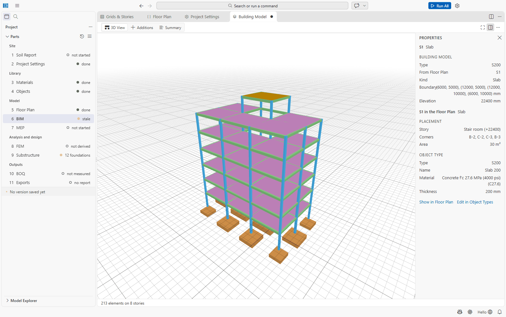

# Part 6: BIM (Building Model)

The building model is the 3D model of the building: every member of the floor plan as an element
with its storey, section and material, plus what the floor plan cannot show (openings, stairs,
inclined members). It is **generated from the floor plan**; you do not draw members here. The
analysis model, the bill of quantities, the MEP coordination and the IFC export are made from it.

File: `06 BIM/bim.json`. Open it with **6 BIM**. The editor is titled **Building Model**.

## Building and rebuilding

- **Build from Floor Plan** builds the model the first time; afterwards the button reads
  **Rebuild from Floor Plan**. It is highlighted when the model is out of date: the status line
  then says *the Floor Plan changed since it was built* with a **Rebuild** link.
- **Rebuild after every floor-plan edit**, before Run All: Run All derives the analysis model from
  the building model, not from the floor plan.
- Rebuilding keeps the *Additions* (below).
- If the floor plan is empty: *The Floor Plan has no layout yet. Open it and create it first.*

## Views

| View | Shows |
| --- | --- |
| **3D View** | The model in 3D, coloured by element class like the floor plan. Drag to orbit, and pan and zoom with the mouse (the viewer's standard camera); a click without dragging selects an element. **Zoom to Fit** frames the model. |
| **Additions** | What the building model adds to the floor plan: slab openings (O..), wall openings and doors (D..), stairs between storeys (ST..), and inclined members such as braces, sloped beams or raking columns (M..). They are edited in a form and kept when you rebuild; openings follow their slab or wall. |
| **Summary** | The storeys (ID, elevation, height) and the number of elements by kind, from the floor plan and own. |

Clicking an element selects the floor-plan member it came from (also in the Model Explorer and
the floor plan) and shows its properties.

The 3D view is drawn from the same IFC file that **Export IFC** writes, so what you see is what
is exported.

## Export IFC

**Export IFC** (in **...**, or on the [Exports](11-exports.md) page) writes
`11 Exports/IFC/<project>.ifc` with the elements, storeys and materials, for other BIM software.

## Studies (alpha 9)

The 3D view's "..." menu:

- **Render**: Standard, Daylight (sun and soft shadows), Overcast, Dusk, Clay model; **Walk
  Mode** (W/A/S/D, Q/E up and down, the arrows turn, Shift faster); **Export Still Image** (a
  PNG at twice the view's size, supersampled).
- **Sun at Noon on the Study Day**: the sun of the site (01 Soil Report's map point) on the
  day set in `06 BIM/environment.json` (default the June solstice).
- **4D Playback of the Programme**: a bar over the view with a day slider and Play; elements not
  started are hidden, those under construction drawn see-through orange.
- **Show Terrain**: the survey's surface under the building.
- **Phase**: the elements standing in a phase of `06 BIM/phasing.json` (existing grey,
  demolished red, temporary yellow).

Office Tools > **Site and Environment** also gives the sun path, the shadows each hour and the
direct sun hours of the ground and the facades, an average daylight factor per room of the
architecture (BR 209 / CIBSE LG10 formula, side windows), and an indicative road-noise level at
the facades (CRTN form) from the roads listed in `environment.json`. **Phases and Options**
splits the bill by phase and compares saved versions (design options) side by side: quantities,
cost, carbon, and the checks of the current files.

## Not confirmed

- The exact mouse buttons for orbit and pan are the defaults of the 3D library (That Open
  Components camera controls) and are not set by SAEngine.
- The 3D view has no section, measure or hide tools in this version.
