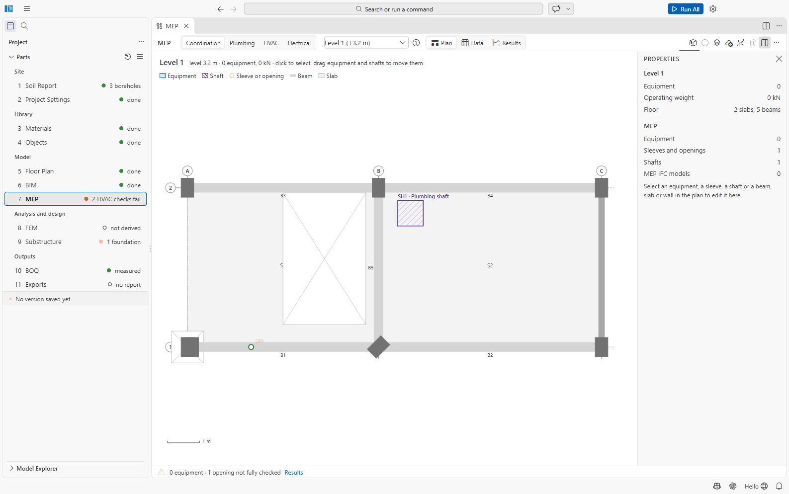

# Part 7: MEP

Part 7 covers the building services **as they affect the structure**: equipment that loads the
floors (water tanks, chillers, generators...), sleeves and openings through beams, slabs and walls,
vertical shafts, and the plumbing, HVAC and electrical design a structural engineer needs (water
demand and tank sizes, RC tank design, plant weights, duct and tray openings).

File: `07 MEP/mep.json`. Open it with **7 MEP**.

## Layout

- **Discipline tabs:** **Coordination**, **Plumbing**, **HVAC**, **Electrical**.
- **Storey picker** and **views:** **Plan**, **Data**, **Results**.
- The **Plan** draws the storey from the building model (grid, slabs with openings, beams,
  columns, walls) with the MEP items. Click to select; drag equipment, risers, tanks, plant and
  shafts to move them. **Delete** removes the selected item, **Esc** deselects.
- Plan positions are in **m**, sizes in **mm**, weights in **kN**.
- The checks are computed by the backend about a second after each edit. Results are not stored
  in the file.

## Coordination

Toolbar: **Add Equipment** (presets: *Overhead water tank, Chiller, Air handling unit, Generator,
Transformer, Lift machine room, Pump*), **Add Sleeve through the Selected Beam, Slab or Wall**,
**Add Shaft**, **Import MEP IFC Model**, **Suggest Sleeves from Clashes**, **Delete**.

- **Equipment:** operating weight and empty weight (kN), plinth height, length/width/height (mm),
  position X/Y (m), rotation. Replace the preset values with the supplier's data.
- **Sleeves and openings:** select a beam, slab or wall in the plan, then add a sleeve (circle) or
  opening (rectangle). In a beam the position is *From start* and *Above bottom*; in a wall *Along*
  and *Up*. Columns cannot take openings.
- **Import MEP IFC Model:** reads the IFC of a services model (copied to `07 MEP/IFC/`), finds where
  pipes and ducts cross the structure and lists the **clashes**. A clash with a large enough sleeve
  or a shaft counts as coordinated; otherwise SAEngine proposes a sleeve, which **Suggest Sleeves
  from Clashes** adds. Clashes with columns or foundations get no sleeve: *reroute the service*.

**Results** (*Loads, openings and clashes*): equipment loads by storey, operating weights, the
**opening checks** (beam sleeves against the h/3 and 3-diameter limits of practice; small openings
by the net-section method, ACI 318-19 shear; large openings flagged as needing a detailed design,
which SAEngine does not do), and the clashes.

**How MEP loads the structure:** equipment weight goes to the superimposed dead case SD; the
contents (operating minus empty weight) go to the fluid case F (or to L until the analysis model
has an F case).

## Plumbing (BNBC 2020 Part 8)

Toolbar: **Add Riser or Stack** (cold water riser, hot water riser, soil, waste, soil and waste,
vent stack, rainwater leader, pumping main), **Add Tank** (overhead tank, underground reservoir,
septic tank, soak well, rainwater tank), **Add Roof Drain**, **Size Tanks**, **Add Sleeves for
Risers**.

Data:
- **Supply and roof:** source (*City main* / *Deep tubewell*), mains residual head, pumping
  hours, minimum residual head, rainfall intensity (mm/h).
- **Fixtures by storey:** WC, urinal, basin, shower, bathtub, kitchen sink, floor drain, washing
  machine, bidet, others; population and occupancy (BNBC Table 8.5.1, e.g. *Moderate apartment*,
  180 lpcd).
- **Tanks:** length, width, water depth, freeboard, compartments, wall/base/roof thickness, top
  level; construction RC, brick or prefabricated.

**Size Tanks** writes the sizes the demand requires into the tanks (undoable). **Add Sleeves for
Risers** adds slab sleeves where a riser is not in a shaft.

Results (*Plumbing coordination*): daily demand and storage, the **RC tank design** (walls, base
and roof analysed as shells, with reinforcement and quantities), riser and rainwater leader sizes
(Table 8.7.2), septic tank and soak well (Appendix S), and the **hydraulics**: residual head at
every floor against the required head, solved with the EPANET 2.2 engine (WNTR).

## HVAC

Toolbar: **Add Plant** (chiller, cooling tower, AHU, FCU, VRF and split outdoor units, pump,
exhaust fan, fresh air unit), **Draw Duct** (supply, return, exhaust, fresh air, kitchen exhaust,
smoke extract; riser ducts in shafts), **Propose Plant**, **Add Duct Openings**, **Calculate
Loads**.

Data: the system (VRF, chilled water, split, packaged, ventilation only) and design conditions,
the envelope, the storeys (use from Table 8.2.3), plant and ducts. While drawing a duct: click the
points, double-click or Enter to end, Backspace removes the last point, Esc cancels.

**Calculate Loads** runs EnergyPlus for the design day when it is installed (about half a
minute); without it, a hand estimate is used and labelled as such. **Propose Plant** sizes plant
entries; **Add Duct Openings** proposes and checks beam web openings for the ducts.

## Electrical

Toolbar: **Add Equipment** (transformer, HT switchgear, LT panel, generator, fuel tank, UPS,
battery bank, PFI capacitor bank, distribution board, solar PV array), **Add Riser** (busbar
trunking, cable tray, cable ladder, conduit bank), **Draw Tray**, **Propose Equipment**, **Add
Openings**.

Data: supply, loads by storey (Table 8.1.17), lightning protection, equipment, risers and trays.
Results: maximum demand (kVA), transformer, generator and UPS sizes, rooms, risers, trays and the
lightning protection risk with the down-conductor columns needed. Equipment weights are typical
catalogue values: replace them with the supplier's data.

## Files

`07 MEP/mep.json`; imported IFC models in `07 MEP/IFC/`; computed summaries and tank designs in
`07 MEP/mep.results/`; the EnergyPlus cache in `07 MEP/hvac.results/`.

## Not confirmed / limitations

- Large beam openings (Vierendeel action) and Imhoff tanks (above 300 residential users) are
  reported, not designed.
- Some values are marked in the code as typical or to be checked: catalogue equipment weights,
  the 40 % cable tray fill, the HVAC fallback irradiance.
- Clashes, tank sizing, hydraulics and proposals all need the Python backend.
