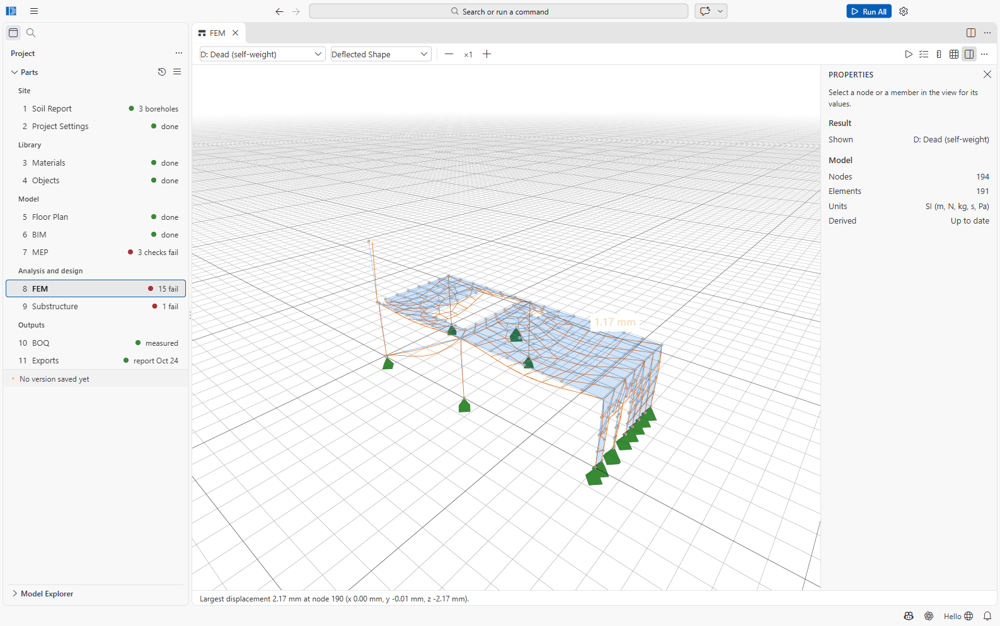
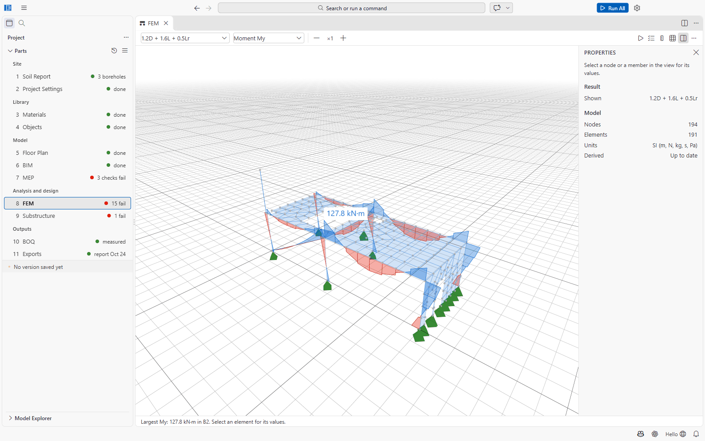
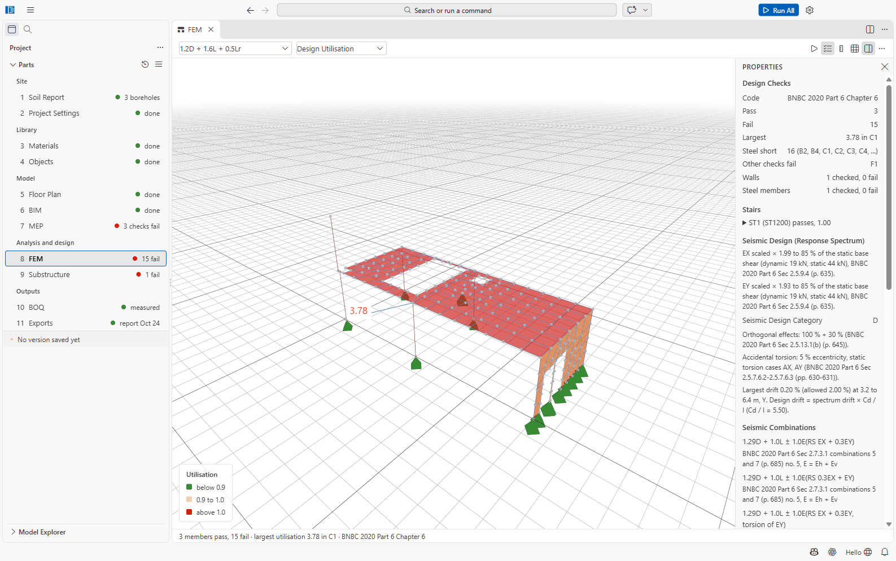
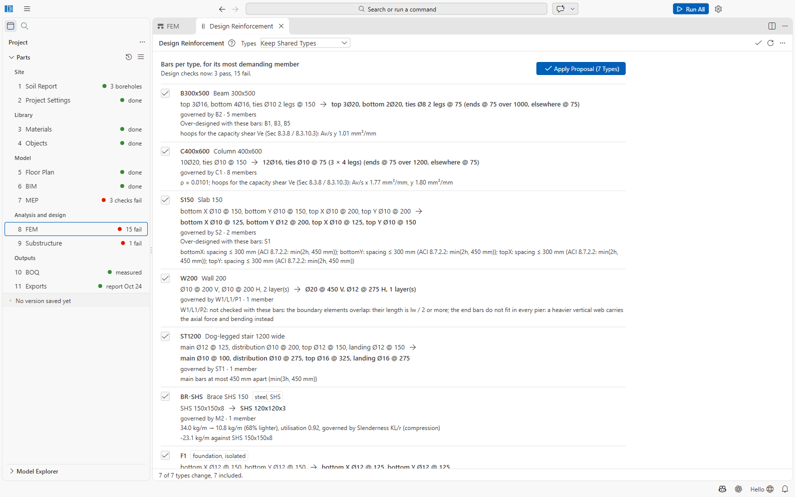

# Part 8: FEM (analysis and design)

Part 8 is the analysis model and its results, and the design of the members. It is what ETABS
calls the *analysis* and *concrete frame design*: SAEngine derives a finite-element model from
the building model, analyses it with **OpenSeesPy**, combines the results with the load
combinations of Project Settings and checks every member to ACI 318-19 clauses and factors (BNBC 2020
Part 6 Chapter 6 is based on an earlier ACI 318) or AISC 360-22.

File: `08 FEM/model.osmodel`, with the results in `08 FEM/model.results/`. Open it with
**8 FEM**. The editor is the **FEM Model Viewport**.

## The analysis model is derived, never drawn

The analysis model is made from the **building model** (6 BIM), **Project Settings**, **Object
Types** and **Materials**, plus the soil report (when the site class comes from it), MEP (when it
has equipment, openings or shafts) and 9 Substructure (with soil-spring supports). You do not
edit it by hand: change the sources and derive again.

- **Derive from Building Model** (empty model) or **Derive Again from Building Model** (shown when
  a source changed). Run All derives automatically when needed.
- When a source changes, the toolbar shows an **Out of date** pill: *Changed since the analysis
  model was derived: Object Types. Click to derive it again.*
- After deriving: *Derived 36 nodes and 63 elements; base shear 276.5 kN, seismic weight
  3071.7 kN.*

What the derivation does:

- Columns, beams and inclined members become elastic beam-column elements; walls (and slabs
  when *Slabs* is set to *Shells*) become shell elements meshed with Gmsh.
- Column and wall bases on the lowest storey are fixed (or on soil springs).
- With *Slabs: Loads to beams* (default), slab loads go to the beams by the 45° rule as
  triangles and trapezoids (since version 0.0.45; irregular panels by their bisector split),
  each beam cut into members of the mesh size; a rigid diaphragm ties each floor. Before 0.0.45
  each edge got a uniform load of the same total, which understated the beams' midspan moments
  by up to 25 % and their end moments by up to 20 %.
- Steel members with simple connections are pinned at their ends.
- Wind and earthquake are applied as BNBC equivalent static storey forces; the response
  spectrum cases are added when *Response spectrum* is on. Each needs only its own site value
  (Z for earthquake, V for wind): a missing one is reported and its cases stay empty. Since
  0.0.45 each storey's wind acts on that storey's own face width at the face's centre, the
  torsional cases WTX and WTY (e = 0.15 B, BNBC Figure 6.2.9) are added, and every
  one-direction wind combination is designed for the four design wind load cases.
- Since 0.0.45, **live load arrangements** (BNBC 6.1.12.2, *Live load arrangement* in Project
  Settings): cases LP1, LP2 ... with the live load on alternate bays (a checkerboard over the
  floors) and on adjacent bays (each floor alone) of the column grid; every gravity
  combination with live load is also designed with each of them.
- Cracked section stiffness (BNBC 6.3.10.4.1: columns 0.70 Ig, beams 0.35 Ig, walls 0.70 or
  0.35 Ig, slabs 0.25 Ig) is used for the lateral cases, gross sections for gravity; the
  engineer's stiffness modifiers (object types, members) replace them where given.
- Since version 0.0.44, as the usual commercial analysis programs model a building: the seismic
  mass is lumped at the story levels (the lower half of the first storey goes to the base);
  beams and columns have **rigid end zones** (rigid zone factor 0.5) and their forces are also
  reported at the support faces (`08 FEM/faces.json`, the results' `face-forces.json`), where
  the design takes them: beams at the column faces with the shear at d (BNBC 2020 Part 6 Sec
  6.1.6.3 and 6.4.1.3.1), columns at the beam soffit and the top of the slab (SAEngine's
  practice); the eccentric static cases EXP, EXN, EYP, EYN are added; shells are meshed at
  500 mm; the line and point loads of `05 Floor Plan/loads.json` are applied.
- The report (Analysis model) shows how W was formed: W per level with its parts, the weight
  that went to the base, the period used, the accidental torsion cases, the line loads and the
  mesh check.
- **Mesh check** (Run All, after the analysis): the beams' gravity end moments on the project's
  mesh and on one twice as coarse; a change above 5 % shows a warning (*Mesh check: ... the mesh
  is not converged*), written to `08 FEM/model.results/mesh-check.json`. It never stops Run All.

## Load cases

Load cases are created by SAEngine; you do not define them.

| Case | Meaning |
| --- | --- |
| D | Dead (self-weight) |
| SD | Superimposed dead (finishes, partitions) |
| L | Live |
| Lr | Roof live |
| WX, WY | Wind in X, Y (BNBC equivalent static) |
| EX, EY | Earthquake in X, Y (equivalent static: T = Ct·hn^m, base shear from Z, I, R, site class) |
| F | Fluids (MEP equipment contents), when there are any |
| T | Temperature, when asked for in Project Settings |
| Modal | up to 12 modes |
| RX, RY | Response spectrum X, Y (BNBC design spectrum, CQC, 5 % damping) |

The **load combinations** are those of [Project Settings](02-project-settings.md#load-combinations),
expanded to ±X and ±Y (*1.2D + 1.0(-EX) + 1.0L*). They are formed as factored sums of the case
results.

With *Earthquake design forces: Response spectrum* (the default), the design scales the
response-spectrum forces to 85 % of the static base shear (BNBC 2.5.9.4), adds the 100 % + 30 %
orthogonal effects, accidental torsion (amplified by Ax where the plan is torsionally irregular)
and the vertical component, and checks the storey drift. The Properties panel shows this under
**Seismic Design (Response Spectrum)**, e.g. *EX scaled × 1.99 to 85 % of the static base shear*,
the Seismic Design Category, and *Largest drift 0.20 % (allowed 2.00 %)*.

## Running the analysis

- **Run Analysis** (toolbar ▷) runs every case; **Run Selected Cases...** (in **...**) only some.
  While it runs the button becomes **Stop Analysis**.
- The log is in the output channel *SAEngine Analysis* (**Show Log** in **...**). It ends with
  *Analysis complete: 11 case(s). Results are in ...*.
- Only one run per model at a time: *The analysis of this model is already running.*
- If the model changed after the run, the status line says *The model changed after this
  analysis ran.* with a **Run Analysis** link.

## Viewing results

Two pickers in the toolbar choose **the result** (a case, a combination, *Modal*, *RX*/*RY*) and
**what to show of it**:

| For | Choices |
| --- | --- |
| Cases and combinations | Model Only, Deflected Shape, Support Reactions, Axial Force N, Shear Force Vy, Shear Force Vz, Torsion T, Moment My, Moment Mz; with shells: Shell Moment M11, M22, M12, membrane forces N11, N22, N12, transverse shear Q13, Q23 |
| Design | **Design Utilisation**, **Joint Checks** |
| Modal | Mode Shape, with a Mode picker (*Mode 1 (T = 0.72 s)*) and **Animate the Mode Shape** |
| Response spectrum | Peak Displacements (response spectrum results have no sign) |

**Draw Smaller** / **Draw Larger** (− and +) scale the diagrams. The status line gives the
extreme value (*Largest displacement 2.17 mm at node 190*, *Total reaction: Fx..., Fy..., Fz...*);
select a node or member for its values in the Properties panel. Units on screen: mm, kN, kN·m,
kN/m, MPa.

**Result Tables** (toolbar) opens tables of the results by case (first 500 rows on screen);
**Export Result Tables...** (in **...**) writes all rows to CSV.

## Design checks (Design Utilisation)

Choose **Design Utilisation** after a run. SAEngine checks every member against every
combination (a few minutes on the sample, much longer on a large building: the checks run
again each time you choose this view after a change) and colours the members: **below 0.9** green,
**0.9 to 1.0** amber, **above 1.0** red.

The Properties panel (nothing selected) shows **Design Checks**: the code, the number that pass
and fail, the largest utilisation, and lists:

- **Steel short**: members whose bars give too little steel (fixed by Design Reinforcement);
- **Too small**: sections that no practical bars can make work (fixed by a bigger section);
- **Other checks fail**: checks bars cannot fix;
- **No bars yet**, **Second-order analysis required**, **Walls**, **Steel members**, **Stairs**.

Select a member for its checks: *Passes* or *Fails*, each check with its utilisation, values and
governing combination, and a **Required Steel** section (*required 1,257 mm², provided
1,473 mm²*; for columns *ρ required 0.0123, provided 0.0201*). Each row ends in *enough*,
*short*, *required* (no bars yet) or **section too small**.

| Element | Checked |
| --- | --- |
| RC beams (rectangular) | Sagging and hogging flexure, shear φ(Vc + Vs); torsion (BNBC 6.4.4: threshold, section limit, closed stirrups, Al and its detailing); deflection (BNBC 6.2.5, Ie, Table 6.6.2 limits). Not checked: weak-axis bending, axial force in beams. |
| RC columns (rectangular, circular) | Axial force with biaxial bending (interaction surface); slenderness by moment magnification or P-Delta (*k lu / r*, *Moment magnifier*); shear with the axial force's effect on Vc and the tie spacing limits. |
| Slabs | Shells: per strip and layer (Wood-Armer), one-way shear. Loads to beams (since 0.0.45): BNBC's coefficient methods (two-way Sec 6.5.8, one-way Sec 6.1.4.3), minimum thickness and steel. |
| Structural walls | Piers, boundary elements, coupling beams. |
| Stairs | By hand methods (span/thickness). |
| Steel beams, columns, braces | BNBC Part 6 Chapter 10 / AISC 360-22, with simple connections. |
| Seismic detailing (BNBC 8.3) | Beam-column joints, joint shear, strong column / weak beam, capacity shear (*Joint Checks* view). |
| Foundations | **Not here**: in [9 Substructure](09-substructure.md). |

Elements of other kinds show *This element is not designed*.

## Design Reinforcement: the design proposal

**Design Reinforcement** (FEM toolbar, Project menu, or the Command Palette) proposes bars for
every object type from the steel its members require under the combinations of the last run,
and applies them to 04 Objects in one undoable edit.

- **Types:** **Keep Shared Types** designs each type for its most demanding member;
  **Split into New Types** moves members that need much less into new, lighter types (this also
  edits 06 BIM and 05 Floor Plan).
- Each row shows the type, its current bars → the proposed bars (*10Ø20, ties Ø10 @ 150 →
  12Ø16, ties Ø10 @ 75 (3 × 4 legs)*), *governed by C1 · 8 members*, members that are
  *Over-designed with these bars*, and notes. Steel types get the lightest section of the same
  family that passes. Foundations get their bars too.
- Tick or untick rows (**Include All Changes**, **Include None**), then **Apply Proposal (n
  Types)**. SAEngine saves the files and checks the members again: *Proposal applied — 3 pass,
  15 fail → 18 pass, 0 fail*. **Undo Apply** reverts it.

Detailing rules: beams use one diameter per face, at most two sizes and two rows, stirrups
Ø8/10/12 with 2 or 4 legs; columns equal bars round the section with ties per ACI 25.7.2; slabs
Ø10/12/16 meshes.

**The proposal never changes a concrete section.** After applying it, the model shows *Out of
date* (the object types changed): derive and run again, or simply Run All, before issuing
results.

## When a section is too small

When no practical bars can carry the demand, the type gets the badge **section too small**, it
cannot be included, and the row says why and what to try, for example:

- column: *Section too small: no layout with ρ up to 0.08 (ACI 10.6.1.1) carries the demand; try
  500 x 700 mm (+100 mm) with about ρ = 0.025; the analysis must be run again*;
- beam: *... try 300 x 600 mm (depth +100 mm); the analysis must be run again, the stiffness
  changes*;
- slab: *try 175 mm (+25 mm)*; foundation: *a thicker foundation*;
- column at the joints of a special moment frame: *Section too small: joint shear at
  C7@18000; try 450 x 450 mm (+50 mm) for the joint shear; the analysis must be run again*.
  The joint shear comes from 1.25 fy of the proposed beam bars and only a larger joint (or a
  higher f'c) carries it (BNBC 2020 Part 6 Sec 8.3.7). Before reporting it, the proposal gives
  the beams framing in the lightest bars that still pass their own checks when that is enough;
  the bars the column needs for its axial force and moments are kept in the row's notes.

To fix it:

1. Open **04 Objects** (**Open Object Types** in the proposal) and enlarge the section of that
   type, or create a bigger type and assign it to the members concerned on the floor plan.
2. If you changed the floor plan, **Rebuild from Floor Plan** in 6 BIM.
3. **Run All** (it derives the model again and reruns the analysis, because the stiffness
   changed).
4. **Design Reinforcement** again, and apply.

Run All's summary counts these as *, 2 section(s) too small*.

## Strut-and-tie models of D-regions

Deep beams, transfer girders, corbels and pile caps are checked with their own strut-and-tie
models. For any other D-region (a dapped end, a corbel with several loads, a frame corner, a wall
or beam with an opening) open **Strut-and-Tie Models** (the button under *Diaphragms and Deep
Members* in the results, or the Command Palette):

1. **New Model from Template** (deep beam, dapped end, corbel, frame corner) or **New Model**.
2. Draw in the region's plane, x along the member and y up, in mm: **Add Node** (click the
   drawing), **Add Strut** and **Add Tie** (click two nodes). Select a node to set its support,
   bearing length, tie anchorage and its load in the case shown; select a member for its width,
   shape, bars or tendons.
3. Put the factored forces from the analysis on the nodes, one load case per combination
   (**Add Load Case**), and the distributed web bars under *Region*.
4. The truss is solved for every case and each strut, tie and nodal zone is checked with the
   project's code pack (BNBC 2020: Appendix I, φ = 0.75 of Sec 6.2.3.2.6): a strut drawn in
   tension or a tie in compression fails; a tie without bars shows the *Ats needed*.

The models are saved in `08 FEM/strut-and-tie.json` and printed in the design report.

## Commands

| Command (category SAEngine) | Does |
| --- | --- |
| Run All | Analysis, design and outputs ([Getting started](00-getting-started.md#run-all)) |
| Run Analysis | Runs every case of the open model |
| Run Selected Analysis Cases... | Runs the cases you pick |
| Show Analysis Log | The *SAEngine Analysis* output |
| Design Reinforcement | The design proposal |
| Strut-and-Tie Models | Strut-and-tie models of D-regions |
| Check Python Runtime | Checks the backend |

## Files

`08 FEM/model.osmodel` (derived), `08 FEM/model.results/` (results, deleted and rewritten by
each run; `design-summary.json`, `design-required.json`, `design-report.json`), and for soil
springs `model-fixed.osmodel` and `ssi-compare.json`.

## Not confirmed / limitations

- Beam deflection is checked from the analysis's deflections with Ie at midspan on the
  rectangle (no flange); slab deflection by the minimum thickness of Tables 6.6.1 and 6.6.3.
- Beam torsion framed at both ends is designed as compatibility torsion (at most φTcr); the
  moments this releases are not redistributed to the adjoining members.
- *Section too small* suggestions are information only; there is no button that enlarges a
  section.
- Advanced analyses (pushover, time history, construction sequence, temperature, soil-structure
  interaction) exist in Project Settings but are not described in detail in this manual.
