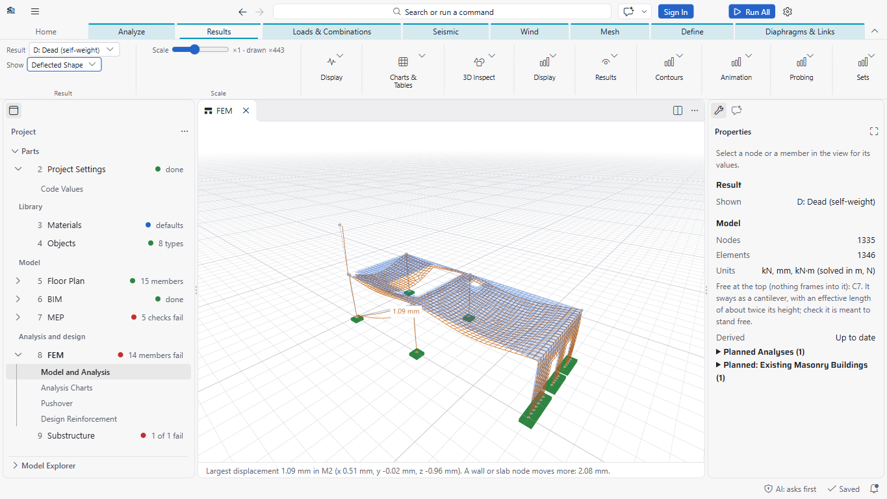
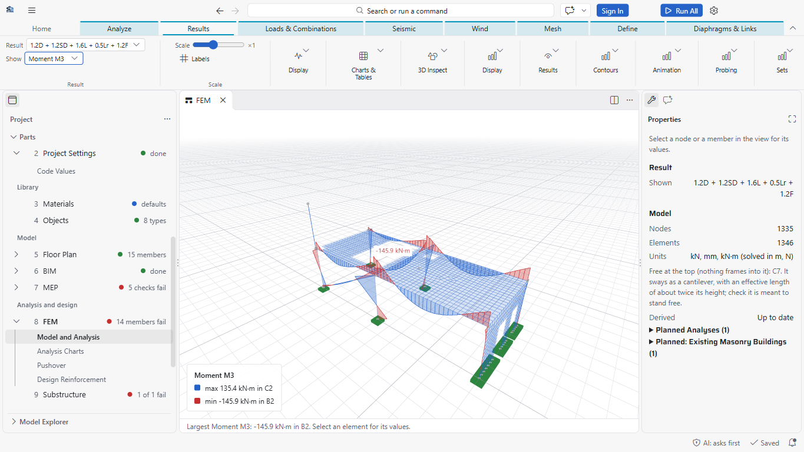
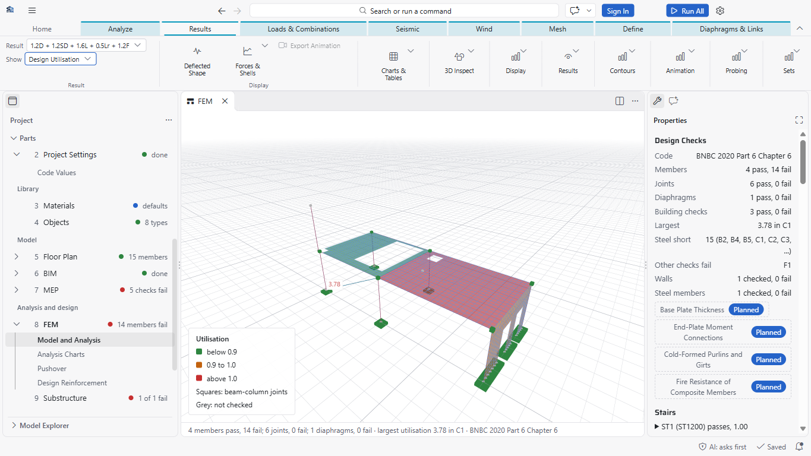
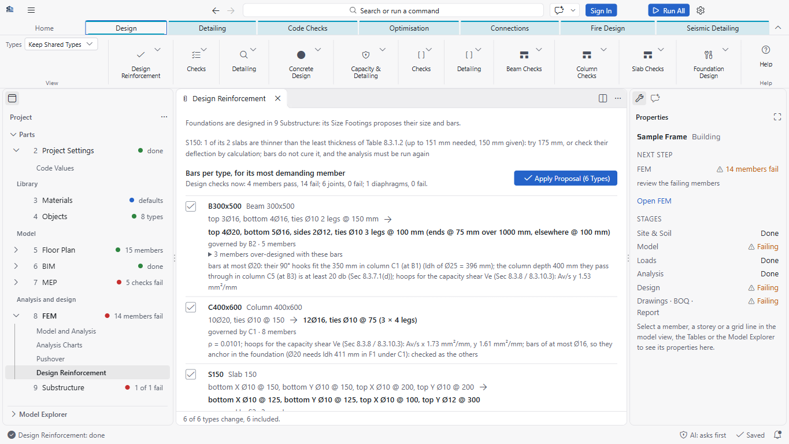

# Part 8: FEM (analysis and design)

Part 8 is the analysis model and its results, and the design of the members. It is what ETABS
calls the *analysis* and *concrete frame design*: SAEngine derives a finite-element model from
the building model, analyses it with **OpenSeesPy**, combines the results with the load
combinations of Project Settings and checks every member to the code pack's design clauses
(with BNBC 2020: Part 6 Chapter 6 for concrete, Chapter 10 for steel).

File: `08 FEM/model.osmodel`, with the results in `08 FEM/model.results/`. Open it with
**8 FEM** in the sidebar. Its sub-windows are **Model and Analysis** (the 3D view of the
analysis model and its results), **Analysis Charts**, **Pushover** and **Design
Reinforcement** (the design proposal). The ribbon of the 3D view has the tabs **Analyze**,
**Results**, **Loads & Combinations**, **Seismic**, **Wind**, **Mesh**, **Define** and
**Diaphragms & Links**.

## The analysis model is derived, never drawn

The analysis model is made from the **building model** (6 BIM), **Project Settings**, **Object
Types** and **Materials**, plus the soil report (when the site class comes from it), MEP (when it
has equipment, openings or shafts) and 9 Substructure (with soil-spring supports). You do not
edit it by hand: change the sources and derive again.

- **Derive from Building Model** (empty model) or **Analyze › Solver › Derive Model** (when a
  source changed). Run All derives automatically when needed.
- When a source changes, the sidebar shows *stale* and Properties says *Derived: Out of date ·
  Changed since: Object Types*.
- After deriving: *Derived 36 nodes and 63 elements; base shear 276.5 kN, seismic weight
  3071.7 kN.*

What the derivation does:

- Columns, beams and inclined members become elastic beam-column elements; walls (and slabs
  when *Slabs* is set to *Shells*) become shell elements meshed with Gmsh.
- Column and wall bases on the lowest storey are fixed (or on soil springs).
- With *Slabs: Loads to beams* (default), slab loads go to the beams by the 45° rule as
  triangles and trapezoids (since version 0.0.45; irregular panels by their bisector split),
  each beam cut into members of the mesh size; a rigid diaphragm ties each floor. Before 0.0.45
  each edge got a uniform load of the same total, which understated the beams' midspan moments
  by up to 25 % and their end moments by up to 20 %.
- Steel members with simple connections are pinned at their ends. The engineer's own **end
  releases** and **point springs** (see [Part 6](06-bim.md#end-releases-and-point-springs)) are
  modelled the same way, as zero-length links.
- Wind and earthquake are applied as BNBC equivalent static storey forces; the response
  spectrum cases are added when *Response spectrum* is on. Each needs only its own site value
  (Z for earthquake, V for wind): a missing one is reported and its cases stay empty. Since
  0.0.45 each storey's wind acts on that storey's own face width at the face's centre, the
  torsional cases WTX and WTY (e = 0.15 B, BNBC Figure 6.2.9) are added, and every
  one-direction wind combination is designed for the four design wind load cases.
- Since 0.0.45, **live load arrangements** (BNBC 6.1.12.2, *Live load arrangement* in Project
  Settings): cases LP1, LP2 ... with the live load on alternate bays (a checkerboard over the
  floors) and on adjacent bays (each floor alone) of the column grid; every gravity
  combination with live load is also designed with each of them.
- Cracked section stiffness (BNBC 6.3.10.4.1: columns 0.70 Ig, beams 0.35 Ig, walls 0.70 or
  0.35 Ig, slabs 0.25 Ig) is used for the lateral cases, gross sections for gravity; the
  engineer's stiffness modifiers (object types, members) replace them where given.
- Since version 0.0.44, as the usual commercial analysis programs model a building: the seismic
  mass is lumped at the story levels (the lower half of the first storey goes to the base);
  beams and columns have **rigid end zones** (rigid zone factor 0.5) and their forces are also
  reported at the support faces (`08 FEM/faces.json`, the results' `face-forces.json`), where
  the design takes them: beams at the column faces with the shear at d (BNBC 2020 Part 6 Sec
  6.1.6.3 and 6.4.1.3.1), columns at the beam soffit and the top of the slab (SAEngine's
  practice); the eccentric static cases EXP, EXN, EYP, EYN are added; shells are meshed at
  500 mm; the line and point loads of `05 Floor Plan/loads.json` are applied.
- The report (Analysis model) shows how W was formed: W per level with its parts, the weight
  that went to the base, the period used, the accidental torsion cases, the line loads and the
  mesh check.
- **Mesh check** (Run All, after the analysis): the beams' gravity end moments on the project's
  mesh and on one twice as coarse; a change above 5 % shows a warning (*Mesh check: ... the mesh
  is not converged*), written to `08 FEM/model.results/mesh-check.json`. It never stops Run All.

## Seismically isolated buildings

A column type (04 Objects) can have a **Seismic isolator**: its bilinear curve from the prototype
tests (Qd, Kd, Dy, vertical stiffness), the lower- and upper-bound factors for the property
variation over the building's life, and optionally the displacement capacity, the tested
vertical capacity, the activation force and the test vertical load. Every column of that type
standing on a support then stands on an isolator. Isolation is available where the code pack
covers it (BNBC 2020: Part 6 Sec 2.5.16); with a pack that does not, the columns stay fixed and
the derivation says so.

When the model is derived:

- the design and maximum displacements DD, DM (with their effective periods and damping) are
  found by iteration on the effective stiffness, and the total displacements DTD, DTM add the
  torsion of the deck above the isolators;
- the forces below (Vb) and above (Vs, with RI and its three minimums) are worked out, and the
  equivalent static cases EX, EY are re-distributed over the height above the isolators;
- each isolated base gets a spring of the unit's upper-bound effective stiffness at DD; with the
  response spectrum on, its spectrum becomes the isolated building's (R = RI, I = 1, the
  isolation damping on the long periods);
- the restoring force, the displacement capacity and the overturning under the maximum
  considered earthquake are checked, the conditions of the equivalent static analysis are
  listed, and the prototype test programme and the design review items are written out.

The design is saved in `08 FEM/isolation.json`; the response spectrum design then takes the
drift with Cd = RI and I = 1 against the isolation limit and gives the isolators'
displacements from RX, RY at 100 % + 30 %. The report has a *Seismic isolation* section.
Viscous dampers are still planned.

## Load cases

SAEngine creates the cases below. You can add **load patterns** of your own (construction,
equipment, special loads) with **Load Patterns...** (Project Settings › Loads ribbon, or **Loads & Combinations › Load Patterns...** here). Each has an id (its case code, e.g. *EQP*), a name, a
type (Dead, Superimposed dead, Live, Roof live, Wind, Seismic or Other) and a self-weight
multiplier. Member and point loads (Floor Plan > Loads) and an area load's *Other load* can go to
any pattern. Each pattern becomes its own case in the analysis model, after the cases below. Its
type sets how it combines: *Generate* gives it the factor of its type in every combination (Dead
takes D's, Live takes L's, and so on), and an Other pattern takes only the factors you enter
under *Factors on the Load Patterns* in Load Combinations. A pattern that still has loads cannot
be deleted.

| Case | Meaning |
| --- | --- |
| D | Dead (self-weight) |
| SD | Superimposed dead (finishes, partitions) |
| L | Live |
| Lr | Roof live |
| WX, WY | Wind in X, Y (BNBC equivalent static) |
| EX, EY | Earthquake in X, Y (equivalent static: T = Ct·hn^m, base shear from Z, I, R, site class) |
| F | Fluids (MEP equipment contents), when there are any |
| T | Temperature, when asked for in Project Settings |
| Modal | up to 12 modes |
| RX, RY | Response spectrum X, Y (BNBC design spectrum, CQC, 5 % damping) |

The **load combinations** are those of [Project Settings](02-project-settings.md#load-combinations),
expanded to ±X and ±Y (*1.2D + 1.0(-EX) + 1.0L*). They are formed as factored sums of the case
results.

With *Earthquake design forces: Response spectrum* (the default), the design scales the
response-spectrum forces to 85 % of the static base shear (BNBC 2.5.9.4), adds the 100 % + 30 %
orthogonal effects, accidental torsion (amplified by Ax where the plan is torsionally irregular)
and the vertical component, and checks the storey drift. Properties shows this under
**Seismic Design (Response Spectrum)**, e.g. *EX scaled × 1.99 to 85 % of the static base shear*,
the Seismic Design Category, and *Largest drift 0.20 % (allowed 2.00 %)*.

**Floor vibration and wind comfort** (alpha 9): after a run with the dead, superimposed dead and
live load cases and a modal case, the results' *Summary* tables add *Floor vibration* (per slab
analysed as shells: the panel's deflection Δ under the vibrating weight, fn = 0.18 √(g/Δ), and
the walking peak acceleration of AISC Design Guide 11 for floors on steel beams or the response
factor of CCIP-016 / SCI P354 for concrete floors, against the limit of the slab's use) and
*Wind comfort* (the along-wind peak acceleration of the top floor in X and Y under the 10-year
wind, from the modal mass and shape, against 15 / 18 / 25 milli-g for residences, hotels and
offices). The design report has a section for each. The methods and limits are the code pack's
(*SAEngine practice where BNBC 2020 is silent* in the default pack).

## Running the analysis

- **Run All** (the title bar, or **Analyze › Solver › Run All**, F5) derives, runs and designs
  everything. **Analyze › Solver › Run** runs every case of the model; **Selected Cases** only
  some. While it runs the button becomes **Stop Analysis**.
- The log is in the output panel *SAEngine Analysis* (**Analyze › Mesh & View › Analysis Log**).
  It ends with *Analysis complete: 11 case(s). Results are in ...*.
- Only one run per model at a time: *The analysis of this model is already running.*
- If the model changed after the run, the status line says *The model changed after this
  analysis ran.* with a **Run Analysis** link.

## Viewing results

On the **Results** tab, two pickers choose **the result** (**Result**: a load case, a
combination, *Modal*, *RX*/*RY*) and **what to show of it** (**Show**):

| For | Choices |
| --- | --- |
| Cases and combinations | Model Only, Deflected Shape, Support Reactions, Axial Force N, Shear Force V2, Shear Force V3, Torsion T, Moment M2, Moment M3; with shells: Shell Moment M11, M22, Shell Twisting Moment M12, Shell Membrane Force N11, N22, Shell Membrane Shear N12, Shell Transverse Shear Q13, Q23 |
| Design | **Design Utilisation**, **Joint Checks**, **Slab Steel Required** (bottom and top, X and Y), **Slab Long-Term Deflection**, **Slab Crack Width** |
| Modal | Mode Shape, with a Mode picker (*Mode 1 (T = 0.72 s)*) and **Animate the Mode Shape** |
| Response spectrum | Peak Displacements (response spectrum results have no sign) |

The **Scale** slider sizes the diagrams (*×1 · drawn ×1525*); **Labels** writes the values on
them. A legend gives the extreme values (*max 135.4 kN·m in C2, min −145.9 kN·m in B2*) and the
status line the largest (*Largest Moment M3: −145.9 kN·m in B2. Select an element for its
values.*). Select a node or member for its values in Properties. Units on screen: mm, kN, kN·m,
kN/m, MPa (or the project's US units).

**Results › Charts & Tables** opens the result tables by case and the charts (storey forces,
drifts, mode shapes); the tables export to CSV. The other groups of the tab (**3D Inspect**,
**Display**, **Contours**, **Animation**, **Probing**, **Sets**) hold more views and
calculators.

## Design checks (Design Utilisation)

Choose **Results › Show › Design Utilisation** after a run. SAEngine checks every member against every
combination (a few minutes on the sample, much longer on a large building: the checks run
again each time you choose this view after a change) and colours the members: **below 0.9** green,
**0.9 to 1.0** amber, **above 1.0** red.

Properties (nothing selected) shows **Design Checks**: the code, the members, joints,
diaphragms and building checks that pass and fail, the largest utilisation, and lists:

- **Steel short**: members whose bars give too little steel (fixed by Design Reinforcement);
- **Too small**: sections that no practical bars can make work (fixed by a bigger section);
- **Other checks fail**: checks bars cannot fix;
- **No bars yet**, **Second-order analysis required**, **Walls**, **Steel members**, **Stairs**,
  **Diaphragms and Deep Members**, the **Column Load Takedown** (each column line's load from
  the analysis), and the **Seismic Design (Response Spectrum)** summary.

Select a member for its checks: *Passes* or *Fails*, each check with its utilisation, values and
governing combination, and a **Required Steel** section (*required 1,257 mm², provided
1,473 mm²*; for columns *ρ required 0.0123, provided 0.0201*). Each row ends in *enough*,
*short*, *required* (no bars yet) or **section too small**.

| Element | Checked |
| --- | --- |
| RC beams (rectangular) | Sagging and hogging flexure, shear φ(Vc + Vs); torsion (BNBC 6.4.4: threshold, section limit, closed stirrups, Al and its detailing); deflection (BNBC 6.2.5, Ie, Table 6.6.2 limits). Not checked: weak-axis bending, axial force in beams. |
| RC columns (rectangular, circular) | Axial force with biaxial bending (interaction surface); slenderness by moment magnification or P-Delta (*k lu / r*, *Moment magnifier*); shear with the axial force's effect on Vc and the tie spacing limits. |
| Slabs | Shells: per strip and layer (Wood-Armer), one-way shear, and the cracked long-term deflection and crack widths (below). Loads to beams: BNBC's coefficient methods (two-way Sec 6.5.8, one-way Sec 6.1.4.3), minimum thickness and steel. |
| Structural walls | Piers, boundary elements, coupling beams. |
| Stairs | By hand methods (span/thickness). |
| Steel beams, columns, braces | BNBC Part 6 Chapter 10 / AISC 360-22, with simple connections. |
| Seismic detailing (BNBC 8.3) | Beam-column joints, joint shear, strong column / weak beam, capacity shear (*Joint Checks* view). |
| Foundations | **Not here**: in [9 Substructure](09-substructure.md). |

Elements of other kinds show *This element is not designed*.

## Design Reinforcement: the design proposal

**Design Reinforcement** (the sub-window under 8 FEM, **Analyze › Analysis Model › Design
Reinforcement**, the button in Run All's notification, or the command search) proposes bars for
every object type from the steel its members require under the combinations of the last run,
and applies them to 04 Objects in one undoable edit.

- **Types:** **Keep Shared Types** designs each type for its most demanding member;
  **Split into New Types** moves members that need much less into new, lighter types (this also
  edits 06 BIM and 05 Floor Plan).
- Each row shows the type, its current bars → the proposed bars (*10Ø20, ties Ø10 @ 150 →
  12Ø16, ties Ø10 @ 75 (3 × 4 legs)*), *governed by C1 · 8 members*, members that are
  *Over-designed with these bars*, and notes. Steel types get the lightest section of the same
  family that passes. Foundations get their bars too.
- Tick or untick rows (**Design › Design Reinforcement › Include All Changes**, **Include
  None**), then **Apply Proposal (n Types)**. SAEngine saves the files and checks the members
  again: *Proposal applied — 0 members pass, 0 fail; 182 members not checked for want of bars →
  182 members pass, 0 fail*. **Undo Apply** reverts it; **Propose Again** proposes from the new
  bars.

Detailing rules: beams use one diameter per face, at most two sizes and two rows, stirrups
Ø8/10/12 with 2 or 4 legs; columns equal bars round the section with ties per ACI 25.7.2; slabs
Ø10/12/16 meshes.

**The proposal never changes a concrete section.** After applying it, the model shows *Out of
date* (the object types changed): derive and run again, or simply Run All, before issuing
results.

## When a section is too small

When no practical bars can carry the demand, the type gets the badge **section too small**, it
cannot be included, and the row says why and what to try, for example:

- column: *Section too small: no layout with ρ up to 0.08 (ACI 10.6.1.1) carries the demand; try
  500 x 700 mm (+100 mm) with about ρ = 0.025; the analysis must be run again*;
- beam: *... try 300 x 600 mm (depth +100 mm); the analysis must be run again, the stiffness
  changes*;
- slab: *S150: 1 of its 2 slabs are thinner than the least thickness of Table 8.3.1.2 (up to
  151 mm needed, 150 mm given): try 175 mm, or check their deflection by calculation*;
  foundation: *a thicker foundation*;
- column at the joints of a special moment frame: *Section too small: joint shear at
  C7@18000; try 450 x 450 mm (+50 mm) for the joint shear; the analysis must be run again*.
  The joint shear comes from 1.25 fy of the proposed beam bars and only a larger joint (or a
  higher f'c) carries it (BNBC 2020 Part 6 Sec 8.3.7). Before reporting it, the proposal gives
  the beams framing in the lightest bars that still pass their own checks when that is enough;
  the bars the column needs for its axial force and moments are kept in the row's notes.

To fix it:

1. Open **04 Objects** (**Design › Design Reinforcement › Open Object Types**) and enlarge the section of that
   type, or create a bigger type and assign it to the members concerned on the floor plan.
2. **Run All** (it rebuilds the building model when the floor plan changed, derives the model
   again and reruns the analysis, because the stiffness changed).
3. **Design Reinforcement** again, and apply.

Run All's summary counts these as *, 2 section(s) too small*.

## Slab deflection and crack widths *(after Alpha 3)*

For slabs analysed as shells, the design works out the **cracked long-term deflection** and the
**crack widths** of each design strip bay, from the analysis's D + SD and L + Lr shell forces and
displacements and the slab's own bars:

- the effective inertia Ie by the code pack's method (ACI-style Branson/Bischoff with λ = ξ/(1 +
  50ρ′); EN 1992 7.4.3 ζ interpolation with Ec,eff; IS 456 Annex C; GB 50010 B = Bs/θ);
- crack widths at mid-span, at the supports and per shell (EN 1992 7.3.4 wk, IS 456 Annex F, GB
  ψ method; where the code gives no crack width, the bar spacing rule).

The inputs (the sustained share ψ, the load duration in months, whether partitions are attached,
the creep coefficient φ and the exposure) are in **Design › Slab Checks › Cracked Deflection**
and **Crack Widths** of the Design Reinforcement window. **Results › Show › Slab Long-Term
Deflection** and **Slab Crack Width** draw them as contours; the slab's panel in Properties sums
them up, and the design report has a *Slab deflection and cracking* table. A pack without a
method shows *not provided by this code*.

## Strut-and-tie models of D-regions

Deep beams, transfer girders, corbels and pile caps are checked with their own strut-and-tie
models. For any other D-region (a dapped end, a corbel with several loads, a frame corner, a wall
or beam with an opening) open **Strut-and-Tie Models...** (under *Diaphragms and Deep Members* in
Properties, **Design › Detailing › Strut-and-Tie**, or the command search):

1. **New Model from Template** (deep beam, dapped end, corbel, frame corner) or **New Model**.
2. Draw in the region's plane, x along the member and y up, in mm: **Add Node** (click the
   drawing), **Add Strut** and **Add Tie** (click two nodes). Select a node to set its support,
   bearing length, tie anchorage and its load in the case shown; select a member for its width,
   shape, bars or tendons.
3. Put the factored forces from the analysis on the nodes, one load case per combination
   (**Add Load Case**), and the distributed web bars under *Region*.
4. The truss is solved for every case and each strut, tie and nodal zone is checked with the
   project's code pack (BNBC 2020: Appendix I, φ = 0.75 of Sec 6.2.3.2.6): a strut drawn in
   tension or a tie in compression fails; a tie without bars shows the *Ats needed*.

The models are saved in `08 FEM/strut-and-tie.json` and printed in the design report.

## CFD wind tunnel (OpenFOAM, optional)

**CFD Wind Tunnel** (**Analyze › Advanced**, or the command search) computes the building's wind by a steady
CFD simulation with **your own OpenFOAM**: SAEngine neither installs nor downloads it. On Windows
it runs in WSL: install WSL with Ubuntu (`wsl --install -d Ubuntu-24.04`), then OpenFOAM in
Ubuntu (the page shows the steps). **Find OpenFOAM** looks for it; Settings > SAEngine > CFD Wind
can name its `etc/bashrc` and the WSL distribution.

1. Set the options in Project Settings > Wind > *CFD wind tunnel* (directions, z0, turbulence
   model, mesh, iterations); empty values take the code pack's (directions every 30°, z0 of the
   wind exposure).
2. **Run CFD...** writes one OpenFOAM case per direction in `08 FEM/cfd-wind/cases` and runs them
   one after the other in the background (it goes on when the page or the app is closed). The page
   shows each direction's step and iteration; **Cancel Run** stops it. **Write Cases** only
   writes them (to run or check them yourself).
3. The results: per direction the base shears and torsion against the code's static wind; per
   storey the force coefficients and forces F = q·CF (q the code's design velocity pressure at the
   roof times its gust factor); per facade zone and storey the pressure coefficients.
4. *Use in the analysis* (Project Settings) makes them the wind cases WX, WY, WXN, WYN and their
   variants (WX2, ...) in place of the code's, at least the code pack's share (80 %) of the code's
   base shear. Derive the model again after a new CFD run.

These are **engineer-supplied loads**: a steady simulation gives mean pressures of the building
alone; codes ask for a boundary-layer wind tunnel test before such loads are used. The page and
the report say so with the code pack's requirement.

## Commands

| Command (category SAEngine) | Does |
| --- | --- |
| Run All | Analysis, design and outputs ([Getting started](00-getting-started.md#run-all)); F5 |
| Run Analysis | Runs every case of the open model |
| Run Selected Analysis Cases... | Runs the cases you pick |
| Show Analysis Log | The *SAEngine Analysis* output |
| Design Reinforcement | The design proposal |
| Strut-and-Tie Models | Strut-and-tie models of D-regions |
| CFD Wind Tunnel | Wind by CFD with your own OpenFOAM (optional) |
| Check Python Runtime | Checks the backend |

## Files

`08 FEM/model.osmodel` (derived), `08 FEM/model.results/` (results, deleted and rewritten by
each run; `design-summary.json`, `design-required.json`, `design-report.json`), and for soil
springs `model-fixed.osmodel` and `ssi-compare.json`.

## Not confirmed / limitations

- Beam deflection is checked from the analysis's deflections with Ie at midspan on the
  rectangle (no flange). Slabs with *Loads to beams* are checked by the minimum thickness of
  Tables 6.6.1 and 6.6.3; the cracked deflection above needs shell slabs.
- Beam torsion framed at both ends is designed as compatibility torsion (at most φTcr); the
  moments this releases are not redistributed to the adjoining members.
- *Section too small* suggestions are information only; there is no button that enlarges a
  section.
- Advanced analyses (pushover, time history, construction sequence, temperature, soil-structure
  interaction) exist in Project Settings but are not described in detail in this manual.
