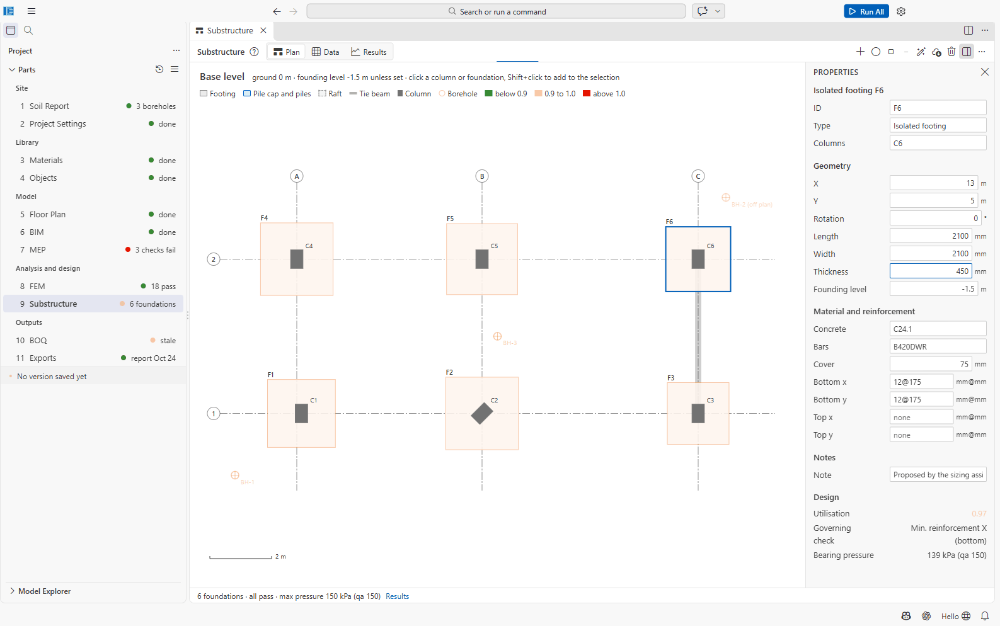
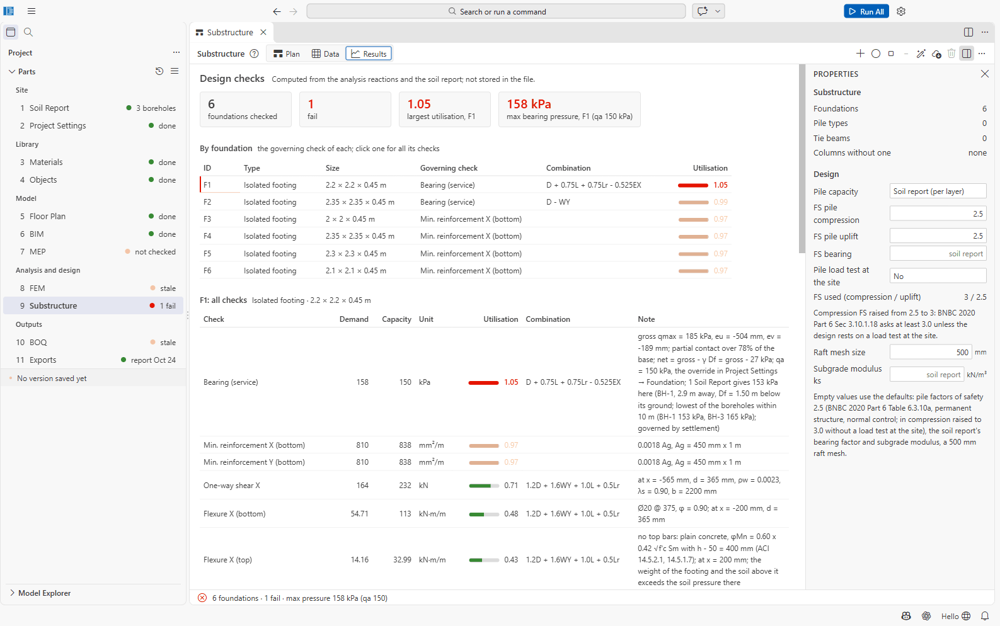

# Part 9: Substructure

Part 9 is where foundations are placed and designed: isolated, combined and strip footings,
pile caps with piles, rafts, and tie beams. The loads are the support reactions of the analysis
(8 FEM); the soil capacity comes from the soil report (Part 1) or from Project Settings.

File: `09 Substructure/substructure.json`. Open it with **9 Substructure** (or **Place Footings
in 9 Substructure** on the floor plan).

## Layout

- **Views:** **Plan**, **Data**, **Results**.
- **Plan** (*Base level*): the grid, the columns, the boreholes and the foundations, coloured by
  utilisation (**below 0.9**, **0.9 to 1.0**, **above 1.0**). Click a column or a foundation to
  select it, **Shift+click** to add to the selection; **Delete** removes the selection; **Esc**
  discards a proposal or clears the selection.
- **Data:** tables of foundations (ID, type, columns, sizes, founding level, piles, utilisation),
  pile types and tie beams. Sizes in mm, levels and positions in m.
- **Properties panel:** the selected foundation, or (nothing selected) the counts, *Columns
  without one*, and the **Design** options.
- **Status line:** e.g. *6 foundations · 0 fail · max pressure 150 kPa (qa 150)*.

Toolbar (the labels follow the selection):

| Button | Does |
| --- | --- |
| **Add Footing under the Selected Columns** | an isolated footing; with several columns selected **Add Combined Footing under the n Selected Columns**; with nothing selected **Add Footings under the Columns without a Foundation** |
| **Add Pile Cap under the Selected Columns** | a pile cap (needs a pile type) |
| **Add Raft under the Selected Columns** | a raft round the columns |
| **Add Tie Beam between the Two Selected Foundations** | a tie beam |
| **Size Footings** | proposes sizes (below) |
| **Import Footings from the Building Model** | takes over footings drawn in an older building model |
| **Delete** | |
| ... | **Add Strip Footing along the Selected Columns**, **Add Pile Type**, **Select Columns without a Foundation**, **Check the Foundations Again** |

## Foundation properties

| Group | Fields (defaults) |
| --- | --- |
| General | Type (*Isolated footing, Combined footing, Strip footing, Pile cap, Raft*), Columns |
| Geometry | X, Y (m; default the columns' centroid), Rotation (°), Length, Width, Thickness (mm), Founding level (m; default ground − 1.5 m) |
| Piles (pile caps) | Pile type; layout *n piles at 3 diameters* with n = 2, 3, 4, 5, 6 or 9 |
| Material and reinforcement | Concrete, Bars, Cover (75 mm), Bottom x/y and Top x/y as `12@150` |
| Design (read only) | Utilisation, governing check, bearing pressure *p kPa (qa q)* |

New foundations: isolated 1.5 × 1.5 × 0.45 m; combined: the columns' extent + 750 mm each side,
600 mm thick; raft: the columns' extent + 1 m, 600 mm thick; bottom mesh 12@150 both ways.
New pile type: bored, 500 mm, 18 m, head fixed in the cap, no depth to fixity.

**Pile heads under lateral load:** each pile type has a *Head* (*Fixed in the cap* or *Free
(pinned)*) and a *Depth to fixity* (m below the head, from the geotechnical report). The cap's
horizontal force is shared equally by its piles; the head moment is H Lf / 2 for a fixed head
and H Lf at the depth to fixity for a free one. With a depth to fixity the pile section is
checked for axial force plus that moment and for shear, and fixed heads add their moments to the
cap's face moments. Empty: the piles are checked for axial force only. Lateral capacity by
Broms and by p-y springs are planned (chips under the pile types table).

**Design options** (nothing selected): pile capacity from the *Soil report (per layer)* or the
*BNBC SPT equations*; factors of safety for pile compression and uplift (default 2.5, BNBC Table
6.3.10a; both raised to 3.0 without a pile load test at the site, Secs 3.10.1.18 and 3.11.3) and for bearing
(default: the soil report's); *Pile load test at the site*; raft mesh size (500 mm); subgrade
modulus ks (default: the soil report's).

## Sizing footings

**Size Footings** proposes isolated footings for the columns without a foundation (or for the
foundations and columns you selected): the width grows in 50 mm steps until bearing passes, then
the thickness from 300 mm for punching and one-way shear, then the bars. Footings that would
overlap are merged into combined footings. The proposal is drawn dashed (*Proposed sizes for 5
foundations*) with **Accept** and **Discard**; nothing is written until you accept.

It needs analysis results: *The sizing assistant proposed no foundations. Run the analysis
first: it sizes from the support reactions.*

## Where the loads and soil capacity come from

- **Loads:** the support reactions of `08 FEM/model.results`, reversed. With soil-spring supports,
  the fixed-base run is used. Without results: *there are no analysis results; run the analysis
  in 8 FEM first*.
- **Bearing combinations:** the service combinations of BNBC 2020 Part 6 2.7.2 — D, D + L + Lr,
  D + W, D + 0.75L + 0.75Lr + 0.75W, 0.6D + W, D + 0.7E, D + 0.75L + 0.75Lr + 0.525E, 0.6D + 0.7E,
  with W and E in ±X and ±Y. **Strength** checks use the factored combinations of Project
  Settings.
- **Allowable bearing qa** of a footing: the *Allowable bearing override qa* in Project Settings →
  Foundation if set; else the soil report: the lowest of the boreholes within 10 m (else the
  nearest), at the footing's width and depth. The check's note says which applied (*qa = 150 kPa,
  the override in Project Settings → Foundation; 1 Soil Report gives 153 kPa here (BH-1, 2.9 m
  away ...)*).

## Checks

| Foundation | Checks |
| --- | --- |
| Footings (isolated, combined, strip) | Bearing (service), Uplift (service), Resultant within the base (service), One-way shear X/Y, Punching at each column, Flexure X/Y bottom and top, Flexure between columns (top), Min. reinforcement. ACI 318-19 Ch. 13, 22 and 7; plain concrete per 14.5. |
| Pile caps | Pile load in compression and uplift, group capacity, block failure (clay), group settlement, pile spacing, cap edge beyond the piles, cover, flexure, one-way shear, punching at columns and round a pile; strut-and-tie for deep caps. |
| Pile sections | Axial + moment on the P-M surface of the circular section (ACI 318-19 22.4) and shear (22.5, bw = D, d = 0.8 D) under the head shear and moment; fully embedded, not a long column (BNBC 2020 Part 6 Sec 3.10.1.31). |
| Pile capacity | Soil-report method or BNBC SPT equations (6.3.21 to 6.3.34): Qult = Qs + Qb − W, uplift ≤ 0.7 Qs + W. |
| Rafts | OpenSees plate on compression-only springs: net contact pressure, maximum and differential settlement, angular distortion (BNBC Table 6.3.8), punching, slab flexure and shear (Wood-Armer). A contact pressure / settlement map can be shown on the plan. |
| Tie beams | Tie force (10 %, BNBC Part 6 1.8.5.2), size (BNBC 8.3.11.3), flexure and shear from settlement. |

The **Results** view (*Design checks — computed from the analysis reactions and the soil report;
not stored in the file*) shows tiles for the number checked and failing, the largest utilisation
and the largest bearing pressure; a table **By foundation** with the governing check and
combination; and **all checks** of the selected foundation with demand, capacity, utilisation,
combination and a note explaining the numbers. Then pile loads, contact pressure, pile capacity,
notes and the method.

**The checks run on the saved file**: save (Ctrl+S) to check your latest edits; the view warns
*These are the checks of the saved file. Save to check the latest edits.*

## Outputs

The foundations are measured in the BOQ, drawn on the *Foundation plan* and *Foundation details*
sheets of the drawings and reported in the design report. `09 Substructure/substructure.results/`
holds the summary.

## Not confirmed / limitations

- Not checked: sliding and overturning of footings, development lengths, rock sockets of piles.
- Walls on rafts are not supported yet (*walls on rafts: not yet*).
- Size Footings proposes isolated and combined footings only (not piles or rafts).
- Raft outlines and strip footing paths cannot be edited graphically.
- A per-foundation qa override, punching reinforcement and separate skin/end-bearing factors
  exist only in the JSON file.
