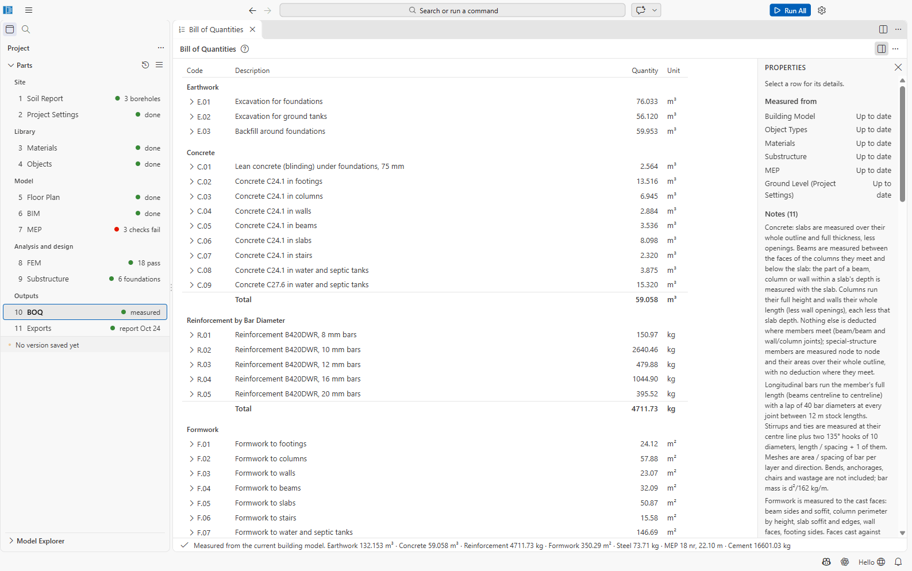

# Part 10: BOQ (Bill of Quantities)

The bill of quantities is measured from the building model, the object types and the materials
(and the substructure and MEP): concrete by grade and element, reinforcement by bar diameter,
formwork, structural steel, earthwork, masonry, MEP items, and the cement, sand, stone chips and
water of the concrete and mortar mixes. **It contains quantities only, no rates or costs.**

File: `10 BOQ/boq.json`. Open it with **10 BOQ**. The editor is **Bill of Quantities**.

## Measuring

- An empty bill shows **Measure from Building Model**. Afterwards the bill is kept; when a source
  changes it shows an **Out of date** pill (*Changed since the bill was measured: Building Model.
  Click to measure it again.*) and **Update from Building Model** becomes the main button.
- Run All measures the bill when it is out of date.
- The bill is never edited by hand: it is measured again on request and saved automatically.

## The table

Columns **Code**, **Description**, **Quantity**, **Unit**, in groups with totals:

| Group (code) | Items |
| --- | --- |
| Earthwork (E) | Excavation for foundations and ground tanks, backfill (300 mm working space each side) |
| Concrete (C) | *Lean concrete (blinding) under foundations, 75 mm*; *Concrete C24.1 in columns*, ... per grade and element kind, m³ |
| Masonry (M) | Masonry per material, m³ |
| Reinforcement by Bar Diameter (R) | *Reinforcement B420DWR, 16 mm bars*, kg |
| Formwork (F) | *Formwork to columns*, ..., m² |
| Structural Steel (S) | per section, with its kg/m, kg |
| MEP Coordination (P) | tanks, pipes, fixtures, ducts, cable trays, sleeves and openings |
| Materials: Cement, Sand, Stone Chips and Water (MT) | cement (kg) and **50 kg bags**, sand (fine aggregate, **cft**), stone chips (coarse aggregate, **cft**), water (l) |

Click a row (or Enter / Space) to expand its **breakdown by element** (Element, Story, Detail,
Quantity); the Properties panel shows the group, material, bar diameter, element count, the
quantity by storey and which sources are up to date. Right-click: **Show Breakdown**, **Copy
Quantity**, **Copy Row**, **Export CSV...**.

## Measurement rules

The bill's notes state the rules it uses:

- laps of 40 d per joint between 12 m stock bars; stirrups at their centre line plus two 135°
  hooks of 10 d; bar mass d²/162 kg/m; *bends, anchorages, chairs and wastage are not included*;
- materials from the mixes with dry-volume factors 1.54 (concrete) and 1.30 (mortar), 0.23 m³ of
  wet mortar per m³ of brickwork, cement 1440 kg/m³, sand 1600 and stone 1450 kg/m³ loose, 50 kg
  bags, 35.3147 cft per m³. These are estimating-practice values, not BNBC values; **no wastage is
  added and bags are not rounded up**;
- a material without a mix gets no cement/sand/stone take-off (add the mix in 03 Materials).

Project Settings → Drawings → **BOQ reinforcement** chooses between *Measured by the BOQ's rules*
(default) and *From the bar bending schedule* of the drawings; by default the notes reconcile the
two per bar size.

## Export

**Export CSV...** (or *Export Bill of Quantities as CSV...*) writes `11 Exports/boq.csv` (you can
choose another file): one row per item followed by one row per element of its breakdown, with
the columns `Row, Code, Group, Description, Element, Story, Detail, Item Quantity, Element
Quantity, Unit`. Open it in Excel to add rates.

## Not confirmed / limitations

- No rates, costs or xlsx export.
- There is no item named *brickwork*: brick walls are in the Masonry group, their mortar in the
  Materials group.
