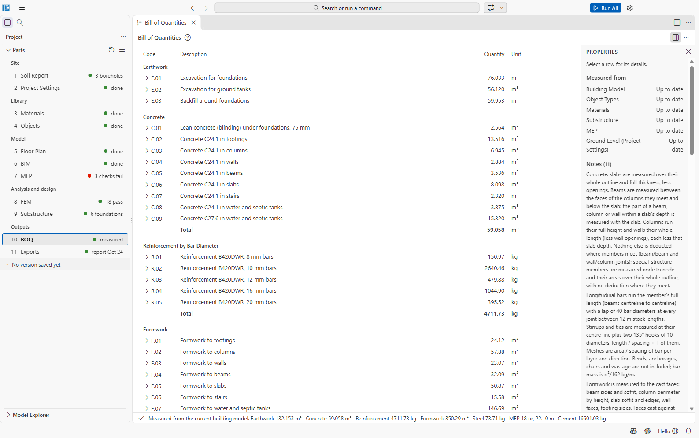

# Part 10: BOQ (Bill of Quantities)

The bill of quantities is measured from the building model, the object types and the materials
(and the substructure and MEP): concrete by grade and element, reinforcement by bar diameter,
formwork, structural steel, earthwork, masonry, MEP items, and the cement, sand, stone chips and
water of the concrete and mortar mixes. **It contains quantities only, no rates or costs.**

File: `10 BOQ/boq.json`. Open it with **10 BOQ**. The editor is **Bill of Quantities**.

## Measuring

- An empty bill shows **Measure from Building Model**. Afterwards the bill is kept; when a source
  changes it shows an **Out of date** pill (*Changed since the bill was measured: Building Model.
  Click to measure it again.*) and **Update from Building Model** becomes the main button.
- Run All measures the bill when it is out of date.
- The bill is never edited by hand: it is measured again on request and saved automatically.

## The table

Columns **Code**, **Description**, **Quantity**, **Unit**, in groups with totals:

| Group (code) | Items |
| --- | --- |
| Earthwork (E) | Excavation for foundations and ground tanks, backfill (300 mm working space each side) |
| Concrete (C) | *Lean concrete (blinding) under foundations, 75 mm*; *Concrete C24.1 in columns*, ... per grade and element kind, m³ |
| Masonry (M) | Masonry per material, m³ |
| Reinforcement by Bar Diameter (R) | *Reinforcement B420DWR, 16 mm bars*, kg |
| Formwork (F) | *Formwork to columns*, ..., m² |
| Structural Steel (S) | per section, with its kg/m, kg |
| MEP Coordination (P) | tanks, pipes, fixtures, ducts, cable trays, sleeves and openings |
| Materials: Cement, Sand, Stone Chips and Water (MT) | cement (kg) and **50 kg bags**, sand (fine aggregate, **cft**), stone chips (coarse aggregate, **cft**), water (l) |

Click a row (or Enter / Space) to expand its **breakdown by element** (Element, Story, Detail,
Quantity); the Properties panel shows the group, material, bar diameter, element count, the
quantity by storey and which sources are up to date. Right-click: **Show Breakdown**, **Copy
Quantity**, **Copy Row**, **Export CSV...**.

## Measurement rules

The bill's notes state the rules it uses:

- laps of 40 d per joint between 12 m stock bars; stirrups at their centre line plus two 135°
  hooks of 10 d; bar mass d²/162 kg/m; *bends, anchorages, chairs and wastage are not included*;
- materials from the mixes with dry-volume factors 1.54 (concrete) and 1.30 (mortar), 0.23 m³ of
  wet mortar per m³ of brickwork, cement 1440 kg/m³, sand 1600 and stone 1450 kg/m³ loose, 50 kg
  bags, 35.3147 cft per m³. These are estimating-practice values, not BNBC values; **no wastage is
  added and bags are not rounded up**;
- a material without a mix gets no cement/sand/stone take-off (add the mix in 03 Materials).
- the **architecture** (walls, rooms, doors and windows of Architecture): brickwork in m³ per
  wall type to the clear height, less openings over 0.1 m²; plaster in m² on each plastered face,
  openings up to 0.5 m² not deducted, up to 3 m² from one face, larger from both (IS 1200 Parts 3
  and 12, as the PWD schedules measure); room floor finishes and ceilings over the net floor, wall
  finishes over the room's walls less its doors and windows; doors and windows counted per type.
  The mortar of the brickwork and the plaster is taken off by its mix. A wall over a floor-plan
  wall is measured with the building model's walls, never both.

Project Settings → Drawings → **BOQ reinforcement** chooses between *Measured by the BOQ's rules*
(default) and *From the bar bending schedule* of the drawings; by default the notes reconcile the
two per bar size.

## Export

**Export CSV...** (or *Export Bill of Quantities as CSV...*) writes `11 Exports/boq.csv` (you can
choose another file): one row per item followed by one row per element of its breakdown, with
the columns `Row, Code, Group, Description, Element, Story, Detail, Item Quantity, Element
Quantity, Unit`. Open it in Excel to add rates.

## Office tools (alpha 9)

**SAEngine: Office Tools** (command palette) opens one editor with a tab per tool:

- **4D Programme**: *Generate from the Model* makes the activities from the building model and
  this bill (substructure first, then per level and tower: columns and walls, the floor, brick
  work, finishes, MEP), their durations from the quantities and `10 BOQ/productivity.json` (the
  office's output per crew-day; a made-up sample to start from), the floor cycle and casting days
  of Project Settings. Edit a duration in the table and the dates follow (critical path); *Save*
  keeps `10 BOQ/construction-schedule.json`, your edits survive generating again. Export CSV or
  MS Project XML; play it in 6 BIM.
- **Cost Optimisation**: for each member group, the cheapest section, steel grade or concrete
  strength that still passes Design Reinforcement's checks, priced with the schedule of rates;
  tick the groups to apply to 04 Objects, then run the analysis and the checks again.
- **PDF Takeoff**: add a PDF drawing, calibrate it from two points and their true length (or
  keep the scale the page states), then measure lengths (times a height for an area), areas
  (times a depth for a volume) and counts. Saved in `10 BOQ/takeoff.json`; computing the bill
  again adds them as items "measured from drawing" (codes `C.D01`, ...).
- **Site and Environment**: import the site's survey (GeoTIFF DEM, XYZ points or a DXF of
  contours) as a terrain; the cut and fill of the building platform go into the earthwork
  (`E.T01`, `E.T02`) when the bill is computed. The sun, daylight and noise studies are
  described in 6 BIM.
- **MEP Fabrication** and **Phases and Options**: see 7 MEP and 6 BIM.

## Not confirmed / limitations

- No rates, costs or xlsx export.
- There is no item named *brickwork*: brick walls are in the Masonry group, their mortar in the
  Materials group.
