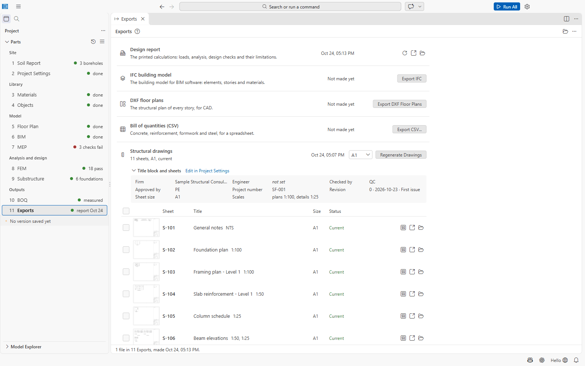
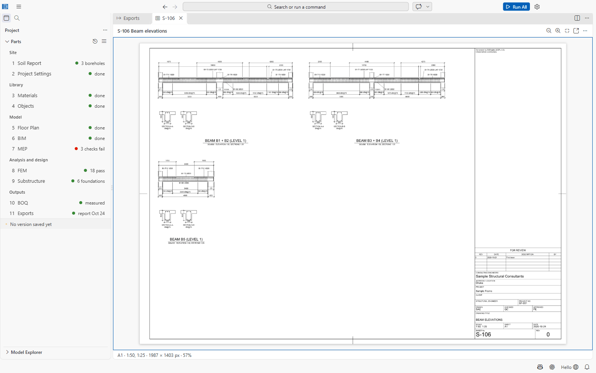

# Part 11: Exports

Part 11 is what the project hands over: the design report, the structural drawings, the building
model as IFC, the floor plans as DXF, the bill of quantities as CSV, and the project archive.
Everything is written to the `11 Exports` folder.

Open it with **11 Exports** in the sidebar (or *SAEngine: Exports*).

## The Exports page

| Row | Make it with | Writes |
| --- | --- | --- |
| **Design report** — the printed calculations: loads, analysis, design checks and their limitations | **Print Design Report** / **Update Report** | `11 Exports/report.pdf` |
| **Design report (Word)** — the same report as an editable Word file | **Export Word Report** / **Update Word Report** | `11 Exports/report.docx` |
| **IFC building model** — for BIM software | **Export IFC** | `11 Exports/IFC/<project>.ifc` |
| **DXF floor plans** — the structural plan of every storey, for CAD | **Export DXF Floor Plans** | `11 Exports/Floor Plan/` |
| **Bill of quantities (CSV)** | **Export CSV...** | `11 Exports/boq.csv` |
| **Structural drawings** | **Generate Drawings** | `11 Exports/Drawings/` |
| **Project archive (.civil)** | **Export Project (.civil)...** | where you save it |

A row that cannot be made yet says what is missing (*Build the building model (6 BIM) first.*,
*Measure the bill of quantities (10 BOQ) first.*). Each file has **Open**, **Reveal in File
Explorer** and, for DXF, **Open in LibreCAD**. The toolbar has **Open Exports Folder**.

## The design report

**Print Design Report** (Exports page, File menu, or Command Palette) typesets the report as a
PDF with Typst and opens it: *Design report written (48 pages).* Warnings are listed in the
report's *Limitations* section. It needs the analysis results (*There are no analysis results:
run the analysis first.*). Run All rewrites it every time.

Contents:

1. **Design basis:** codes and method, building and site, seismic force-resisting system,
   materials, area loads, load cases, load combinations, analysis model and analyses.
2. **Soil and foundations** (with boreholes) and **Foundations**.
3. **Analysis model:** model summary, analysis run.
4. **Analysis results:** modal periods and mass participation, base reactions per case,
   displacements and storey drifts, earthquake design from the response spectrum (scaling,
   torsion, design drift), section stiffness and second-order effects.
5. **Member design.**
6. **Bill of quantities.**
7. **Limitations and notes.**
8. **Appendix:** the design checks of every element.

### Configuring the report: templates

The report follows a **report template**: which sections it prints and in what order, their
headings, the detail (**Summary**: the results and governing values; **Full**: every table and the
calculations of each element), the cover (title, subtitle, design result, signature block, a
note), a letterhead (organisation, address lines, logo) and the members printed (kinds, storeys,
member ids, only failing members, and which elements the appendix prints). The PDF and the Word
file are drawn from the same document, so they always hold the same content.

**Configure Design Report...** (File menu or Command Palette) lists the templates. Two are built in:
*default* (every section in full) and *summary* (no appendix, the member tables cut to the
failing members and the governing one). Choosing a built-in one, or **New Template...**, writes an
editable copy to `11 Exports/report-templates/<id>.json` and opens it in its form; the form's
toolbar prints the PDF or exports Word with it, and **Print This Template for the Project** makes
it the one Print Design Report, Export Word Report and Run All use (Project Settings → Design
report → Template). A template file can be copied to another project as it is.

**Export Design Report to Word** writes `11 Exports/report.docx`. Word fills in the contents and
the page numbers when it opens the file (it may ask to update the fields).

### Calculation worksheets

A **calculation worksheet** is a hand calculation made with SAEngine's own design functions and
the project's code pack, for a member or a check the model does not cover, or to show a
calculation step by step. **New Calculation Worksheet...** (Model Explorer title bar or Command
Palette) offers the kinds:

- *Concrete*: beam in flexure, beam in shear, beam deflection, beam torsion threshold, column
  axial capacity, column slenderness (non-sway), one-way slab, two-way slab panel (BNBC's
  coefficient tables), punching shear at a column, lintel over an opening, stair flight;
- *Detailing*: development length (tension, compression, standard hook), lap splice;
- *Foundations*: isolated footing, bearing capacity (general equation), cantilever retaining
  wall;
- *Loads*: wind on a freestanding sign or wall, seismic base shear (equivalent static).

A worksheet is written to `11 Exports/worksheets/<id>.json` with the kind's default values and
opens in its editor: the inputs on the left, the calculation on the right, made again on every
change. Each step shows its expression and the clause it comes from (BNBC 2020 Part 6, or the ACI
318-19 clause BNBC adopts), then the checks with their utilisation. The title, a reference (a
member mark, grid line or drawing) and notes are what the report prints; **Print in the design
report** takes a worksheet out of the report without deleting it. **Calculation Worksheets...**
lists the project's worksheets with their result.

The design report prints the worksheets marked to print in its *Calculation worksheets* section:
the inputs, the calculation (full detail only) and the checks. A worksheet that fails, or cannot
be calculated, is named among the report's warnings. Nothing calculated is stored in the file:
the report always shows what the present inputs and code pack give.

## Structural drawings

The **Structural drawings** section of the Exports page makes the drawing set: *framing plans,
column and beam schedules, slab, footing, wall and stair details with a title block, as DXF for
LibreCAD and one PDF set, with the bar bending schedule.*

1. Fill in the **Title block and sheets** (Firm, Engineer, Checked by, Approved by, Project
   number, Revision, Sheet size, Scales) with **Edit in Project Settings** (Project Settings →
   Drawings).
2. Choose the **sheet size** (A1, A2 or A3; default A1).
3. Click **Generate Drawings**. SAEngine runs the design checks, details the reinforcement, makes
   the bar bending schedule, draws the sheets and writes DXF, PDF and previews (about 15 s for the
   sample, minutes for a large building).
4. The sheet list shows each sheet (number, title, size, *Current* or *Out of date —
   regenerate*) with a thumbnail, **Preview**, **Open in LibreCAD** and **Reveal in File
   Explorer**. **Open PDF Set** and **Bar Bending Schedule (CSV)** open the whole set.

Sheets are numbered from **S-101** in this order: general notes, foundation plan, framing plans
(one per level), slab reinforcement plans, column schedule, beam elevations, foundation details,
wall details, stair details, bar bending schedule. A plan that does not fit its scale is drawn at
the next scale (*drawn at 1:150, 1:100 does not fit*). Every plan notes *Levels are top of slab.*

If design checks fail or bars cannot be detailed, the general notes sheet says **NOT FOR
CONSTRUCTION until these are resolved: ...**. Fix the design first.

Run All regenerates the drawings when a set exists and is out of date; **the first set is always
started here**.

**Preview** opens the sheet in SAEngine (**Zoom In**, **Zoom Out**, **Fit Sheet**, **Actual
Pixels**, **Open in LibreCAD**, **Open PDF Set**).

Files in `11 Exports/Drawings/`: one DXF per sheet (`S-101 General notes.dxf`, ...),
`drawings.pdf`, `previews/*.png`, `bbs.csv` (UTF-8 with BOM, for Excel) and `drawings.json`.

### Opening the DXF sheets in CAD

The sheet DXFs are written for AutoCAD, BricsCAD and LibreCAD: layers follow the US National CAD
Standard pattern (`S-GRID`, `S-COLS`, `S-BEAM`, ...), text uses Arial, and each sheet plots
from model space and from its layout (see [docs/drawings-layers.md](../drawings-layers.md) and,
for checking them in AutoCAD, [docs/drawings-qa.md](../drawings-qa.md)). **Open in LibreCAD**
opens a sheet in the LibreCAD bundled with SAEngine (or the program in the setting
`saengine.cad.program`). **Open DXF in CAD...** (File menu) opens any DXF. DXF files also open inside SAEngine
in a read-only CAD Drawing Editor.

### Post-tensioning sheets

When slabs have post-tensioning tendons (06 BIM, Additions, Slab tendons), the set gets the PT
sheets after the slab reinforcement plans, drawn from the tendons and their forces as the PT slab
design works them out:

- **Post-tensioning plan** of each level with tendons: the tendons of each group as lines
  (distributed over their strip; banded at 300 mm centres at most, the final band positions
  being the PT supplier's), the live end as a filled triangle and the dead end as a filled
  square, and the CGS height above the soffit at each profile point;
- **Tendon profiles** at the elevation scale, heights exaggerated five times: the slab, the CGS
  (parabolic between the points), the supports at the high points, the distances and heights;
- **Tendon and stressing schedule**: per group the tendons and strands, strand area and fpu,
  bond, length, the live end(s), the live and dead anchors, the jacking force per tendon
  (fpj Aps), the lock-off force at the live anchor after the anchor set, the elongation to
  measure at each live end (∫P(x)dx / Ep Aps with the friction of ACI 318-11 18.6.2.1;
  measured elongations within 7 %, 18.20.1) and the f'ci at stressing.

### MEP sheets

When the project has building services in 07 MEP, the set gets MEP sheets after the structural
and architectural ones, drawn from `07 MEP/mep.json` as entered (nothing is sized or routed
again):

- **Plumbing and drainage plans** (`P-101` on): water, soil, waste, vent and rainwater risers on
  every story they rise through, with their size (entered, or *sized* by the plumbing sizing),
  the tanks, the roof drains and the wet rooms with their fixtures;
- **HVAC plans** (`M-`): ducts with their size, system and bottom level, duct risers, plant;
- **Electrical plans** (`E-`): equipment with its rating, electrical rooms, cable trays, busbar
  and cable risers, the lightning air terminals on the roof;
- **Fire protection plans** (`FP-`): risers, mains, pumps, the pump room, fire tanks;
- **MEP coordination plans** (`MC-`): every service on one plan with the shafts and the sleeves
  and openings through the beams, slabs and walls;
- **MEP schedules** (`MC-`): risers, equipment (with operating weights), tanks (with the water
  they hold) and the sleeves and openings.

Each plan is drawn over the grids, columns, walls and slab edges of the story and the
architectural walls, at the plan scale. The MEP sheets go stale when 07 MEP changes.

### Office standard

Project Settings → Drawings → **Office standard** sets the office's drafting standard: the
layer names (a prefix for all, or a name of its own per layer), colours and lineweights, the
text font, the dimension arrows, the sheet number prefixes of each discipline, an office address
line under the firm in the title block and a disclaimer above the status. **Save Office
Standard...** (Title block and sheets) writes it to a file; **Load Office Standard...** puts a
saved one into another project. The sheets keep SAEngine's layers while they are drawn and take
the office's names when they are written, so your own edits on a sheet are still kept when it is
drawn again. A name the standard cannot use (a name of SAEngine's scheme, one given twice, or
characters DXF does not allow) is skipped and listed with the drawings' problems.

### Bar bending schedule

`bbs.csv` lists member, bar mark, type and size, BS 8666 shape code, dimensions, number, cutting
length (rounded up to 25 mm), total length and mass, with totals per bar size.

## DXF floor plans and IFC

- **Export DXF Floor Plans** writes one DXF per storey with layers S-GRID, S-COLS, S-BEAM and
  others (also **Export DXF** in the floor plan).
- **Export IFC** writes the building model (elements, storeys, materials) as IFC.

## Revit link

**Export for Revit** writes `Revit/<project>.exchange.json` for the SAEngine Revit add-in:

- the levels and the grid lines;
- the analytical model, with each element's type;
- the designed bars (generate the drawings first, so that the bars are detailed).

**Import Changes from Revit...** reads the file the add-in writes back. It lists what was moved,
added, deleted or retyped in Revit; untick what you do not want, then apply. The changes go into
the floor plan, and a copy of the floor plan as it was is kept beside the file. Rebuild the
building model afterwards.

Reinforcement, braces and sloped members are listed but not taken back. The file format and the
full list are in [revit-link.md](../revit-link.md).

## Not confirmed / limitations

- The BS 8666 shape-code values in the bar bending schedule are marked in the code as *to be
  checked against BS 8666:2020 before the schedules are issued for fabrication*.
- Whether rafts and tie beams are drawn on the foundation plan was not confirmed.
