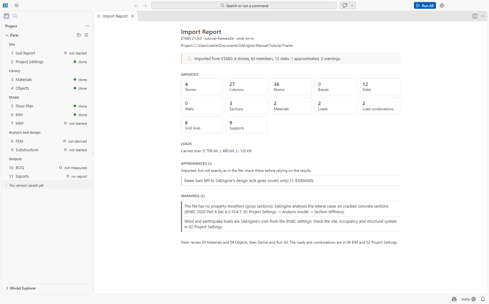

# Importing ETABS, STAAD.Pro and SAP2000 models

SAEngine creates a **new project** from the text export of another analysis program. The model
(stories, grids, members, sections, materials, supports, area loads and linear combinations) is
carried over; SAEngine's own BNBC wind and earthquake loads replace those of the file.

| Program | File | Export it there with |
| --- | --- | --- |
| ETABS | `.e2k` (also `.$et`) | File → Export → ETABS .e2k Text File |
| STAAD.Pro | `.std` | the input file itself |
| SAP2000 | `.s2k` (also `.$2k`) | File → Export → SAP2000 .s2k Text File |

See also [docs/import.md](../import.md) for the full list of what each importer reads.

## In the app

1. **Import from ETABS, STAAD or SAP2000...** (start page, File menu, or ≡ menu).
2. Pick the file, then **Choose Where to Put the Imported Project** (it starts in the folder of
   the last import) and **Name the Imported Project** (default: the file's name without its
   extension, *Office* for `Office.e2k`).
3. SAEngine writes the project and opens the **Import Report**.



The Import Report has these sections:

| Section | Meaning |
| --- | --- |
| **Imported** | what was read: stories, grid lines, columns, beams, slabs, supports, area loads, combinations, object types, materials |
| **Loads** | the loads carried over, and *Not carried over: ... (total ... kN). Add these loads in SAEngine, or check that its own loads cover them.* (point and frame loads) |
| **Approximated** | *Imported, but not exactly as in the file: check these before relying on the results.* (end releases, offsets, ribbed slabs as solid, beam bars left to SAEngine's design) |
| **Skipped** | *Not imported: add them in SAEngine if the design needs them.* |
| **Warnings** | e.g. *Wind and earthquake loads are SAEngine's own from the BNBC settings: check the site, occupancy and structural system in 02 Project Settings.* |

It ends with: *Next: review 03 Materials and 04 Objects, then Derive and Run All. The loads and
combinations are in 06 BIM and 02 Project Settings.* **Show Import Report** reopens the report of
the last import made in the app. The importers also write the report into the project as
`import-report.json`.

From the command line (the report is printed, and written to `import-report.json`):

```bash
saengine import "Office.e2k" "D:\Projects" --name "Office"
```

## What the ETABS importer reads

- **Units** from `$ CONTROLS UNITS "KN" "M" "C"` (kN, kip, kgf, tonf; m, mm, in, ft). Without a
  units line: *kN and m assumed*.
- **Stories** (`STORY ... HEIGHT` / `ELEV`), **cartesian grids** (`GRID ... DIR "X" COORD`).
- **Materials** (concrete f′c, steel Fy/Fu, rebar, E, ν, unit weight).
- **Frame sections:** concrete rectangular and circular; I, tube/box, pipe, channel, angle, tee
  steel; a designation such as `W14X90` from SAEngine's section table. Concrete T/L and general
  sections are approximated. **Column bars** from `CONCRETESECTION`; beam bars are left to
  SAEngine's design.
- **Shell properties:** slabs and walls with their thickness (ribbed/waffle and decks as solid;
  mat foundations skipped: foundations belong to 9 Substructure).
- **Points, lines, areas** and their **story assigns**. A point's third number puts it that far
  below its story.
- **Supports:** SAEngine fixes the column and wall bases of the lowest story itself. A pinned
  restraint there becomes a pinned support (the column base rotates freely); restraints elsewhere
  (a brace's foot, a support above the base) become supports too. A file **without restraints is
  an error** in the report. Point springs are not imported.
- **Walls:** a panel that is a rectangle between two stories is a wall; ETABS mesh pieces and the
  panels round doors and windows are merged into one wall with openings.
- **Releases:** steel beams and braces released in bending at both ends get a simple connection
  (fin plate or gusset; check it in 04 Objects), which pins them in the analysis. Other releases
  are reported, and the members stay continuous.
- **Property modifiers:** SAEngine has no per-member modifiers. Modifiers equal to BNBC 2020
  6.3.10.4.1's cracked factors switch on SAEngine's cracked sections; other modifiers are
  reported as not applied. A file without modifiers gets the warning *The file has no property
  modifiers (gross sections): SAEngine analyses the lateral cases on cracked concrete sections*.
- **Steel sections named only by a designation** (`SHAPE "W14X90"`): SAEngine's section table,
  then FreeCAD's profile table (American W, HEA/HEB/HEM, IPE, UPE, UB, UC, CHS, RHS and Indian
  sections), then an estimate from the name (reported as *estimated from the designation —
  check*).
- **Load patterns** (Dead and Super Dead → D/SD, Live → L, Roof Live → Lr, wind and seismic → WX,
  WY, EX, EY by the X or Y in the name; fluid patterns such as *F* or *Water* → F),
  **uniform gravity area loads** (the slabs with the most area give the floor and roof loads,
  other groups become area loads of their own on their slabs), and **linear combinations**
  (envelopes and SRSS are skipped).
- Reported but not carried: point loads and frame loads (with their totals), end offsets,
  rigid-zone factors and insertion points, the mass source where it differs from SAEngine's
  seismic weight, auto seismic and wind definitions (SAEngine's BNBC loads apply). Ignored:
  diaphragms, piers, spandrels, design preferences.

## After importing

1. Read the import report.
2. Check **02 Project Settings** (location, occupancy, structural system: the wind and earthquake
   loads are SAEngine's), **03 Materials** and **04 Objects**.
3. Run All. Then compare with the source program, as in
   [Tutorial 4](tutorials/04-etabs-import.md).

## Not confirmed / limitations

- **There is no automatic comparison** of SAEngine's results with those of the source program.
  Compare by hand (Tutorial 4 shows how).
- The importers are tested on synthetic files written from each program's published format (see
  [docs/import.md](../import.md)), not yet on exports from licensed copies. Check the first
  import of each program's export against its own model (the report's counts and the base
  reactions under D).
