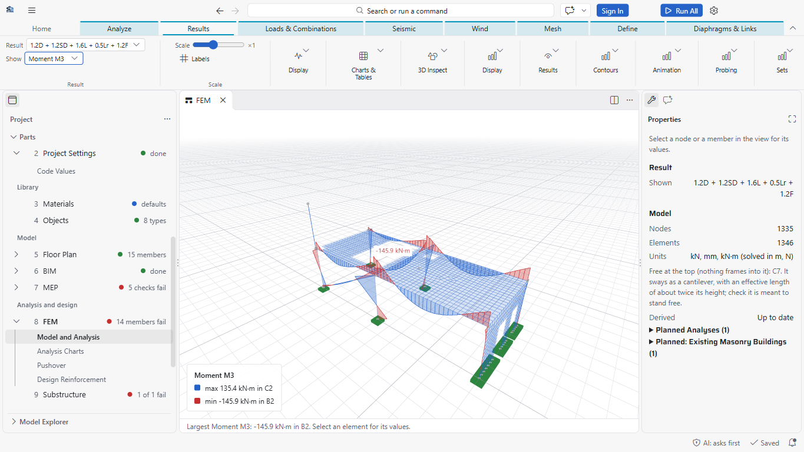
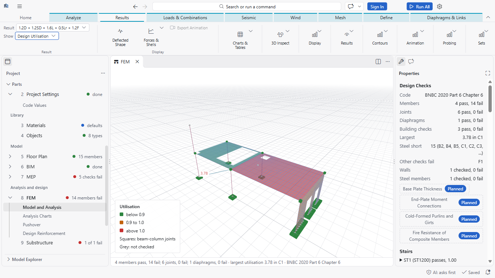
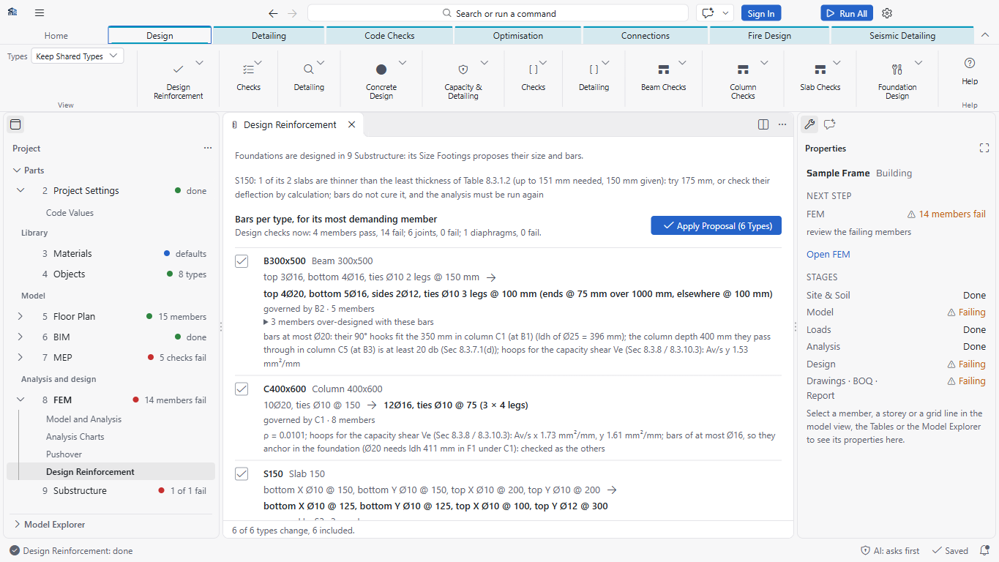
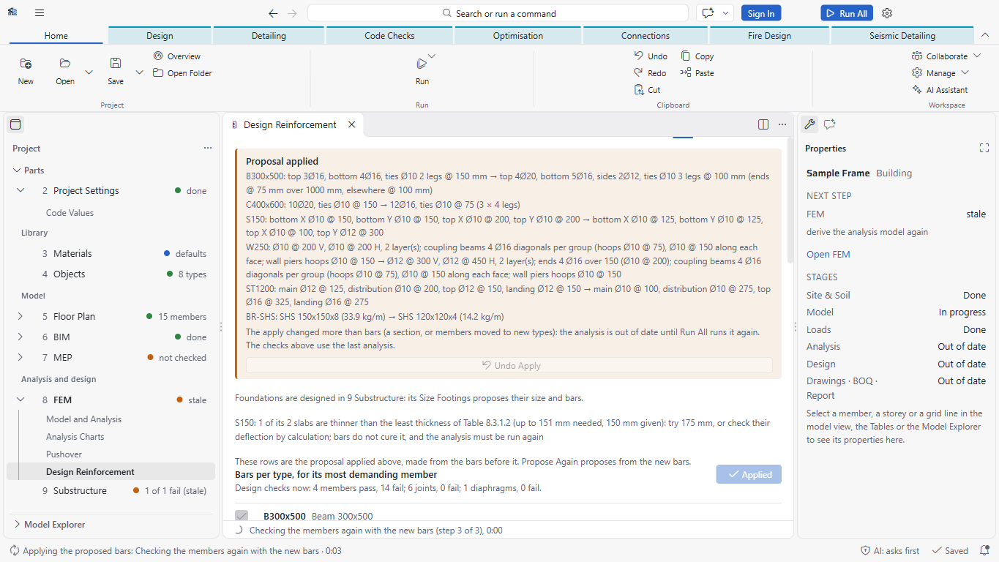
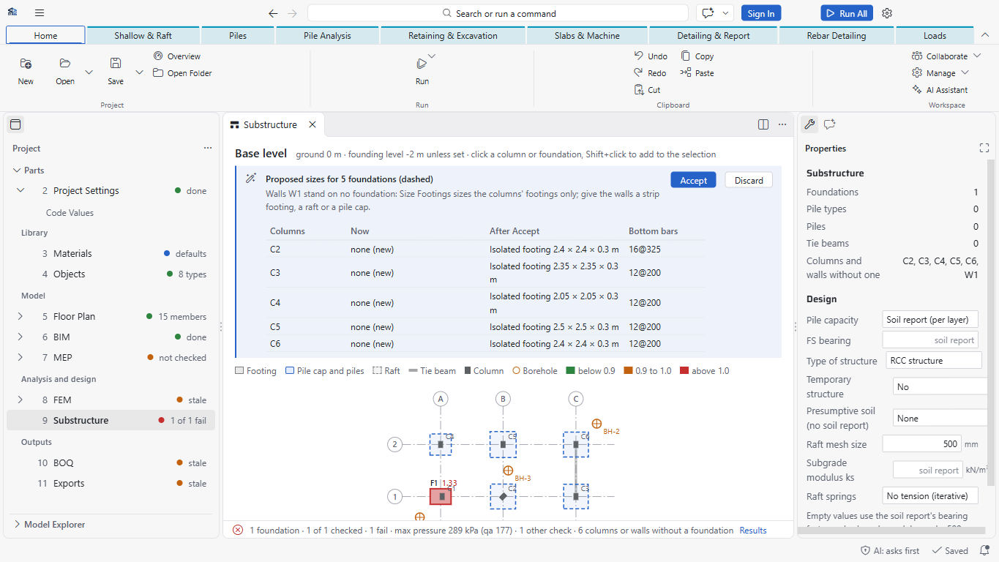
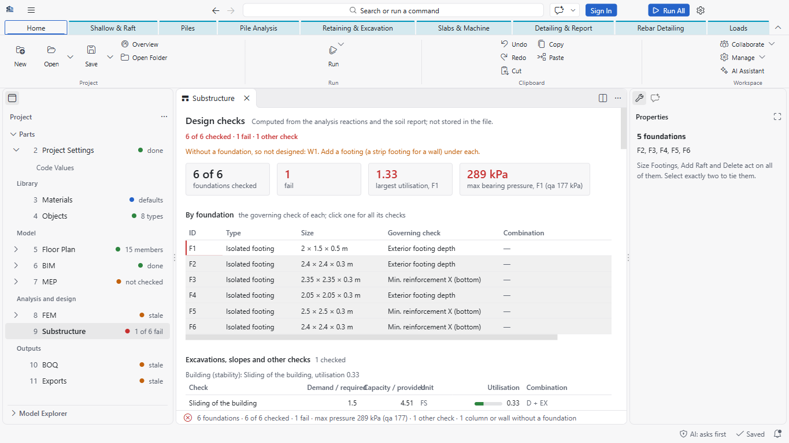
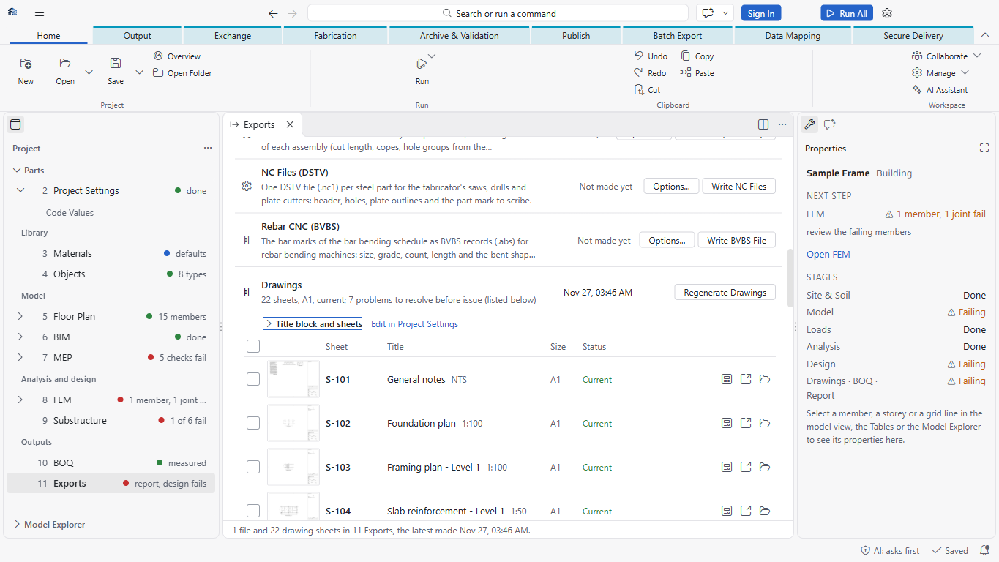
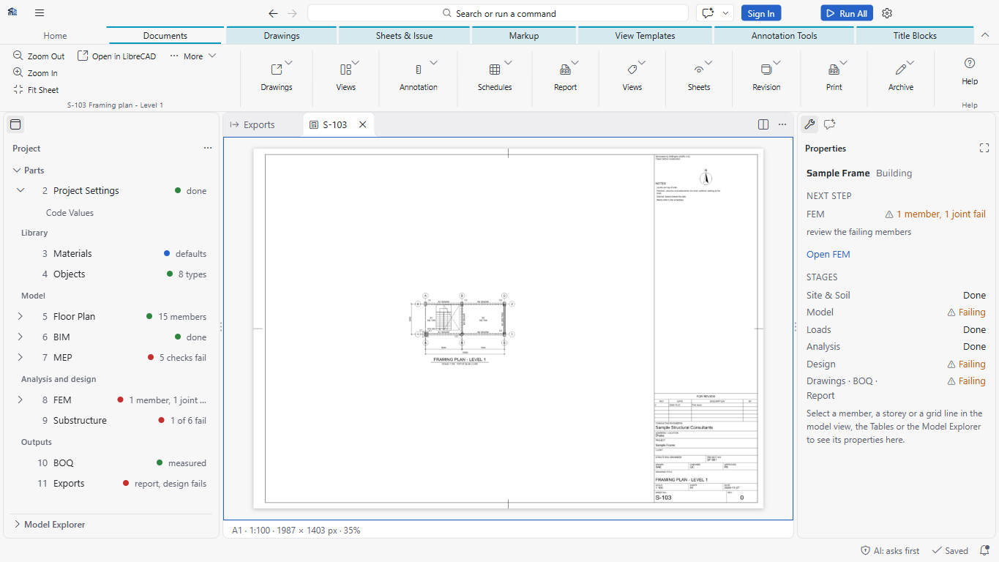

# Tutorial 1: The sample project — Run All, the design proposal, drawings

You will open the sample project, run the analysis and design of the whole building with one
click, let SAEngine propose the reinforcement, size the missing footings, read the problems the
drawings report, and produce the drawing set.

Time: about 30 minutes.

The *Sample Frame* is a small synthetic RC building: grids A–C (0, 6, 13 m) and 1–2 (0, 5 m),
storeys at 3.2, 6.4 and 10.0 m, seven columns, five beams, a wall, two slabs, a stair, a steel
brace, MEP equipment and tanks, three boreholes and one footing.

## 1. Open the sample

1. On the Start page click **Open Sample Project...**.
2. Choose a folder for your copy. SAEngine copies the sample there and opens it. Your changes go
   to the copy; the original stays untouched.

The **Overview** shows every part, and the stage bar on its Home ribbon shows where the project
stands. 8 FEM is *not derived*, so Analysis and Design are *not started*.

Take a minute to click through the parts: the boreholes in 1 Soil Report, the grids and members
in 5 Floor Plan › Plan (pick *Level 1 (+3200)* in **Home › View › Story**), and the column type
*C400x600* in 4 Objects with its bars. Click a column on the plan: Properties shows it, and the
**Tables** panel below highlights its row.

## 2. Run All

Click **Run All** in the title bar. The status bar shows the steps (*Run All 3/11: analysis*);
**Tables › Progress** lists them. When it finishes (a few minutes the first time), a notification
sums up:

*Run All done: design 4 pass, 14 fail · foundations 1 of 1 fail, 6 columns or walls without a
foundation · MEP 5 fail*

Failing checks are results, not errors: Run All went through every step. The stage bar now shows
*Analysis* done and *Design* failing.

Open **8 FEM**. On the **Results** tab choose **Result** *1.2D + 1.2SD + 1.6L + 0.5Lr + 1.2F*
and **Show** *Moment M3*: the beams' bending moments, with the extremes in the legend.

Now choose **Show** *Design Utilisation*. The members are coloured by utilisation (green below
0.9, amber to 1.0, red above), the beam-column joints are drawn as squares, and Properties lists
the checks: *Members 4 pass, 14 fail*, *Steel short 15 (B2, B4, B5, C1, C2, C3, ...)*, *Other
checks fail F1*, and the seismic design summary (*EX scaled × 1.84 to 85 % of the static base
shear*, *Largest drift 0.20 % (allowed 2.00 %)*). Click a member for each of its checks.

## 3. Let SAEngine propose the bars

1. Open **8 FEM › Design Reinforcement** in the sidebar (or **Analyze › Analysis Model › Design
   Reinforcement**). SAEngine proposes bars for every object type from the steel its members
   require, for example *C400x600: 10Ø20, ties Ø10 @ 150 → 12Ø16, ties Ø10 @ 75 (3 × 4 legs),
   governed by C1 · 8 members*. Each row says which member governs it and which members are
   over-designed with these bars.

   

2. Read the notes above the rows. Here: *S150: 1 of its 2 slabs are thinner than the least
   thickness of Table 8.3.1.2 (up to 151 mm needed, 150 mm given): try 175 mm, or check their
   deflection by calculation; bars do not cure it.* Keep it in mind for step 6.
3. Click **Apply Proposal (6 Types)**. SAEngine writes the bars to 04 Objects and checks the
   members again.

   

The bars changed the object types, so the analysis is out of date (the stage bar says so).

## 4. Size the footings

Only column C1 has a footing (F1). Open **9 Substructure**.

1. Click **Shallow & Raft › Sizing › Size Footings** with nothing selected. SAEngine sizes a
   footing under every column without one, from its reactions and the soil report's bearing
   pressure at its position, and proposes bars: *Proposed sizes for 5 foundations (dashed)*, for
   example *C2: Isolated footing 2.4 × 2.4 × 0.3 m, bottom bars 16@325*. The wall W1 gets none:
   *Size Footings sizes the columns' footings only; give the walls a strip footing, a raft or a
   pile cap.*

   

2. Click **Accept**.
3. Open the **Results** view (**Shallow & Raft › View › Results**): every foundation with its
   governing check and utilisation, then the stability of the whole building (sliding and
   overturning).

   

F1, the footing the sample came with, still fails (*Exterior footing depth*, 1.33): it is too
thin. Select it on the **Plan** and raise its **Thickness** in Properties.

## 5. Run All again, then the drawings

1. Click **Run All** again. It derives the model again (the objects changed), reruns the analysis
   and the checks: *Run All done in 0:59: design 17 pass, 1 fail · joints 1 fail · foundations 1
   of 6 fail, 1 column or wall without a foundation · MEP 5 fail*.
2. Open **11 Exports**. Check **Title block and sheets** (client, firm, engineer, checked by, ...;
   **Edit in Project Settings** changes them) and leave the sheet size at **A1**.
3. Click **Generate Drawings**. After a few seconds the sheet list shows the set: *22 sheets, A1,
   current; 7 problems to resolve before issue*, from S-101 *General notes* to the MEP sheets.

   

## 6. Read the drawing problems

The problems are listed under the sheets. Until they are resolved, the general notes sheet is
marked **NOT FOR CONSTRUCTION**. Here they are:

- *C2: Column bars into foundation, C2: 328.53 mm needed, 193 mm provided, BNBC 2020 Part 6 Sec
  8.3.11.2(a), (b); 8.2.6: not met* (and the same for C3 to C6). The footings the sizing chose
  for bearing and shear are too thin to develop the column bars. Make them thicker (about 450
  mm) in 9 Substructure.
- *Design checks: 1 of 18 members fail (S2)*: the slab of step 3's note. Make S150 175 mm thick
  in 4 Objects, or give S2 its own thicker type.
- *Design checks: 1 beam-column joint(s) fail*: select it in 8 FEM (Show *Joint Checks*) for the
  check that governs.
- *Bar congestion, joint C2 at L1: B5 top bars Ø20 past the column bars Ø16: 1.3 mm clear, 25 mm
  needed*: the bars crossing at the joint do not fit. Smaller bars, or a wider column, fix it.

Design is iterative: each fix changes the loads or the bars a little. The loop is always the
same: **change the sections or foundations → Run All → Design Reinforcement → Apply → Run All →
Regenerate Drawings**, until the list is empty and the set says *current* with no problems.

## 7. Look at the outputs

- Click the **Preview** icon of a sheet (e.g. S-103 *Framing plan - Level 1*). The sheet opens in
  its own window with the **Documents** ribbon (**Zoom In**, **Zoom Out**, **Fit Sheet**, **Open
  in LibreCAD**). **Open PDF Set** opens the whole set, **Bar Bending Schedule (CSV)** the
  schedule.

  

- **Open Report** (in Run All's notification, or *Design report* on the Exports page) opens
  `11 Exports/report.pdf`, the printed calculations.
- **10 BOQ** shows the quantities measured by the last run.

Finally, save a version: **Home › Workspace › Collaborate › Save Version**, message *Designed
bars and footings*.

## What you learned

- Run All runs the whole chain; failing checks are results, not errors.
- *Steel short* is fixed by **Design Reinforcement**; a failing foundation by **Size Footings** or
  a bigger foundation; *section too small* or a too-thin slab by a bigger section.
- After a change to the object types, Run All again.
- The drawings check the detailing (anchorage, bar congestion) and say what to fix before
  issue.
