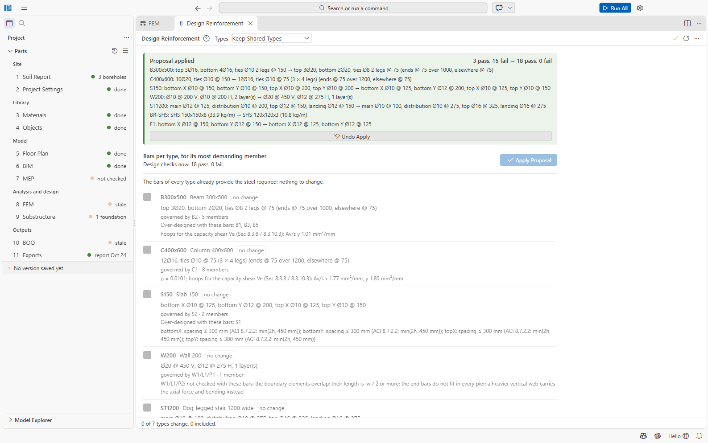

# Tutorial 1: The sample project — Run All, the design proposal, drawings

You will open the sample project, run the analysis and design of the whole building with one
click, let SAEngine propose the reinforcement, size the missing footings, resolve the problems
the drawings report, and produce the drawing set.

Time: about an hour, much of it waiting for Run All.

The *Sample Frame* is a small synthetic RC building: grids A–C (0, 6, 13 m) and 1–2 (0, 5 m),
storeys at 3.2, 6.4 and 10.0 m, seven columns, five beams, a wall, two slabs, a stair, a steel
brace, MEP equipment and tanks, three boreholes and one footing.

## 1. Open the sample

1. On the start page click **Open Sample Project...**.
2. Choose a folder for your copy (default `Documents\SAEngine Projects`). SAEngine copies the
   sample there and opens it. Your changes go to the copy; the original stays untouched.

The **Overview** shows every part. Most are *done*; 8 FEM is *not derived* and the Overview's
**Next** line says *Next: 8 FEM — derive the analysis model*.

Take a minute to click through the parts: the boreholes in 1 Soil Report, the grids and members
in 5 Floor Plan (pick *Level 1 (+3200)* in the storey picker), the column type *C400x600* in
4 Objects with its bars.

## 2. Run All

Click **Run All** in the title bar. The left of the status bar shows the steps (*Running 2 of
9: analysis*, *Running 4 of 9: design checks*, ...). Click it if you want to cancel. On a typical
PC the sample takes three to five minutes.

When it finishes, a notification sums up:

*Done: 3 pass, 15 fail; steel short in 16 element(s) · foundations 0 pass, 1 fail · MEP: failing
openings 0, open clashes 0 · plumbing: failing checks 1, ... · model derived · BOQ updated ·
report written*

The sidebar now says *8 FEM — 15 fail* and *9 Substructure — 1 fail*. Fifteen members fail
because their bars give too little steel (*steel short*): the sample's object types carry
deliberately light bars.

Open **8 FEM**. The viewport shows the analysis model; pick a combination and a result in the two
pickers, e.g. **1.2D + 1.6L + 0.5Lr** and **Moment My**.

Choose **Design Utilisation** in the second picker. After about a minute the members are
coloured green (below 0.9), amber (0.9 to 1.0) or red (above 1.0), and the Properties panel lists
the result: *3 members pass, 15 fail · largest utilisation 3.78 in C1*, *Steel short: 16 (B2, B4,
C1, ...)*, *Other checks fail: F1*. Click a red member to see its checks and its **Required
Steel**.

## 3. Let SAEngine propose the bars

1. Click **Design Reinforcement** in the FEM toolbar. SAEngine proposes bars for every object
   type from the steel its most demanding member requires (*Keep Shared Types*).
2. Read the proposal. For example *C400x600 — 10Ø20, ties Ø10 @ 150 → 12Ø16, ties Ø10 @ 75 (3 ×
   4 legs); governed by C1 · 8 members*. The brace type *BR-SHS* gets a lighter section of the
   same family (*SHS 150x150x8 → SHS 120x120x3*), and footing F1 gets new bars but also the note
   that bearing fails: *bars do not help; a larger foundation (or another type) is the remedy*.

   

3. Click **Apply Proposal (7 Types)**. SAEngine writes the bars into 4 Objects and checks again:
   *Proposal applied — 3 pass, 15 fail → 18 pass, 0 fail*. (**Undo Apply** would revert it.)

   

The analysis model is now **out of date**: the brace section changed, so its stiffness did.
You will run everything again after the foundations.

## 4. Size the footings

Footing F1 fails in bearing (*Bearing (service) 374 kPa against qa 150 kPa*) and five columns
have no foundation.

1. Open **9 Substructure**. The plan shows F1 in red and the columns C2 to C6 without footings.
2. Click **Size Footings**. SAEngine proposes footings for the five columns, drawn dashed
   (*Proposed sizes for 5 foundations*). Click **Accept**.
3. Click F1 to select it, click **Size Footings** again, and **Accept** the new size.
4. Save (**Ctrl+S**): the checks run on the saved file. The **Results** view shows *6
   foundations checked, 0 fail*.

## 5. Run All again, then the drawings

1. Click **Run All** again. It derives the model again (the objects changed), reruns the analysis
   and the checks: *Done: 18 pass, 0 fail · foundations 6 pass, 0 fail · ...*.
2. Open **11 Exports**. Check the **Title block and sheets** (firm, engineer, checked by, ...;
   **Edit in Project Settings** to change them) and leave the sheet size at **A1**.
3. Click **Generate Drawings**. After a few seconds the sheet list shows eleven sheets, S-101
   *General notes* to S-111 *Bar bending schedule (2 of 2)*.

The drawings report **5 problems to resolve before issue**, for example:

- *C1: Column bars into foundation, C1: 328.53 mm needed, 251 mm provided, BNBC 2020 Part 6 Sec
  8.3.11.2(a), (b); 8.2.6: not met.* The footings the sizing assistant chose for bearing and
  shear are too thin to develop the column bars.
- *S2: Top X bars Ø10 hooked into the edge support W1: 205.3 mm needed, 180 mm provided.* The
  200 mm wall is too thin to anchor the slab's top bars.

Until they are resolved, the general notes sheet is marked **NOT FOR CONSTRUCTION**.

## 6. Resolve the drawing problems

Design is iterative: each fix changes the loads or the bars a little, so check again after each
round. This is the sequence that resolves the sample's problems.

**Round 1: thicker footings and wall.**

1. In **9 Substructure**, click each of F1, F3, F5 and F6 and set **Thickness (mm)** to **450**
   in the Properties panel (press Enter). Save.
2. In **4 Objects**, select the wall type **W200** and set **Thickness** to **250**. Save.
3. **Run All**. Because a drawing set exists and is now out of date, Run All regenerates it at
   the end: *Done: 16 pass, 2 fail; steel short in 8 element(s) · foundations 2 pass, 4 fail ·
   ... · 11 drawing sheets drawn*.

The stiffer wall attracts more force (two members are now steel short) and the thicker footings
need more bars: in 9 Substructure → **Results** the governing check of F1, F3, F5 and F6 is now
*Min. reinforcement X (bottom)*.

**Round 2: bars again.**

4. **Design Reinforcement** → **Apply Proposal**: *16 pass, 2 fail → 18 pass, 0 fail*. The
   proposal also gives the footings heavier bars (*F3: bottom X Ø12 @ 200 → bottom X Ø20 @ 375*).
5. On the Exports page click **Regenerate Drawings**. One problem is left: *S2: Top X bars Ø16
   hooked into the edge support W1: 328.5 mm needed, 230 mm provided.* The proposal chose Ø16
   top bars, which a 250 mm wall cannot anchor. 9 Substructure shows F1 at 1.05 in bearing.

**Round 3: engineering judgement.**

6. In **4 Objects** select **S150** and change the top X bars from Ø16 @ 275 to **Ø10 @ 100**
   (about the same steel area, a much shorter anchorage). Save.
7. In **9 Substructure** select **F1** and set **Length** and **Width** to **2300**. Save.
8. **Regenerate Drawings**: *11 sheets, A1, current* — no problems left.
9. **Run All** once more so that the report and the bill of quantities match the final design.

## 7. Look at the outputs

- **Preview** a sheet (e.g. S-106 *Beam elevations*); **Open in LibreCAD** opens its DXF;
  **Open PDF Set** the whole set; **Bar Bending Schedule (CSV)** the schedule.

  

- **Open Report** (or *Design report* on the Exports page) opens `11 Exports/report.pdf`, the
  printed calculations.
- **10 BOQ** shows the quantities measured after the last run.

Finally, save a version: **Save Version...** in the ≡ menu, message *Designed bars and
footings*.

## What you learned

- Run All runs the whole chain; failing checks are results, not errors.
- *Steel short* is fixed by **Design Reinforcement**; a failing foundation by **Size Footings** or
  a bigger foundation; *section too small* by a bigger section (Tutorial 2).
- After a change to the object types, run the analysis again.
- The drawings check the detailing (anchorage, development lengths) and say what to fix before
  issue.
