# Tutorial 2: A new 6-storey RC building

You will generate a six-storey RC frame building from its grid, edit the floor plan with window
selection, Fill and Copy to Stories, check the floor loads, run the analysis and design, apply
the proposed bars, and produce the drawings and the bill of quantities.

Time: about 45 minutes.

The building: a residential frame in Dhaka, three bays of 6 m in X and two bays of 5 m in Y,
ground storey 3.6 m, five typical storeys of 3.2 m, concrete C27.6 and rebar B500DWR.

## 1. Generate the building

1. On the Start page (or **≡ › File › New Project...**) open the **New Project** wizard.
   *Start from* stays at **Grid and storeys**.
2. Fill in, step by step (**Next** goes on):

| Field | Value |
| --- | --- |
| Name | *Six Storey Demo* |
| Folder | your projects folder |
| Design code / Units | BNBC 2020 / SI (step 1) |
| Location | Dhaka (zone 2, 65.7 m/s) (step 2) |
| Site class | SD (step 2; assumed until a soil report gives one) |
| Building use / Occupancy category | Residential / II (step 2) |
| X (A, B, C ...) | `3×6000` |
| Y (1, 2, 3 ...) | `2×5000` |
| Number / ground, mm / typical, mm | `6` / `3600` / `3200` |
| System | RC frame |
| Concrete / Reinforcement | C27.6 / B500DWR |
| Footings | Isolated |

   On step 3 (Grid and Storeys) the preview draws the plan and the elevation and sums up: *3 × 2
   bays · 18.0 m × 10.0 m · 6 storeys, 19.6 m · 12 columns a floor*.

   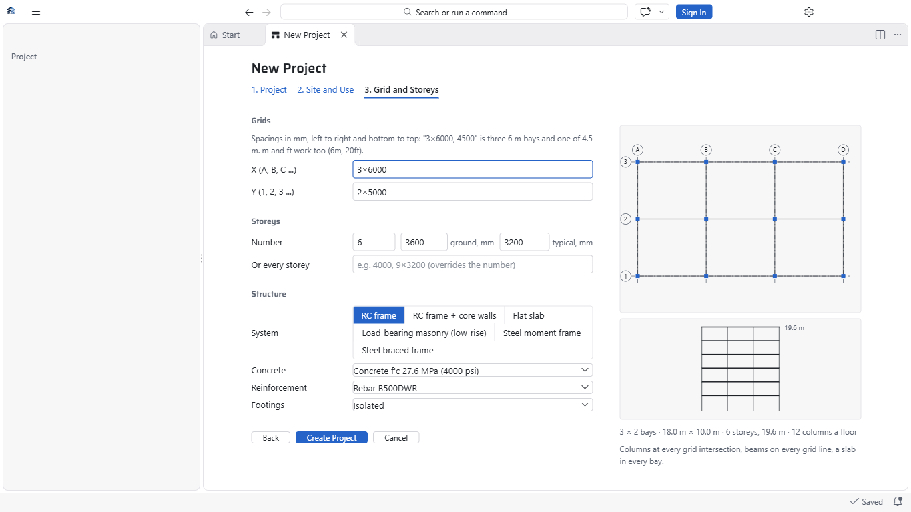

3. Click **Create Project**. The page *Six Storey Demo Is Ready* lists the **Preliminary
   Sizes**, with what governed each:

| Members | Type | Governed by |
| --- | --- | --- |
| Columns L1-L3 corner / edge / interior | C500x500 / C600x600 / C700x700 | joint shear |
| Columns L4-L6 corner | C400x400 | stiffness: drift / period |
| Columns L4-L6 edge / interior | C500x500 / C600x600 | joint shear; transition (at most 20 % smaller) |
| Beams | B275x600, B300x500 | |
| Slabs | S150 | |
| Footings | 2.5 m to 4.4 m square | an assumed bearing pressure |

   Open **How the sizes were chosen** and read the notes. The first says the site class SD is
   *assumed* until a soil report gives one. The others give the Seismic Design Category (*D,
   zone 2, site class SD assumed, occupancy category II; system RC special moment frame*), the
   drift, period and wind-sway checks the generator ran (*Before: T X 1.75 s ... Final sizes: T X
   1.10 s, Y 1.29 s ... All three met.*) and the rule behind each size.

   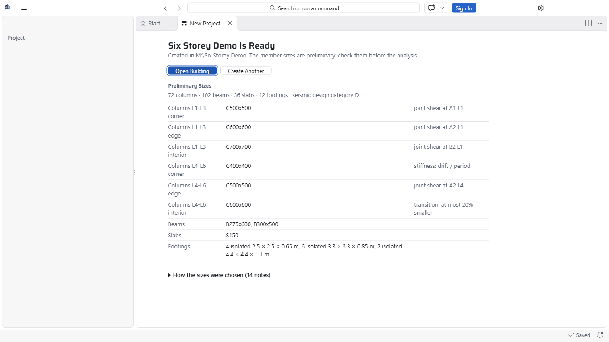

4. Click **Open Building**.

Look at what was generated:

- **4 Objects:** the column, beam and slab types above, all **without bars**.
- **5 Floor Plan:** the grids A–D and 1–3, the storeys Base and Level 1 to Level 6, a column at
  every intersection, beams on every grid line, a slab in every bay, and **typical floors**: the
  Story picker shows *Level 2 (+6800) (typical)*, *Level 3 (+10000) = Level 2*, *Level 4
  (+13200) (typical)*, *Level 5 = Level 4*, *Level 6 = Level 4*. A new family starts where the
  column types change. The members are named by grid and storey (*C-A1-L1*, *B-A1-B1-L1*,
  *S-A1-L1*).
- **9 Substructure:** twelve isolated footings.
- **2 Project Settings:** residential, Dhaka, structural system *RC special moment frame*.

## 2. Edit the floor plan

The architect needs a stair and lift void in bay **B–C / 2–3** on every floor, and a stair room
on the roof over it.

**a) Remove the slab of the void with a crossing window.**

1. Open **5 Floor Plan › Plan** and choose **Level 1 (+3600)** in **Home › View › Story**.
   **Structure › Loads › Zoom Floor Plan to Extents** fits the plan.
2. With nothing selected, drag **from right to left** inside bay B–C / 2–3, without touching the
   grid lines: a dashed *crossing* window. The status line says *Crossing window: 1 member(s)
   touched. · Selected 1: 1 slab*.

   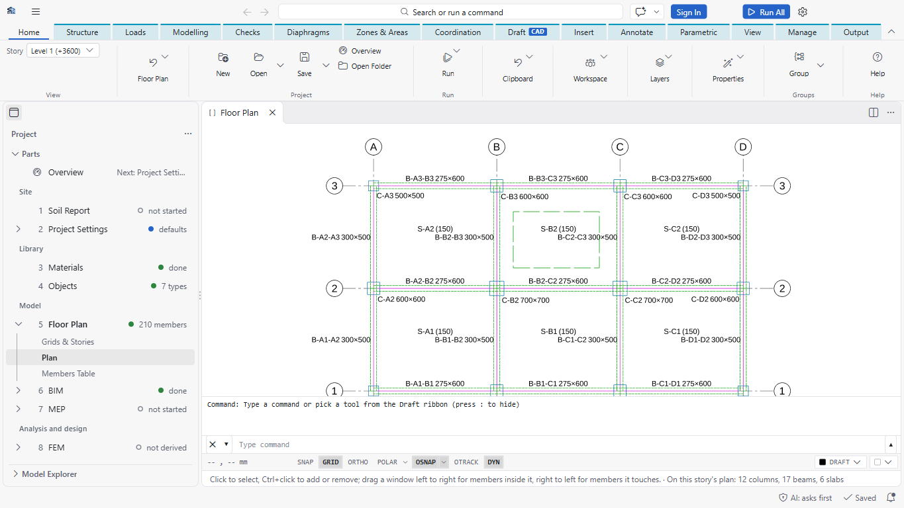

3. Press **Delete**: *Deleted 1 selected shape(s).*
4. Choose **Level 2 (+6800) (typical)**, click inside the bay to select its slab (the status
   line says *Selected 1: 1 slab*) and press **Delete**. The status line says *Typical floor
   Level 2: edits repeat on all 2 stories*: Level 3 loses its slab too.
5. Choose **Level 4 (+13200) (typical)** and do the same (Levels 5 and 6 follow).

Check the status line before you press Delete: a window drawn across a grid line also catches
the beams and columns on it. Ctrl+Z undoes a wrong delete.

**b) Add a storey for the stair room.**

6. Open **5 Floor Plan › Grids & Stories**. Under **Stories** click **Add Story** and enter ID
   *SR*, Name *Stair room*, Elevation *22400* (2.8 m above Level 6). Save (Ctrl+S).

   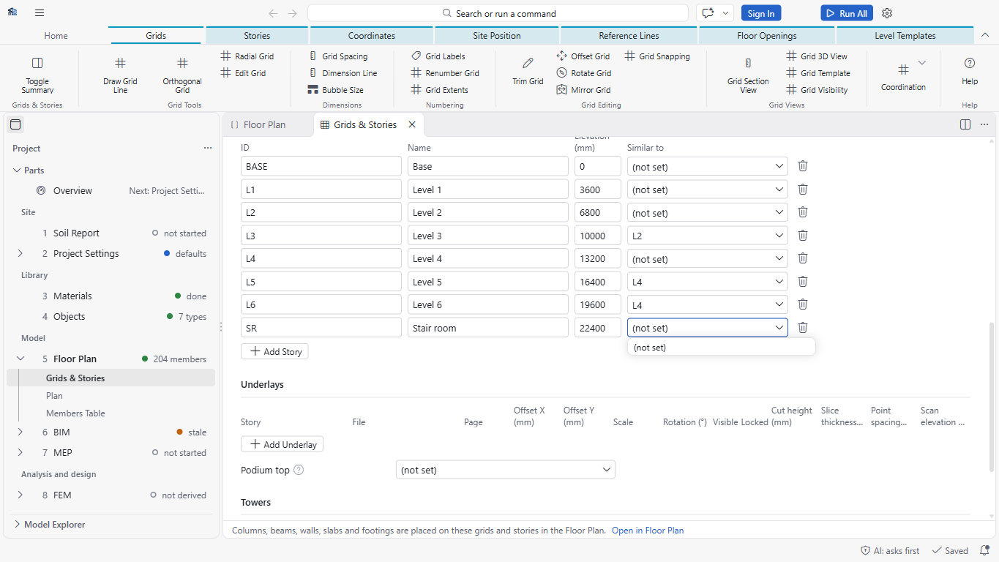

**c) Copy the frame of the bay up with a window and Copy to Stories.**

7. Back in **Plan**, choose **Level 6 (+19600) = Level 4**. Drag **from left to right** a window
   a little larger than bay B–C / 2–3: a solid *window* selects what lies fully inside: *Window:
   8 member(s) fully inside. · Selected 8: 4 columns, 4 beams*.

   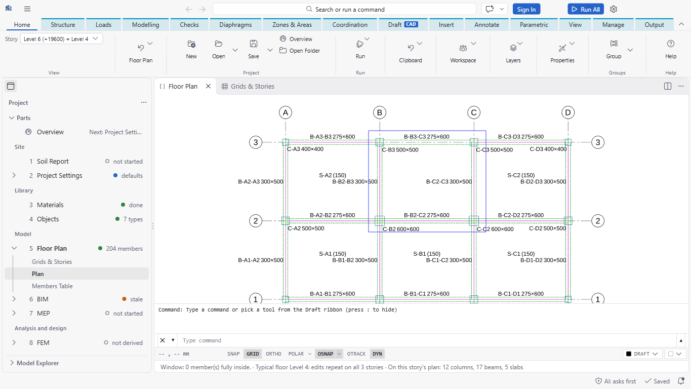

8. Click **Structure › Edit › Copy Selection to Stories...**, tick **Stair room +22400** and click
   **OK**: *Copied 8 member(s) to Stair room (and their typical floors); skipped 0 already
   there.* The copied columns rise from Level 6.

   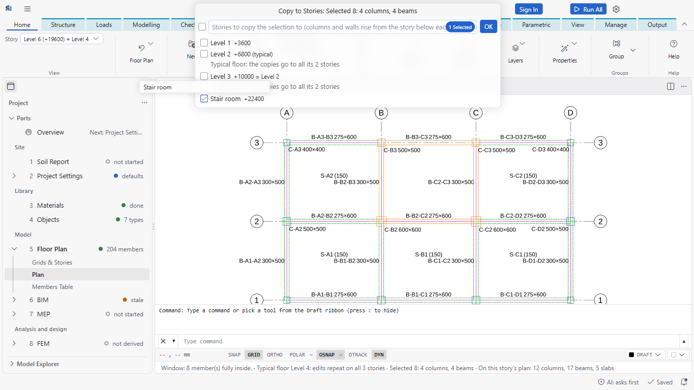

**d) Fill the roof slab of the stair room.**

9. Choose **Stair room (+22400)**. Click **Structure › Place › Fill Grid with Members**; on the
   Home tab choose **Fill** *Slabs in Bays* and **Type** *Slab 150 (S150)*.
10. Drag a window over the bay: *Placed 1.* Press Esc and save (Ctrl+S).

    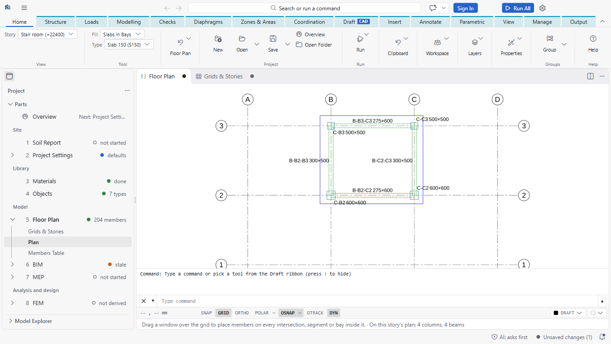

The same tools work at any scale: **Fill › Columns at Intersections** over the whole grid places
every column of a storey in one drag, and the command line (press **:**) takes `fill beams`,
`copy 6000,0 3` or `tostories all`.

## 3. Floor loads

Open **2 Project Settings › Loads, Load Patterns and Crane Runways**, section **Area Loads**. The
generator set the residential floor load:

| Area load | Use | Live | Floor finish | Partitions |
| --- | --- | --- | --- | --- |
| FL Floors | Residential | 2.0 | 1.2 | 1.2 |
| ST Stairs | Stairs | 4.8 | 1.2 | 0 |
| RF Roof | Roof | 1.0 | 1.5 | 0 |

Change them to your project's values (for example a heavier floor finish), and check that
**Floors** is *FL* and **Roof** is *RF*. A live load below the code minimum for the use is
flagged. Save.

Self-weight is computed from the sections. Brick walls on beams are line loads on the floor plan
(**Structure › Loads › Add Line Load on Selected Beams**); see
[Floor Plan › Loads](../05-floor-plan.md#loads).

## 4. Run All

1. Open **6 BIM**: the status line says *the Floor Plan changed since it was built*. Click
   **Rebuild** to look at the building in 3D (Run All would rebuild it anyway).

   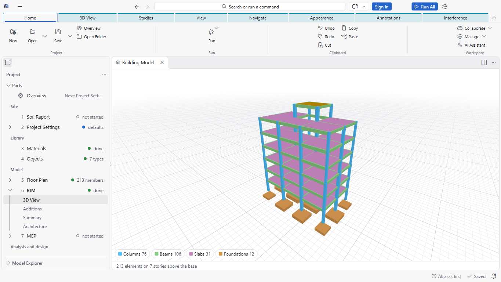

2. Click **Run All**. The analysis takes seconds. Then Run All stops:

   *Run All: step 6 of 11 (design checks) failed: The design checks checked nothing: the object
   types B275x600, B300x500, C400x400, C500x500, C600x600, C700x700 have no bars (8 FEM, Design
   Reinforcement proposes them). 2 steps not run.*

   This is expected: the generated types have no bars, and Run All never writes bars itself.

## 5. Let SAEngine propose the bars

1. Click **Design Reinforcement** in the notification (or open **8 FEM › Design
   Reinforcement**). After about a minute every type has a proposal, for example:

   - *B275x600: no bars → top 4Ø16, bottom 4Ø12, stirrups Ø8 3 legs @ 175 mm (ends @ 75 mm over
     1200 mm), governed by B-A2-B2-L1 · 56 members*
   - *C700x700: no bars → 16Ø20, ties Ø10 @ 100 (3 legs), governed by C-B2-L1 · 6 members, ρ =
     0.0103*
   - *S150: no bars → bottom X Ø10 @ 300, ...*: *The design checks checked none of its members:
     left out unless you include it.*

   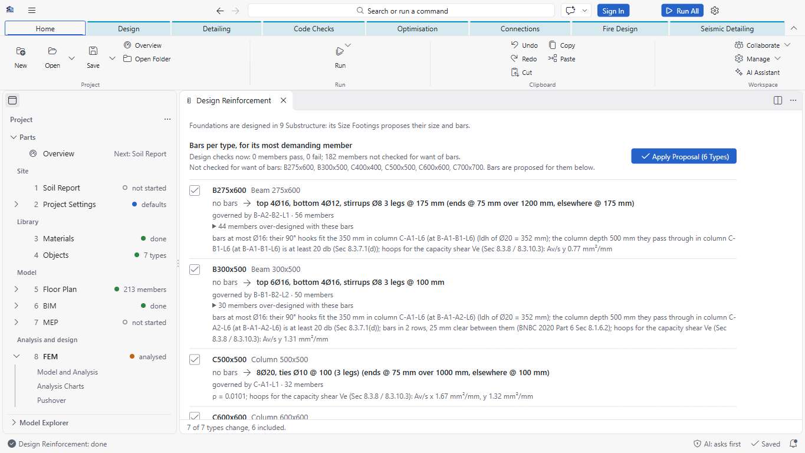

2. Click **Design › Design Reinforcement › Include All Changes**, then **Apply Proposal**:
   *0 members pass, 0 fail; 182 members not checked for want of bars → 182 members pass, 0 fail;
   76 joints, 0 fail; 7 diaphragms, 0 fail*.

   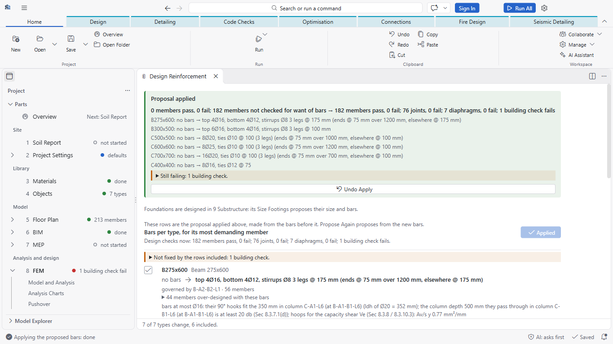

3. **Run All** again: *design 182 pass, 0 fail · foundations 12 of 12 without a bearing check*.
   The footings wait for a soil report ([Tutorial 3](03-soil-and-footings.md)).

Open **8 FEM**, **Results › Show › Design Utilisation**: every member is green or amber; the
largest utilisation is 0.89 in B-B1-B2-L2.

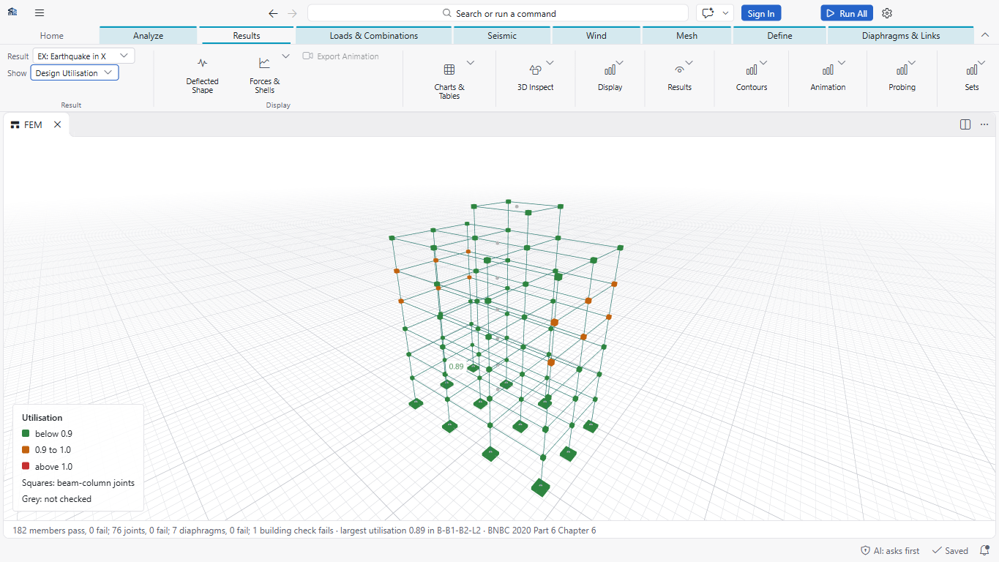

If a type comes out **section too small**, the proposal cannot include it and says what to try
(for example *try 500 x 500 mm (+100 mm)*). Enlarge that type in 4 Objects (or give some members a
new, bigger type), **Run All**, and run the proposal again; see
[8 FEM](../08-fem.md#when-a-section-is-too-small). The loop is always the same: **enlarge what
is too small or over the steel limit → Run All → Design Reinforcement → Run All**. Save a version
(**Home › Workspace › Collaborate › Save Version**) after each round.

## 6. Drawings and bill of quantities

**Bill of quantities.** Run All measured the bill: open **10 BOQ**. It lists earthwork, concrete
by grade and element (columns, beams, slabs, footings), reinforcement by bar diameter, formwork,
and the cement (kg and 50 kg bags), sand and stone chips (cft) of the mixes. Click a row for its
breakdown by element and storey; **Quantities › Export › Export CSV** writes
`11 Exports/boq.csv` for your rates.

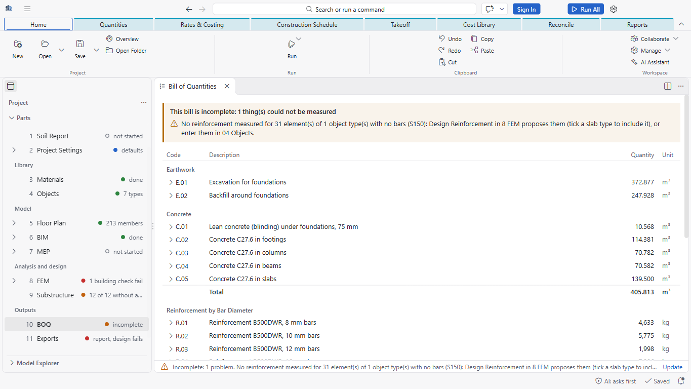

**Drawings.** Open **11 Exports**, check the **Title block and sheets**, and click **Generate
Drawings**. For this building the set has **42 sheets** on A1: general notes, the foundation
plan, the framing plans (Levels 1 to 6 on one sheet, the stair room on its own), slab
reinforcement plans two levels per sheet, the column schedule, beam elevations on four sheets,
foundation details on six and the bar bending schedule. Fill in **Firm**, **Engineer**,
**Checked by** and the other title-block fields (*not set* here) before issuing.

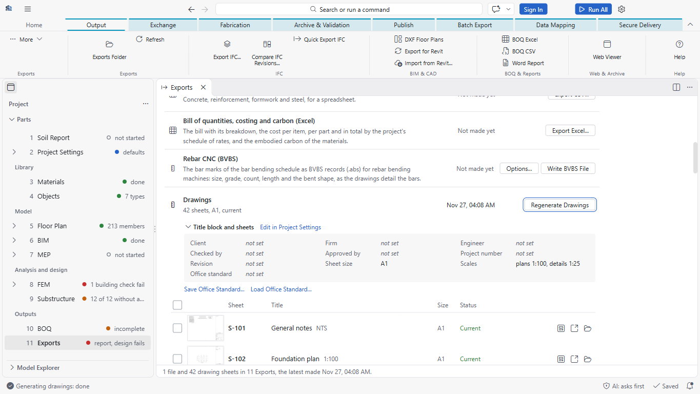

## What you learned

- New Project from the grid gives a complete model with preliminary sizes, checked for drift,
  period and joint shear, in one step.
- Window (left to right) and crossing (right to left) selection, Fill, and Copy to Stories.
- Floor loads are area loads in Project Settings.
- Run All stops at the design checks while the types have no bars; **Design Reinforcement**
  proposes them, and Run All checks them.
