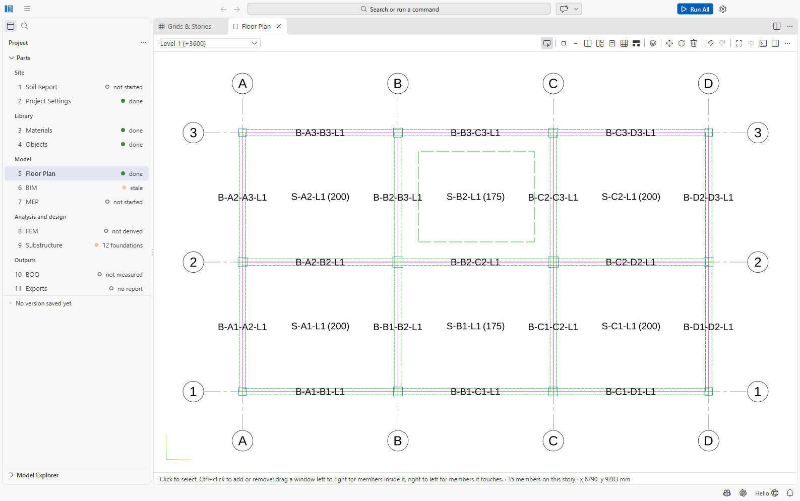
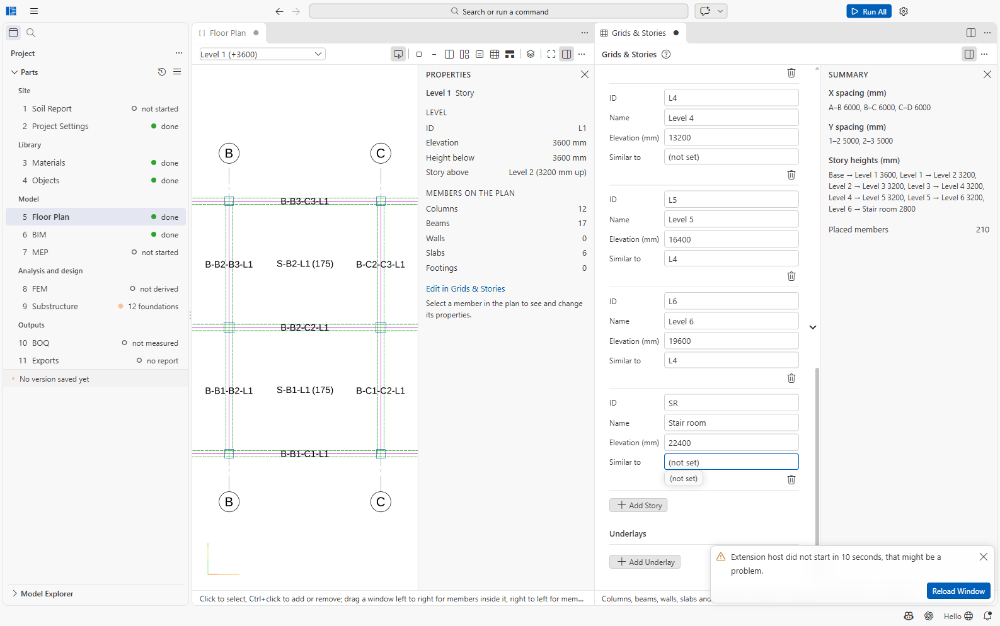
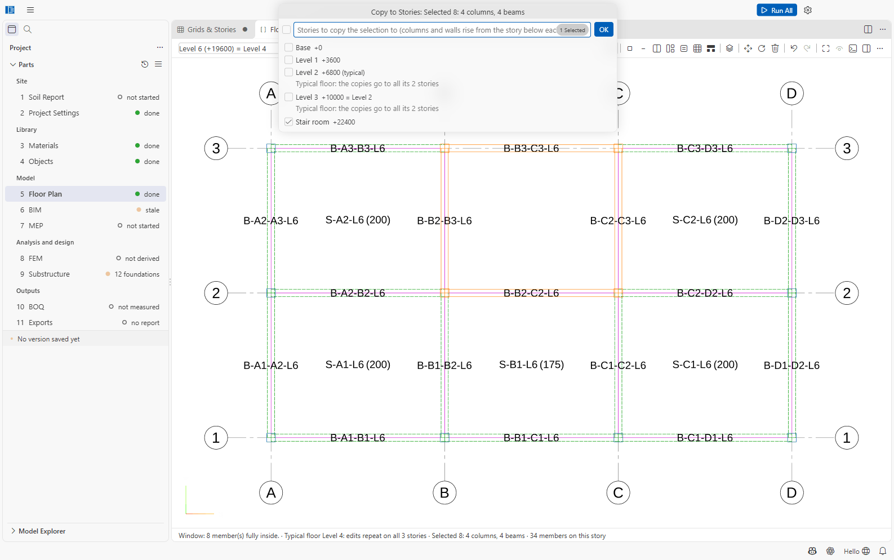
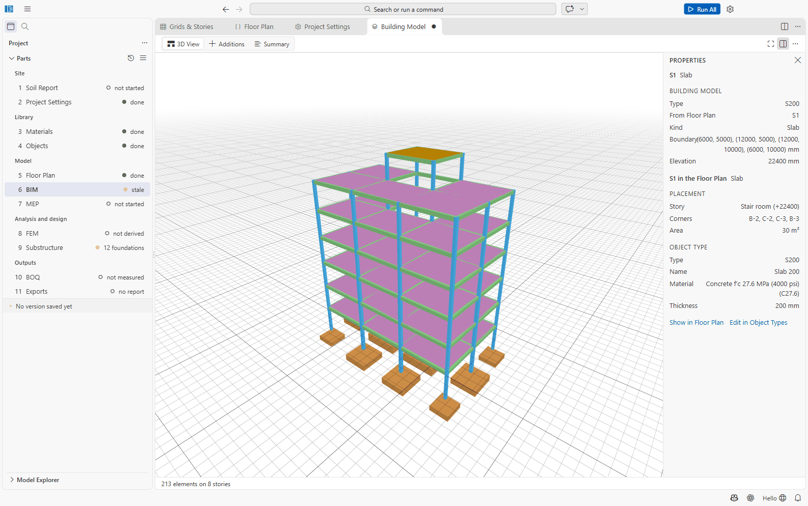
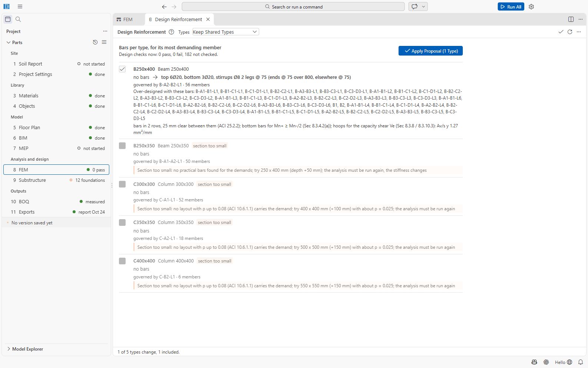
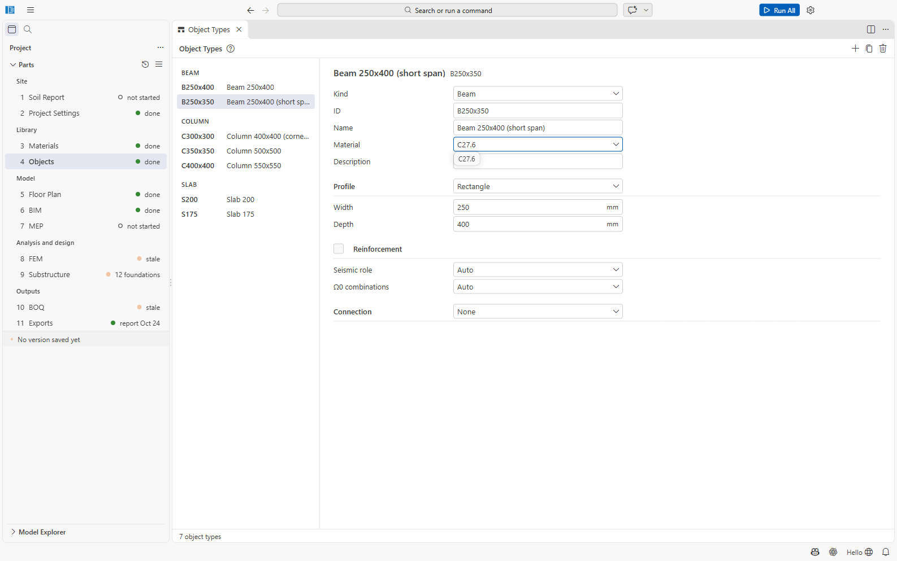
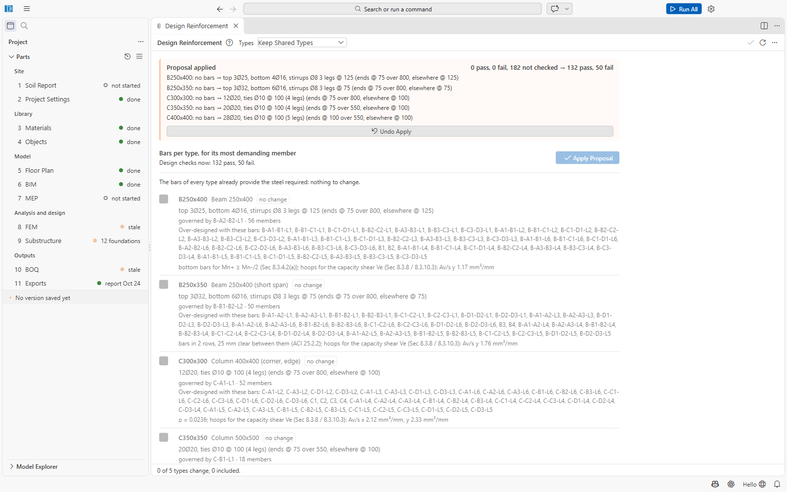
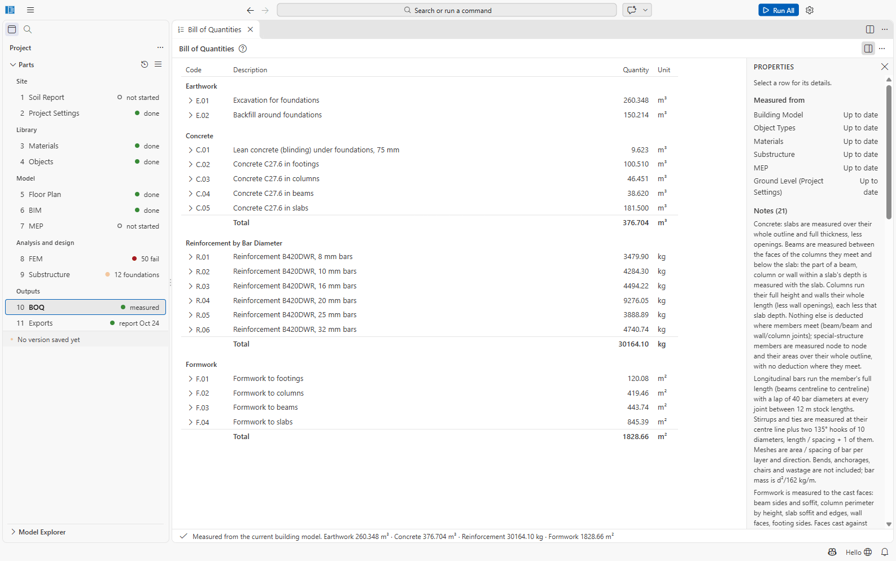
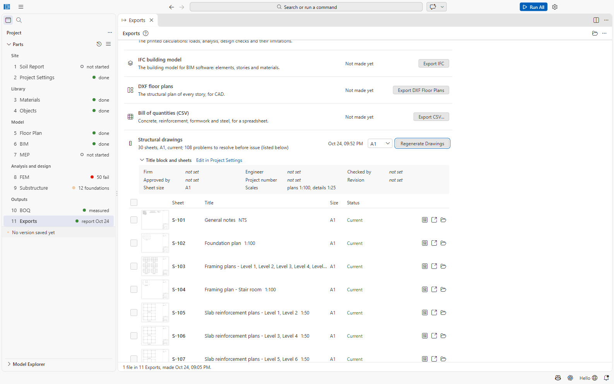

# Tutorial 2: A new 6-storey RC building

You will generate a six-storey RC frame building from its grid, edit the floor plan with window
selection, Fill and Copy to Stories, set the floor loads, run the analysis and design, fix the
columns that come out *section too small*, and produce the drawings and the bill of quantities.

Time: about 1.5 hours, much of it waiting for Run All.

The building: a residential frame in Dhaka, three bays of 6 m in X and two bays of 5 m in Y,
ground storey 3.6 m, five typical storeys of 3.2 m, concrete C27.6 and rebar B500DWR.

## 1. Generate the building

1. On the start page (or ≡ → **New Building from Grid...**) open the **New Building** wizard.
2. Fill in:

| Field | Value |
| --- | --- |
| Name | *Six Storey Demo* |
| Folder | your projects folder |
| X (A, B, C ...) | `3×6000` |
| Y (1, 2, 3 ...) | `2×5000` |
| Number / ground, mm / typical, mm | `6` / `3600` / `3200` |
| System | RC frame |
| Concrete / Reinforcement | C27.6 / B500DWR |
| Footings | Isolated |
| Location | Dhaka (zone 2, 65.7 m/s) |
| Building use / Occupancy category | Residential / II |

   The preview draws the plan and the elevation and sums up the bays, storeys and columns.

   

3. Click **Create Building**. The page *Six Storey Demo Is Ready* lists the **Generator Notes**:
   how each preliminary size was chosen. Read them, then click **Open Building**.

   The first note is a warning worth reading:

   > *WARNING - Seismic Design Category D: the column sizes are for GRAVITY ONLY. The earthquake
   > moments (and, in a special moment frame, the strong-column / weak-beam and joint rules)
   > usually govern the columns here, the corner and edge ones most. Expect Design mode to
   > report some columns as 'section too small': enlarge those column types (Members Table or
   > 04 Objects) after the first Run All.*

   The other notes give the Seismic Design Category (*D, zone 2, site class SD, occupancy
   category II; system RC special moment frame*) and the rule behind each size.

The project opens at the floor plan (if the plan is still blank, click **5 Floor Plan** in the
sidebar again). Look at what was generated:

- **4 Objects:** column types C300x300, C350x350 and C400x400 (by storey group and position:
  interior, edge, corner), beam types B250x400 and B250x350, slab types S200 and S175 — all
  **without bars**.
- **5 Floor Plan:** the grids A–D and 1–3, the storeys Base and Level 1 to Level 6, a column at
  every intersection, beams on every grid line, a slab in every bay, and **typical floors**: the
  storey picker shows *Level 2 (+6800) (typical)*, *Level 3 (+10000) = Level 2*, *Level 4
  (+13200) (typical)*, *Level 5 = Level 4*, *Level 6 = Level 4*. A new family starts where the
  column types change.
- **9 Substructure:** twelve isolated footings sized for an assumed qa = 100 kPa.
- **2 Project Settings:** residential, Dhaka, structural system *RC special moment frame*.

## 2. Edit the floor plan

The architect needs a stair and lift void in bay **B–C / 2–3** on every floor, and a stair room
on the roof over it.

**a) Remove the slab of the void with a crossing window.**

1. In the storey picker choose **Level 1 (+3600)**. Click **Zoom Extents**; hide the Properties
   panel if you want more room.
2. With the **Select** tool, drag **from right to left** inside bay B–C / 2–3, without touching the
   grid lines: a dashed *crossing* window. The status line says *Crossing window: 1 member(s)
   touched. · Selected 1: 1 slab*.

   

3. Press **Delete**: *Deleted 1 member(s).*
4. Choose **Level 2 (+6800) (typical)** and do the same. The status line says *Typical floor
   Level 2: edits repeat on all 2 stories*: Level 3 loses its slab too.
5. Choose **Level 4 (+13200) (typical)** and do the same (Levels 5 and 6 follow).

**b) Add a storey for the stair room.**

6. In **...** choose **Edit Grids and Stories**. Under the storeys click **Add Story** and enter ID
   *SR*, Name *Stair room*, Elevation *22400* (2.8 m above Level 6). Close the form and save.

   

**c) Copy the frame of the bay up with a window and Copy to Stories.**

7. Choose **Level 6 (+19600) = Level 4**. Drag **from left to right** a window a little larger
   than bay B–C / 2–3: a solid *window* selects what lies fully inside: *Window: 8 member(s)
   fully inside. · Selected 8: 4 columns, 4 beams*.

   

8. In **...** choose **Copy Selection to Stories...**, tick **Stair room+22400** and click **OK**:
   *Copied 8 member(s) to Stair room (and their typical floors); skipped 0 already there.* The
   copied columns rise from Level 6.

   

**d) Fill the roof slab of the stair room.**

9. Choose **Stair room (+22400)**. Click **Fill**; in the pickers next to it choose **Slabs in
   Bays** and the type **Slab 200 (S200)**.
10. Drag a window over the bay: *Placed 1.* Press Esc and save (Ctrl+S).

    

The same tools work at any scale: **Fill → Columns at Intersections** over the whole grid places
every column of a storey in one drag, and the command line (press **:**) takes `fill beams`,
`copy 6000,0 3` or `tostories all`.

## 3. Floor loads

Open **2 Project Settings → Area Loads**. The generator set the residential floor load:

| Area load | Use | Live | Floor finish | Partitions |
| --- | --- | --- | --- | --- |
| FL Floors | Residential | 2.0 | 1.2 | 1.0 |
| RF Roof | Roof | 1.0 | 1.5 | — |

Change them to your project's values (for example a heavier floor finish), and check that
**Floors** is *FL* and **Roof** is *RF*. A live load below the BNBC minimum for the use is
flagged. Save (Ctrl+S).

Self-weight is computed from the sections; there are no load entries on the plan.

## 4. Build and Run All

1. Open **6 BIM** and click **Rebuild from Floor Plan** (it is highlighted because you edited
   the plan). Check the building in the **3D View**.
2. Click **Run All**. A six-storey building takes noticeably longer than the sample (several
   minutes to a quarter of an hour, depending on the PC).

   On the PC used for this manual it took about 20 minutes, most of it in the design checks.

   

The result:

*Done: 0 pass, 0 fail, 36 section(s) too small · foundations 0 pass, 0 fail · model derived ·
BOQ updated · report written*

No member passes or fails yet: the generated types have **no bars**, so the checks report the
steel each member requires. But 36 columns are **too small**: no practical bars can carry their
demand. Open **8 FEM** and choose **Design Utilisation**: the Properties panel lists them under
**Too small** (*C-A1-L1, C-A3-L1, C-D1-L1, ...*: corner and edge columns of the lower storeys
first, as the generator warned) and every type under **No bars yet**. The response-spectrum
summary shows the earthquake governs: *EX scaled × 3.22 to 85 % of the static base shear*, and
the largest design drift is 1.67 % against 2.00 % allowed.

## 5. Fix the columns that are "section too small"

1. Click **Design Reinforcement**. The proposal can only give bars to the beam type B250x400
   (*Apply Proposal (1 Type)*); the other types are marked **section too small** with a
   suggestion:

| Type | Members | Message |
| --- | --- | --- |
| C300x300 | 52 | *Section too small: no layout with ρ up to 0.08 (ACI 10.6.1.1) carries the demand; try 400 x 400 mm (+100 mm) with about ρ = 0.025; the analysis must be run again* |
| C350x350 | 18 | *... try 500 x 500 mm (+150 mm) ...* |
| C400x400 | 6 | *... try 550 x 550 mm (+150 mm) ...* |
| B250x350 | 50 | *Section too small: no practical bars found for the demands; try 250 x 400 mm (depth +50 mm); the analysis must be run again, the stiffness changes* |

   

   Do not apply yet: the bars of B250x400 would be designed for forces that change when the
   columns grow.

2. Click **Open Object Types** (or open **4 Objects**). For each type, select it and change
   **Width** and **Depth** as suggested, and its **Name** so that it still describes it:
   C300x300 → 400 × 400, C350x350 → 500 × 500, C400x400 → 550 × 550, B250x350 → 250 × 400. The IDs
   stay the same, so every member on the floor plan keeps its type. Save.

   

   To give only some members a bigger section, create a new type instead (**Duplicate**) and
   assign it to those members on the floor plan (select them, then **Type** in the Properties
   panel, or the Members Table).

3. **Run All** again: the model is derived again (the stiffness changed) and every member is
   checked again.

   *Done: 0 pass, 0 fail · foundations 0 pass, 0 fail · model derived · BOQ updated · report
   written* — no section is too small any more; every type still waits for its bars.

4. **Design Reinforcement** again. Now all five frame types get bars (*Apply Proposal (5
   Types)*), for example *C300x300: no bars → 12Ø20, ties Ø10 @ 100 (4 legs)* and *B250x400: no
   bars → top 3Ø25, bottom 4Ø16, stirrups Ø8 3 legs @ 125*. Click **Apply Proposal**: *0 pass, 0
   fail, 182 not checked → 132 pass, 50 fail*. The proposal then says *The bars of every type
   already provide the steel required: nothing to change.*

   

5. **Run All** once more (the bars are new, and the model is out of date):
   *Done: 132 pass, 50 fail; steel short in 6 element(s) · ...*

**Why 50 still fail, and what to do.** Open the report (`11 Exports/report.pdf`, chapter *Member
design*): every failing element is a beam of type **B250x350**, governed by *Detailing: Largest
steel ratio, top (8.3.4.2(a))*: 3.0 % against the 2.5 % that BNBC 2020 Sec 8.3.4.2(a) allows in
the beams of a special moment frame. The proposal had to put 3Ø32 on top of a 250 × 400 beam to
carry the earthquake moments. More bars cannot fix a steel-ratio limit: the beam needs a bigger
section, exactly like the columns before.

6. In **4 Objects** make **B250x350** wider and deeper (for example 300 × 450), save, **Run All**,
   **Design Reinforcement → Apply Proposal**, and **Run All** again. Repeat until 8 FEM reports
   no failing member. The six *steel short* elements are marginal (for example *required 1476.6
   mm², provided 1472.6 mm²*) and are fixed by applying the proposal after the last analysis.

The manual's walk-through stops at this point; the loop is always the same: **enlarge what is
too small or over the steel limit → Run All → Design Reinforcement → Run All**.

> On the PC used for this manual each Run All of this building took 20 to 35 minutes, most of it
> in the design checks; the checks run again whenever you choose *Design Utilisation* after a
> change. Plan the iterations, and save a version (≡ → **Save Version...**) after each one.

## 6. Drawings and bill of quantities

**Bill of quantities.** Run All measured the bill: open **10 BOQ**. It lists earthwork, concrete
by grade and element (columns, beams, slabs, footings), reinforcement by bar diameter, formwork,
and the cement (kg and 50 kg bags), sand and stone chips (cft) of the mixes. Click a row for its
breakdown by element and storey; **Export CSV...** writes `11 Exports/boq.csv` for your rates.

**Drawings.** Open **11 Exports**, check the **Title block and sheets**, and click **Generate
Drawings** (it runs the design checks first, so it takes as long as they do). While members
still fail, the general notes sheet says **NOT FOR CONSTRUCTION until these are resolved: ...**
and the problems are listed under the sheet list: finish step 5 first, then **Regenerate
Drawings**.

For this building, at the state where the walk-through stopped, the set has **30 sheets** on A1
(*30 sheets, A1, current; 108 problems to resolve before issue*): general notes, the foundation
plan, framing plans (*Framing plans - Level 1, Level 2, ... Level 6* on one sheet, and the stair
room's own), slab reinforcement plans two levels per sheet, the column schedule, beam elevations
on four sheets, foundation details and the bar bending schedule. Fill in **Firm**, **Engineer**,
**Checked by** and the other title-block fields (*not set* here) before issuing.

## What you learned

- New Building from Grid gives a complete model with preliminary sizes in one step.
- Window (left to right) and crossing (right to left) selection, Fill, and Copy to Stories.
- Floor loads are area loads in Project Settings.
- *Section too small* is fixed in 4 Objects (a bigger section), followed by Run All and Design
  Reinforcement.
