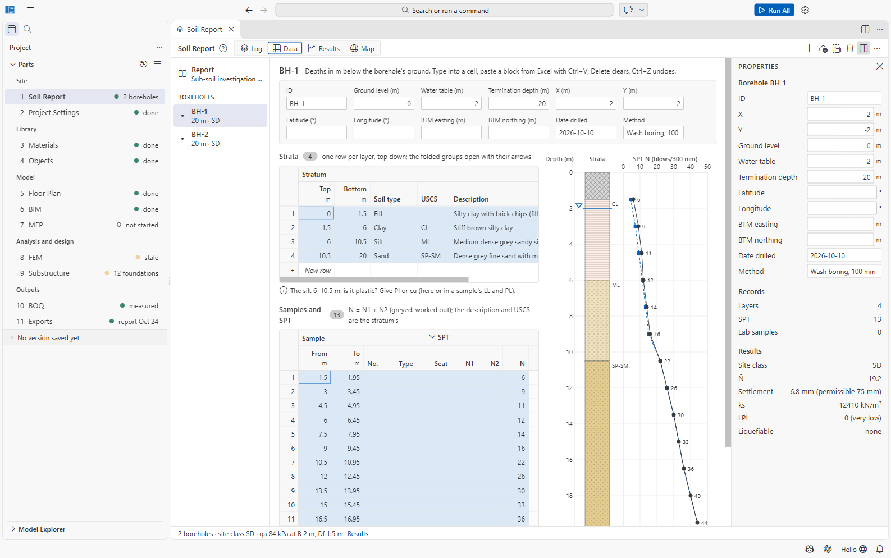
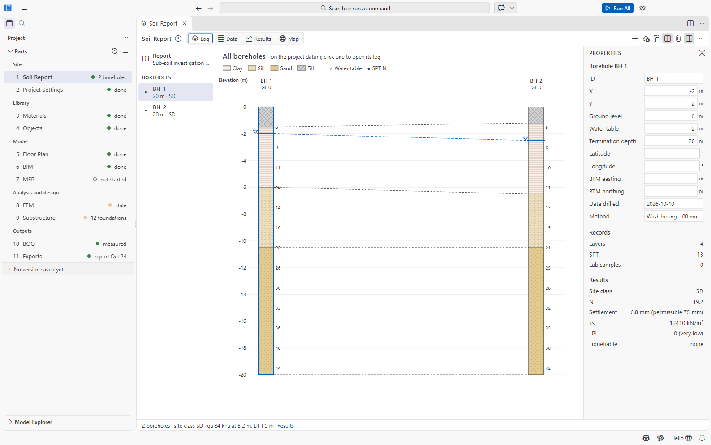
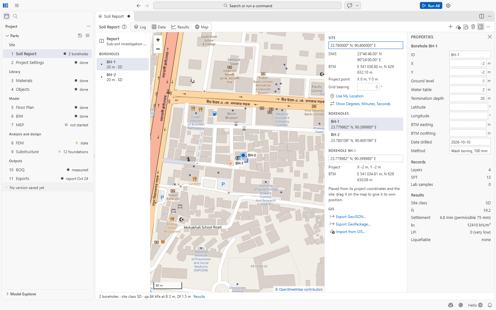
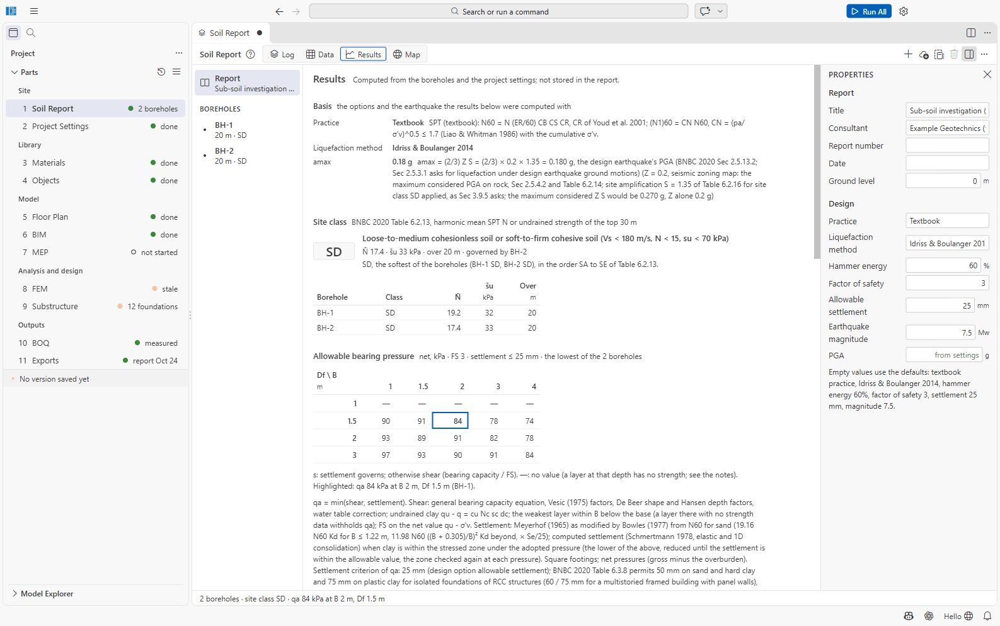
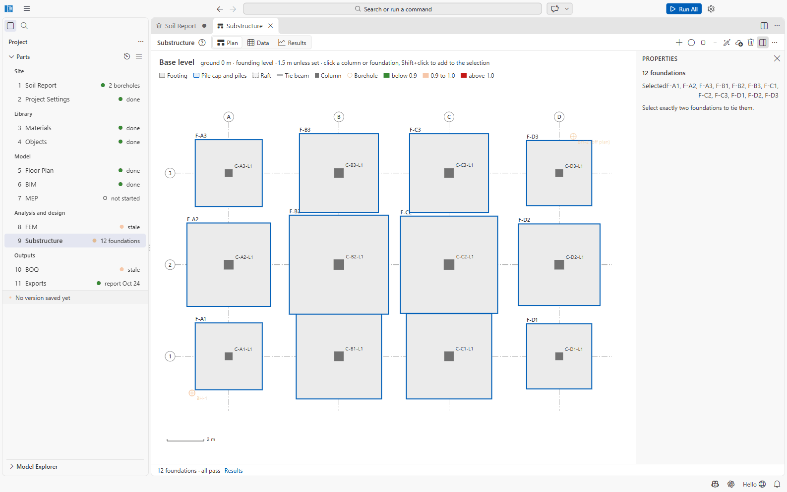
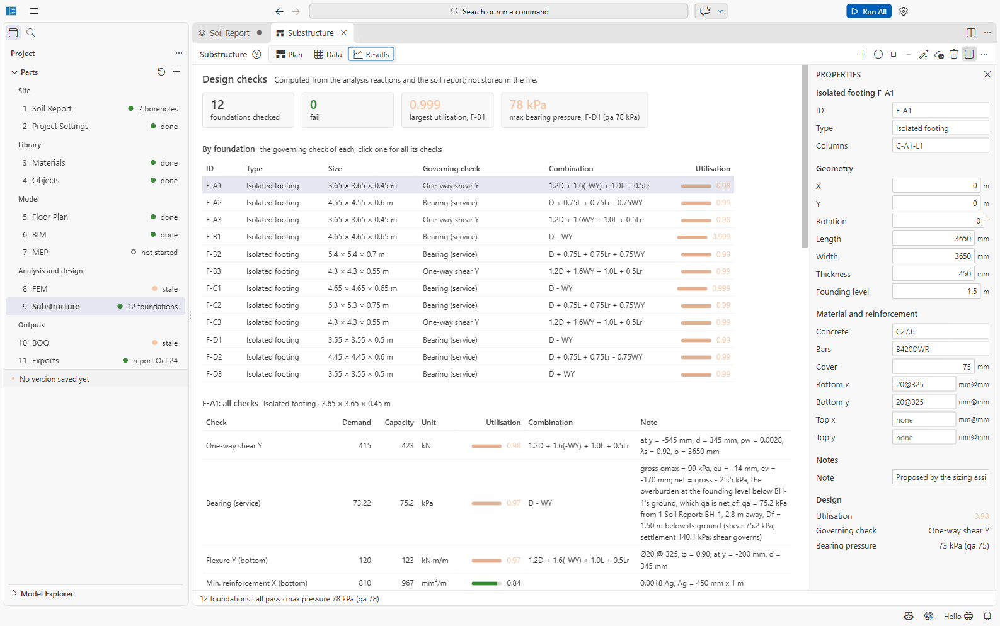

# Tutorial 3: Soil report, site map and footing design

You will enter a borehole log sheet by hand, import a second borehole from a CSV file, place the
site on the map, read the bearing capacity, and design the footings of the building from
[Tutorial 2](02-six-storey-building.md) in 9 Substructure.

Time: about 40 minutes.

You need the project *Six Storey Demo* from Tutorial 2 (analysed with Run All), and the file
[tutorial-boreholes.csv](../files/tutorial-boreholes.csv). All borehole data in this tutorial is
synthetic.

## 1. Fill in the report

1. Open **1 Soil Report**. It shows *No boreholes yet*.
2. Click **Add Borehole** (it creates BH-1). Select **Report** in the list on the left and fill
   in the Properties panel: Title *Sub-soil investigation (tutorial, synthetic)*, Consultant
   *Example Geotechnics (fictitious)*, Ground level *0*.
3. Under **Design** leave the defaults (textbook practice, Idriss & Boulanger 2014, hammer
   energy 60 %, factor of safety 3, settlement 25 mm), or choose **Bangladesh consultant
   practice** if that is how your consultant works.

## 2. Enter the log sheet of BH-1

Select **BH-1** and switch to the **Data** view.

**Header strip:** ID *BH-1*, Water table *2* (m below ground), Termination depth *20*, X *-2*,
Y *-2* (m, next to grid A-1), Date drilled *2026-10-10*, Method *Wash boring, 100 mm*. Leave
Ground level empty: the report's 0 applies.

**Strata** (click a cell and type; Tab moves right, Enter down). The new borehole starts with one
clay layer 0–10 m: overwrite it and add rows.

| Top | Bottom | Soil type | USCS | Description |
| --- | --- | --- | --- | --- |
| 0 | 1.5 | Fill | | Silty clay with brick chips (fill) |
| 1.5 | 6 | Clay | CL | Stiff brown silty clay |
| 6 | 10.5 | Silt | ML | Medium dense grey sandy silt |
| 10.5 | 20 | Sand | SP-SM | Dense grey fine sand with mica |

The folded column groups (*Unit weight*, *Strength*, *Index*, *Consolidation*) take γ, cu, c′,
φ′, E, fines, PI and the rest when the report gives them; this tutorial leaves them empty, so
SAEngine works from the SPT values.

**Samples and SPT** (one row per test, *From* the depth; *To* fills in as From + 0.45 m):

| From (m) | 1.5 | 3 | 4.5 | 6 | 7.5 | 9 | 10.5 | 12 | 13.5 | 15 | 16.5 | 18 | 19.5 |
| --- | --- | --- | --- | --- | --- | --- | --- | --- | --- | --- | --- | --- | --- |
| N | 6 | 9 | 11 | 12 | 14 | 16 | 22 | 26 | 30 | 33 | 36 | 40 | 44 |

If your log sheet gives the three 150 mm increments, type them in *Seat*, *N1* and *N2* instead:
N is worked out as N1 + N2. You can also copy a block of cells from Excel and paste it with
**Ctrl+V** at the first cell (a block that is longer than the sheet asks *Paste 13 rows × 8
columns from row 1? It adds 12 row(s).* — click **Paste**).

SAEngine fills in *To* (From + 0.45 m), the stratum's description and USCS, and the corrected
**N60** and **(N1)60** of every row; the compact log beside the sheet draws the strata and the
SPT values as you type. The status line now reads *1 borehole · site class SD · qa 84 kPa at B 2
m, Df 1.5 m*. Fix anything listed under *Problems* (for example *BH-1: layer 1 ends at or above
its top.* if a row is shifted).

## 3. Import BH-2 from a file

1. Click **Import CSV/Excel...** and pick `tutorial-boreholes.csv`. SAEngine reports *Imported
   tutorial-boreholes.csv: 1 new borehole(s).*
2. Look at the file in Excel: one row per record, `Record` = `layer` or `spt`, the borehole's
   position and water table on its first row. **Save Template...** writes an empty template in
   the same layout for your own data.
3. Click **Show All Boreholes Side by Side** in the **Log** view to compare BH-1 and BH-2.

## 4. Place the site on the map

1. Switch to the **Map** view.
2. Under **Site**, type the latitude and longitude of the project point (grid A-1) in the box
   (placeholder *23.8103, 90.4125*); for the tutorial `23.7800, 90.4000`, and press Enter. Leave
   **Grid bearing** at 0 (the X axis points east).
3. SAEngine shows the point in degrees, minutes and seconds (*23°46′48.00″ N, 90°24′00.00″ E*)
   and in BTM (*E 541 036.80 m, N 629 632.10 m*), and places BH-1 and BH-2 from their X and Y
   (*BH-1: 23.779982° N, 90.399980° E*). Drag a marker to a surveyed position if you have one;
   that borehole then keeps its own latitude and longitude.
4. When the nearest BNBC town's seismic zone or wind speed differ from those in 2 Project
   Settings, a banner names them with **Apply to Project Settings**. The tutorial building is
   already set to Dhaka, so no banner appears.
5. **Export GeoPackage...** (or **Export GeoJSON...**) writes the site, the boreholes and the
   building outline for QGIS, into `11 Exports` by default.

## 5. Read the results

Select **Report** in the list and switch to **Results**:

- **Site class:** *SD — N̄ 17.4 · s̄u 33 kPa · over 20 m · governed by BH-2* (BH-1: N̄ 19.2, BH-2:
  N̄ 17.4). Project Settings → Site → *Site class source: From the soil report* uses it for the
  earthquake loads; it is the same class the generator assumed.
- **Allowable bearing pressure** (net, FS 3, settlement ≤ 25 mm, the lowest of the two
  boreholes):

| Df \ B (m) | 1 | 1.5 | 2 | 3 | 4 |
| --- | --- | --- | --- | --- | --- |
| 1 | — | — | — | — | — |
| 1.5 | 90 | 91 | 84 | 78 | 74 |
| 2 | 93 | 89 | 91 | 82 | 78 |
| 3 | 97 | 93 | 90 | 91 | 84 |

  At 1 m the fill has no strength data, so no value is given. At the generator's founding level
  of 1.5 m, qa is 74 to 91 kPa: **less than the 100 kPa the generator assumed**.
- **Settlement** of the reference footing: 6.8 mm (BH-1) and 6.9 mm (BH-2) against the 75 mm
  BNBC Table 6.3.8 permits on plastic clay. **Liquefaction**: LPI 0 (very low).

## 6. Design the footings

1. Open **9 Substructure** and its **Results** view. All twelve footings say *not checked: no
   reinforcement*: the generator sized them (for qa = 100 kPa) but gave them no bars.
2. On the **Plan**, select all twelve footings: click the first, **Shift+click** the others. The
   Properties panel says *12 foundations*.
3. Click **Size Footings**. The assistant sizes each from its column reactions and the soil
   report's qa at its position (the lowest borehole within 10 m) and proposes bars: *Proposed
   sizes for 12 foundations (dashed)*. Click **Accept**. The footings grow from 2.3–4.3 m to
   3.55–5.4 m, for example F-A1 *3.65 × 3.65 × 0.45 m* with bottom bars *20@325* both ways.

   

4. Save (**Ctrl+S**): the checks run on the saved file. If the Results still show the old state,
   choose **... → Check the Foundations Again**.
5. Results: *12 foundations checked, 0 fail · 0.999 largest utilisation, F-B1 · 78 kPa max
   bearing pressure, F-D1 (qa 78 kPa)*. Bearing governs the inner footings (*Bearing (service)*
   under *D − WY* or *D + 0.75L + 0.75Lr ± 0.75WY*), one-way shear the corner ones. Click a
   footing for all its checks: the note of *Bearing (service)* explains the pressures and where
   qa came from.

   

6. Look at the plan critically: with 6 m × 5 m bays, the footings 4.65 m and 5.4 m wide meet
   (F-B1 with F-B2, and F-C1 with F-C2: 2.33 m + 2.70 m > 5 m). All checks pass, but footings that
   touch are not isolated footings any more. Where they overlap, select the two columns and use **Add
   Combined Footing under the 2 Selected Columns**, or a raft (**Add Raft under the Selected
   Columns**), and check again. Tie beams: select two foundations and **Add Tie Beam between the
   Two Selected Foundations**.

## 7. Finish

Run All once more: the bill of quantities measures the new footings (excavation, blinding,
concrete, bars) and the drawings' *Foundation plan* and *Foundation details* show them.

## What you learned

- Entering a log sheet in the Data view, and importing boreholes from CSV or Excel.
- Placing boreholes and the site on the map, and taking the BNBC location from it.
- How the soil report feeds the site class (Project Settings) and the bearing capacity (9
  Substructure).
- Sizing and checking footings from the analysis reactions.
