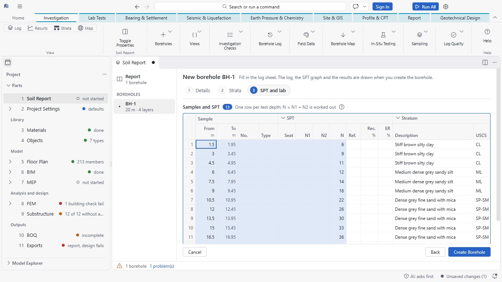
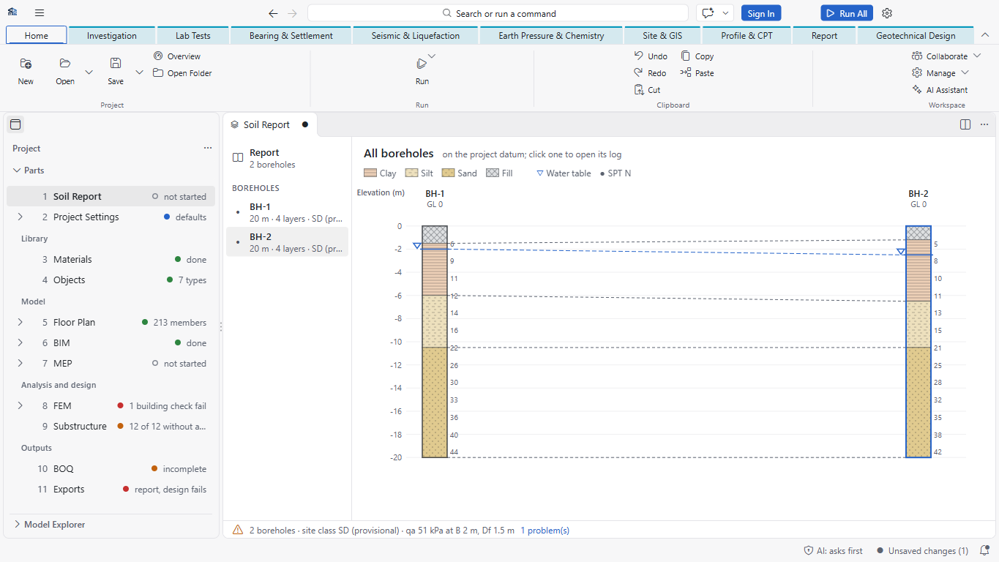
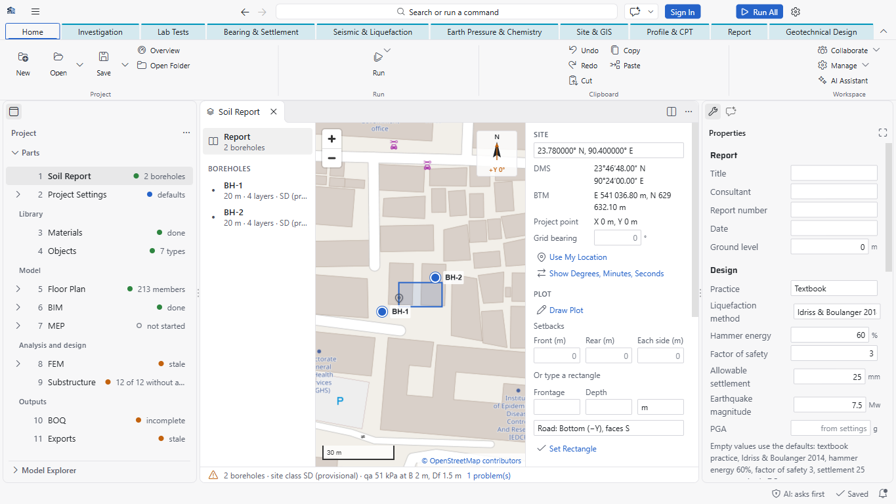
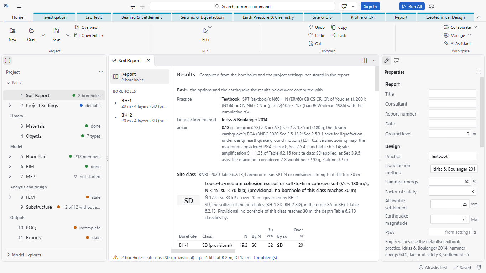
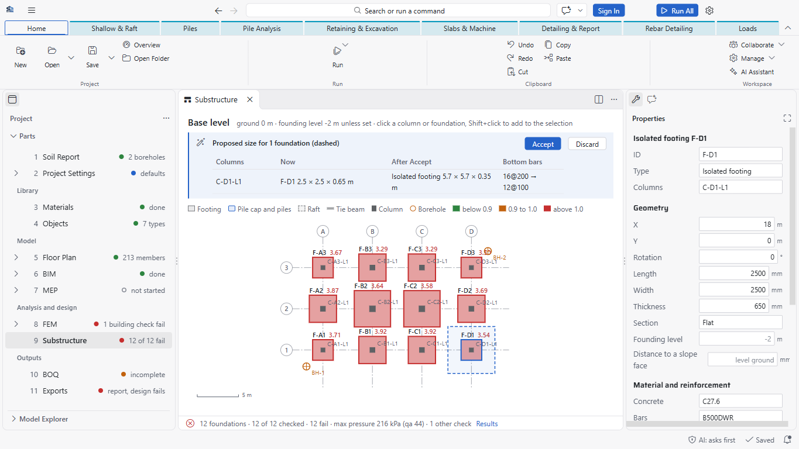
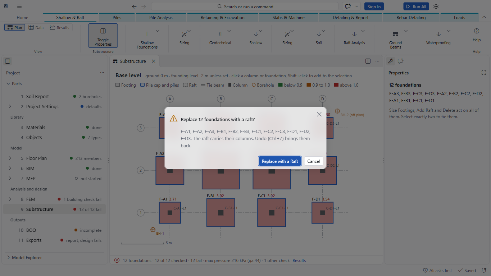
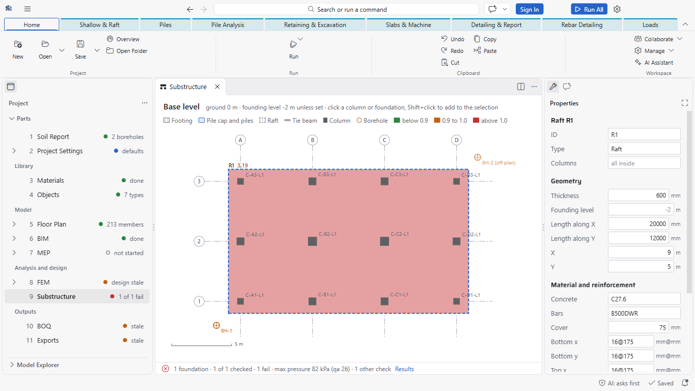
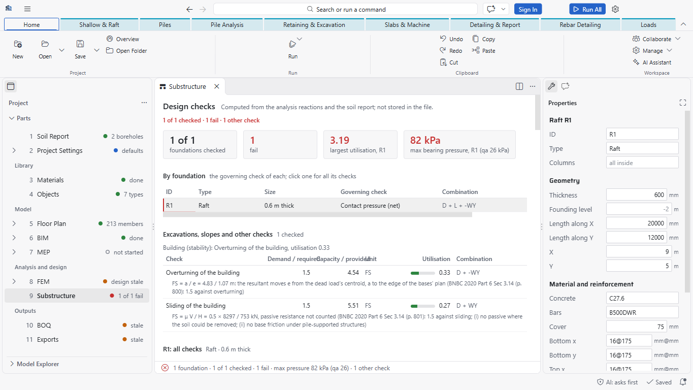

# Tutorial 3: Soil report, site map and foundation design

You will enter a borehole log sheet, import a second borehole from a CSV file, place the site on
the map, read the bearing capacity, and design the foundations of the building from
[Tutorial 2](02-six-storey-building.md) in 9 Substructure.

Time: about 40 minutes.

You need the project *Six Storey Demo* from Tutorial 2 (with its bars applied), and the file
[tutorial-boreholes.csv](../files/tutorial-boreholes.csv). All borehole data in this tutorial is
synthetic.

## 1. Add the first borehole

1. Open **1 Soil Report**. It shows *No boreholes yet*.
2. Click **Add Borehole**. The log sheet of *New borehole BH-1* opens at step 1, **Details**.
3. Fill in: Date drilled *2026-10-10*, Method *Wash boring, 100 mm*, Termination depth *20*,
   Water table *2* (m below ground), X *-2*, Y *-2* (m, next to grid A-1). Leave Ground level
   empty: the report's 0 applies. Click **Next: Strata**.

## 2. Enter the log sheet of BH-1

**Strata** (click a cell and type; Tab moves right, Enter down; or paste a block from Excel with
Ctrl+V and confirm **Paste**):

| Top | Bottom | Soil type | USCS | Description |
| --- | --- | --- | --- | --- |
| 0 | 1.5 | Fill | | Silty clay with brick chips (fill) |
| 1.5 | 6 | Clay | CL | Stiff brown silty clay |
| 6 | 10.5 | Silt | ML | Medium dense grey sandy silt |
| 10.5 | 20 | Sand | SP-SM | Dense grey fine sand with mica |

The folded column groups (*Unit weight*, *Strength*, *Index*, *Consolidation*) take γ, cu, c′,
φ′, E, fines, PI and the rest when the report gives them; this tutorial leaves them empty, so
SAEngine works from the SPT values.

Click **Next: SPT and lab**. **Samples and SPT**, one row per test (*From* the depth; *To* fills
in as From + 0.45 m):

| From (m) | 1.5 | 3 | 4.5 | 6 | 7.5 | 9 | 10.5 | 12 | 13.5 | 15 | 16.5 | 18 | 19.5 |
| --- | --- | --- | --- | --- | --- | --- | --- | --- | --- | --- | --- | --- | --- |
| N | 6 | 9 | 11 | 12 | 14 | 16 | 22 | 26 | 30 | 33 | 36 | 40 | 44 |

If your log sheet gives the three 150 mm increments, type them in *Seat*, *N1* and *N2* instead:
N is worked out as N1 + N2. A block pasted from Excel that is longer than the sheet asks *Paste
13 rows × 8 columns from row 1? It adds 13 row(s).*: click **Paste**.

SAEngine fills in *To*, the stratum's description and USCS of every row, and the corrected
**N60** and **(N1)60** in the last columns. Click **Create Borehole**. The log of BH-1 is drawn,
and the status line reads *1 borehole · site class SD (provisional) · qa 51 kPa at B 2 m, Df
1.5 m · 1 problem(s)*. Click *1 problem(s)*: *No borehole reaches 30 m (the deepest ends at 20
m): BNBC 2020 Table 6.2.13 classifies the site by the top 30 m, so the site class is
provisional.* A real investigation for a six-storey building should go deeper.

## 3. Import BH-2 from a file

1. Click **Investigation › Boreholes › Import** and pick `tutorial-boreholes.csv`. SAEngine
   reports *Imported tutorial-boreholes.csv: 1 added.*
2. Look at the file in Excel: one row per record, `Record` = `layer` or `spt`, the borehole's
   position and water table on its first row. **Investigation › Boreholes › Template** writes an
   empty template in the same layout for your own data.
3. Click **Investigation › Views › All Boreholes** to compare BH-1 and BH-2 on the project datum,
   with a table of both.

Save the soil report (Ctrl+S).

## 4. Place the site on the map

1. Choose **Investigation › View › Map**.
2. Under **Site**, type the latitude and longitude of the project point (grid A-1); for the
   tutorial `23.7800, 90.4000`, and press Enter. Leave **Grid bearing** empty (the X axis points
   east).
3. SAEngine shows the point in degrees, minutes and seconds (*23°46′48.00″ N, 90°24′00.00″ E*)
   and in BTM (*E 541 036.80 m, N 629 632.10 m*), and places BH-1 and BH-2 from their X and Y
   (*BH-1: 23.779982° N, 90.399980° E*). Drag a marker to a surveyed position if you have one;
   that borehole then keeps its own latitude and longitude.
4. When the nearest town's seismic zone or wind speed differ from those in 2 Project Settings, a
   banner names them with **Apply to Project Settings**. The tutorial building is already set to
   Dhaka, so no banner appears.
5. **Plot** draws the site boundary and its setbacks; **Export GeoPackage...** (or **Export
   GeoJSON...**) writes the site, the boreholes and the building outline for QGIS.

## 5. Read the results

Choose **Investigation › View › Results** and select **Report** in the list:

- **Site class:** *SD (provisional) — N̄ 17.4 · s̄u 33 kPa · over 20 m · governed by BH-2*
  (BH-1: N̄ 19.2, BH-2: N̄ 17.4; by N̄ alone the class would be SC, the undrained strength makes
  it SD). Project Settings › Site › *Site class source: From the soil report* uses it for the
  earthquake loads; it is the class the generator assumed.
- **Allowable bearing pressure** (net, FS 3, settlement ≤ 25 mm, the lowest of the two
  boreholes):

| Df \ B (m) | 1 | 1.5 | 2 | 3 | 4 |
| --- | --- | --- | --- | --- | --- |
| 1 | — | — | — | — | — |
| 1.5 | 89s | 64s | 51s | 38s | 30s |
| 2 | 90s | 65s | 52s | 38s | 31s |
| 3 | 92s | 67s | 55s | 41s | 34s |

  *s* means settlement governs. At 1 m the fill has no strength data, so no value is given. The
  clay has no consolidation test, so its settlement (and the qa it governs) is *estimated by the
  code pack's modulus numbers*: give Cc and e0 from a consolidation test to compute it.
- **Settlement** of the reference footing (B 2 m at 1.5 m under 51 kPa): 25 mm, against the
  75 mm BNBC Table 6.3.8 permits on plastic clay. **Liquefaction:** LPI 0 (very low).
- **Pile design parameters** per layer: skin friction and end bearing for bored piles (α method
  in the clay, β method in the silt and sand).

## 6. Design the foundations

1. **Run All**, so that the analysis uses the soil report's site class. It ends with
   *foundations 12 of 12 fail*.
2. Open **9 Substructure**. The plan shows the twelve generated footings in red with their
   utilisation (3.3 to 3.9): the governing check is *Bearing (service)*, about 215 kPa against a
   qa of 44 to 46 kPa at their size and depth.
3. Click a corner footing, then **Shallow & Raft › Sizing › Size Footings**. The proposal: *C-D1-L1:
   F-D1 2.5 × 2.5 × 0.65 m → Isolated footing 5.7 × 5.7 × 0.35 m*. A 5.7 m footing on a 6 m × 5 m
   grid meets its neighbours: isolated footings do not work here. Click **Discard**.

   

4. Try a raft. Select the twelve footings (click the first, **Shift+click** the others;
   Properties says *12 foundations*) and click **Shallow & Raft › Shallow Foundations › Add
   Raft**. SAEngine asks first:

   

   Click **Replace with a Raft**, save (Ctrl+S) and click **Shallow & Raft › Sizing › Check
   Again**.

   

5. Open **Shallow & Raft › View › Results**: *R1 · Raft · 0.6 m thick · Contact pressure (net)
   81.88 kPa against 25.67 kPa, 3.19 under D + L − WY*. One-way shear and flexure need a thicker,
   more heavily reinforced raft too, and its settlement is 83 mm. Each row says what to try:
   *Suggested: a larger outline (or piles under it)*. The building's sliding and overturning
   pass.

   

**The engineering conclusion.** On this soil (soft-to-firm clay over the top 6 m, with qa about
50 kPa at a 2 m footing) a six-storey frame cannot stand on shallow foundations: the pressures
are three times what the clay allows, and the settlements too large. It needs **piles** founded
in the dense sand below 10.5 m. Undo the raft (Ctrl+Z) and design bored piles with pile caps:
**Piles › Piles & Caps › Add Pile Type** (diameter, length, the soil report's skin friction and
end bearing per layer), then **Add Pile Cap** under the selected columns, and **Check Again**;
see [9 Substructure](../09-substructure.md).

## 7. Finish

**Run All** once more: the bill of quantities measures the foundations (excavation, blinding,
concrete, bars) and the drawings' *Foundation plan* and *Foundation details* show them.

## What you learned

- Entering a log sheet in the **Edit Borehole** steps, and importing boreholes from CSV or Excel.
- Placing boreholes and the site on the map, and taking the location from it.
- How the soil report feeds the site class (Project Settings) and the bearing capacity (9
  Substructure).
- Reading Size Footings' proposal and the raft's checks critically: when they fail by a factor
  of three, the answer is a different foundation type, not a bigger footing.
