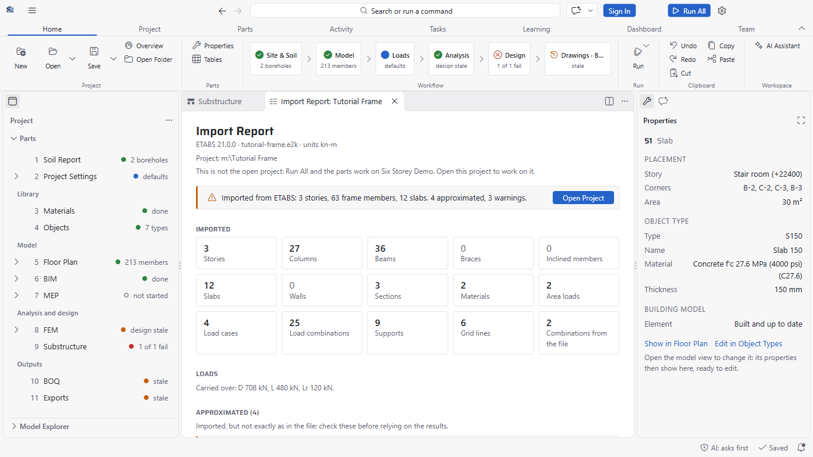

# Tutorial 4: Importing an ETABS model and comparing results

You will import a small ETABS model from its `.e2k` text file, read the import report, run the
analysis and design in SAEngine, and compare the results with hand calculations and with the
ETABS results of the same model.

Time: about 30 minutes, most of it waiting for Run All.

> SAEngine has **no automatic comparison** with ETABS results: you compare by hand, with the
> table at the end of this tutorial. Check your first real import as carefully as this tutorial
> does.

## The model

The file [tutorial-frame.e2k](../files/tutorial-frame.e2k) is a synthetic model written by hand
for this manual (it is not an export of a real project). It has the structure ETABS writes:

- units kN, m (`$ CONTROLS  UNITS "KN" "M" "C"`);
- three storeys of 3.2 m (`Story1` to `Story3` above `Base`);
- grids A, B, C at 0, 6, 12 m and 1, 2, 3 at 0, 5, 10 m: two bays each way, 12 m × 10 m;
- columns C400x400, beams B300x500, slabs S150, concrete f′c 28 MPa, rebar B420; column bars
  12 Ø16 in `$ CONCRETE SECTIONS`;
- fixed supports at the nine base points;
- load patterns Dead (self-weight), SDL, Live, RLive with uniform area loads: SDL 2.2 kN/m² on the
  floors and 1.5 kN/m² on the roof, Live 2.0 kN/m² on the floors, roof live 1.0 kN/m²;
- two combinations, U1 = 1.4(Dead + SDL) and U2 = 1.2(Dead + SDL) + 1.6 Live + 0.5 RLive.

If you have ETABS, you can open this file there (File → Import → ETABS .e2k Text File) to get the
ETABS results for the comparison. With your own model, export it from ETABS with **File → Export
→ ETABS .e2k Text File**.

## 1. Import the file

1. On the Start page (or **≡ › File**) choose **Import from ETABS, STAAD or SAP2000...**.
2. Pick `tutorial-frame.e2k`.
3. **Choose Where to Put the Imported Project**: your projects folder.
4. **Name the Imported Project**: *Tutorial Frame*.

SAEngine writes the project and shows the **Import Report**. Click **Open Project** on it to
work on the new project.



Read it section by section:

| Section | What it says here | What to do |
| --- | --- | --- |
| Imported | 3 stories, 27 columns, 36 beams, 12 slabs, 3 sections, 2 materials, 2 area loads, 4 load cases, 25 load combinations, 9 supports, 6 grid lines; 2 combinations from the file | Check the counts against ETABS (9 columns × 3 storeys, 12 beams × 3, 4 slabs × 3). |
| Loads | *Carried over: D 708 kN, L 480 kN, Lr 120 kN.* | These are the area loads; nothing was lost. |
| Approximated | *beam bars left to SAEngine's design (e2k gives covers only)*; *area loads not in the file: SAEngine's defaults kept (Stairs)*; *combinations with F (fluid) 0* | Expected: SAEngine designs the beam bars. |
| Warnings | *The file has no property modifiers (gross sections): SAEngine analyses the lateral cases on cracked concrete sections*; *Load combinations: the 23 of BNBC 2020 Part 6 Sec 2.7.3.1 on SAEngine's wind and earthquake cases, then the file's 2*; *Wind and earthquake loads are SAEngine's own from the code pack settings* | Note the first for the period comparison; the last is step 2. |

The same import from the command line:

```bash
saengine import tutorial-frame.e2k "D:\Projects" --name "Tutorial Frame"
```

## 2. Check what was imported

1. **02 Project Settings.** The importer sets Dhaka, residential, occupancy II, site class SD,
   *RC intermediate moment frame*. Set them to your project's site and system: wind and
   earthquake are computed by SAEngine from these settings, not taken from the file. The **Area
   Loads** show *Floors (imported)* (live 2.0, finish 2.2) and *Roof (imported)* (live 1.0, finish
   1.5): the file's SDL became the floor finish. The **Load Combinations** are the file's U1 and
   U2 *(from the file)* after the 23 BNBC 2020 combinations the importer added. **Generate from
   BNBC 2020** in Load Combinations resets them to the code's set.
2. **03 Materials:** C28 (f′c 28 MPa) and B420 (fy 420 MPa) with the file's E and unit weight.
3. **04 Objects:** C400x400 with its 12 Ø16 bars, B300x500 without bars, S150.
4. **05 Floor Plan:** the grids A–C, 1–3 and the members on each storey. **6 BIM** has been built.

## 3. Run All

Click **Run All**. On a typical PC this takes about a minute. The members are checked, but the
beam and slab types have no bars (the file gives covers only), so open **8 FEM › Design
Reinforcement**:

*Design checks now: 0 members pass, 27 fail; 3 diaphragms, 3 fail; 48 members not checked for
want of bars.*

- B300x500 and S150 get bars (*Apply Proposal (2 Types)*).
- **C400x400** is marked **section too small**: its 12 Ø16 are not the problem; the beam-column
  joints of a special moment frame fail joint shear with these beams. The proposal offers the bars
  its strength needs anyway (*Tick to apply the bars its strength needs anyway; its joints still
  fail joint shear*).

Click **Apply Proposal**: *0 members pass, 27 fail ... → 48 members pass, 27 fail; 27 joints, 10
fail*. The 27 columns still fail *Detailing: Confinement Ash* (Sec 8.3.5.4), and 4 joints joint
shear and 6 strong column / weak beam. An ETABS model of a special moment frame with 400 mm
columns would need bigger columns in SAEngine too: compare the systems in 2 Project Settings ›
Seismic before you compare designs. **Run All** again after any change.

## 4. Compare

Open the report (**Open Report**, or `11 Exports/report.pdf`), chapter *Analysis results*.

**Gravity loads by hand.** Plan area 12 × 10 = 120 m², three floors.

| Case | Hand calculation | SAEngine (report 4.2, ΣFz) |
| --- | --- | --- |
| D, self-weight | slabs 0.15 × 120 × 3 = 54.0 m³; columns 0.4 × 0.4 × 3.2 × 9 × 3 = 13.8 m³; beams 0.3 × 0.5 × (3 × 12 + 3 × 10) × 3 = 29.7 m³; total 97.5 m³ × 23.56 kN/m³ = **2297 kN** | **2298.0 kN** |
| SD | 2.2 × 120 × 2 + 1.5 × 120 = **708 kN** | **708.0 kN** |
| L | 2.0 × 120 × 2 = **480 kN** | **480.0 kN** |
| Lr | 1.0 × 120 = **120 kN** | **120.0 kN** |

The self-weight matches the gross volumes: SAEngine counts the slab, beam and column volumes
where they overlap. Check how your ETABS model treats these overlaps before comparing.

**Against ETABS.** Fill in the ETABS column from ETABS's own tables (Display → Show Tables →
*Base Reactions*, *Modal Participating Mass Ratios*, *Story Drifts*):

| Quantity | SAEngine 0.0.52 | ETABS | Difference |
| --- | --- | --- | --- |
| ΣFz Dead | 2298.0 kN | | |
| ΣFz SDL | 708.0 kN | | |
| ΣFz Live | 480.0 kN | | |
| ΣFz Roof live | 120.0 kN | | |
| Seismic weight | 3071.7 kN | | |
| Period, mode 1 (X) | 0.646 s | | |
| Period, mode 2 (Y) | 0.609 s | | |
| Mode 1 mass participation | 84.6 % | | |
| Static base shear EX = EY | 172.8 kN | | |
| Largest design storey drift X (response spectrum) | 0.572 % (allowed 2.00 %) | | |

The SAEngine values above are those of the tutorial file in a build after 0.0.52 (report sections
3.2, 4.1, 4.2 and the response-spectrum drift table); yours should be the same. The base shear
uses the approximate period Ta = 0.357 s (Table 6.2.20); the response spectrum results are scaled
to 85 % of it.

**Why results can differ** (check these before suspecting an error):

- **Gravity reactions** should agree within rounding. If not, look at the import report's *Loads*
  and *Skipped* sections (point and frame loads are not carried over) and at the unit weight of
  the materials.
- **Periods** depend on the stiffness: SAEngine uses cracked sections for the lateral cases (BNBC
  6.3.10.4.1: columns 0.70 Ig, beams 0.35 Ig, slabs 0.25 Ig) and rigid end zones (factor 0.5). Compare with ETABS using the same property modifiers. They also depend on the mass
  source: compare SAEngine's seismic weight (shown when the model is derived: *Derived ...
  nodes and ... elements; base shear ... kN, seismic weight ... kN*) with the ETABS mass first.
- **Seismic and wind forces** are SAEngine's own from Project Settings, not ETABS's auto loads:
  compare them only when the site, occupancy, system and the code parameters are the same.
- **Member forces** at the ends of members differ where ETABS has insertion points or end offsets
  that SAEngine approximates, and where ETABS has releases the importer only reports (one end
  only, concrete members, axial, shear and torsion: *Approximated* in the import report). Such
  releases can be set by hand in 6 BIM › Additions.
- **Designs** differ because SAEngine designs to BNBC 2020 Part 6 Chapter 6 with its own seismic
  detailing rules (Sec 8.3), and proposes bars for each object type.

## What you learned

- How an `.e2k` file maps to SAEngine's parts, and what the import report tells you.
- That wind and earthquake loads always come from SAEngine's BNBC settings.
- How to check an imported model with hand calculations and against the source program.
