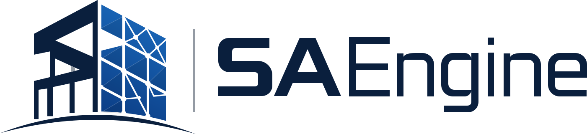

# SAEngine brand

The SAEngine logo and its typography are SAEngine's design system (owner decision 2026-11-11,
docs/engineering-decisions.md). Every SAEngine mark, icon and brand heading comes from the files
here, and all of them are generated from one hand-drawn geometry by
[`scripts/brand/build_brand.py`](../../../scripts/brand/build_brand.py): change the geometry or
the tokens there and run it again (Pillow, numpy and fontTools only), never edit the outputs.

## Files

| File | Use |
| --- | --- |
| `saengine-lockup.svg` | Full logo: mark, divider, wordmark. On white or light backgrounds. |
| `saengine-lockup-dark.svg` | Full logo on dark backgrounds (white frame and wordmark, lighter facade). |
| `saengine-lockup-white.svg` | One colour, white: on photos, navy or any dark colour. |
| `saengine-mark.svg` | The mark alone, square (512), transparent. |
| `saengine-mark-dark.svg`, `saengine-mark-white.svg` | The mark for dark backgrounds / one colour white. |
| `saengine-mark-small.svg` | The mark simplified for 32 px and smaller (no mesh, no node dots, heavier joints). |
| `saengine-wordmark.svg`, `saengine-wordmark-white.svg` | The wordmark alone, as outlines (no font needed). |
| `saengine-app-icon.svg` | The app icon: the colour mark on a white rounded tile. |

Generated from the same geometry: `resources/saengine-mark.svg`, the title bar / welcome icon
(`src/vs/workbench/browser/media/code-icon.svg`), the empty editor letterpress
(`src/vs/workbench/browser/parts/editor/media/letterpress-*.svg`), the app icons
(`resources/win32/code.ico`, `code_70x70.png`, `code_150x150.png`, `resources/darwin/code.icns`,
`resources/linux/code.png`, `resources/linux/rpm/code.xpm`, `resources/server/code-*.png`,
`favicon.ico`), the installer bitmaps (`resources/win32/inno-*.bmp`), the SAEngine extensions'
icons, the start page art (`saengineProject/browser/saengineBrandArt.ts`) and the report footer
mark (`python/src/saengine/report/templates/saengine-mark.{svg,png}`).

## Colours

| Token | Light | Dark | Where |
| --- | --- | --- | --- |
| Brand ink (`saengine.brandInk`) | `#0A1F3D` navy | `#F2F5FA` | Frame, ground arc, wordmark, brand headings |
| Facade top (`saengine.brandFacadeTop`) | `#1C6EC1` | `#4C94E8` | Facade gradient, top right |
| Facade bottom (`saengine.brandFacadeBottom`) | `#0B3C84` | `#1F5FBF` | Facade gradient, bottom left |
| Brand blue (`saengine.brandBlue`) | `#1A5FB4` | `#6EA8F2` | Brand text and highlights |
| Brand grey (`saengine.brandGrey`) | `#939AA3` | `#6B7686` | The divider (decorative only) |

The tokens are theme colours (registered in `saengineProject/browser/saengineBrand.ts`, set by
SAEngine Light and SAEngine Dark) and CSS variables (`--sa-brand-*` in `saengineTokens.css`).
They colour the logo and brand headings only: the UI keeps its own accent and is not made blue.
Contrast (WCAG 2.x) on the SAEngine themes' editor / side bar: ink 16.5:1 / 15.4:1 light and
16.5:1 dark; brand blue 6.3:1 / 5.9:1 light and 7.4:1 / 6.9:1 dark, so both pass AA for body
text. The grey is never used for text.

## Typography

The logo's lettering is **Saira** (Omnibus-Type, SIL Open Font License 1.1):

- "SA": Saira Expanded ExtraBold (width 125, weight 800), heavy, wide, geometric.
- "Engine": Saira Regular (width 100, weight 400), squarish, rounded corners.

Rule: brand type is for SAEngine's titles and headings (the wordmark, page titles, start page
headings, report headings, `--sa-font-brand` with `--sa-font-brand-heading-weight: 600`; the
"SA" style `--sa-font-brand-display-weight: 800` + `--sa-font-brand-display-stretch: 125%` is for
display use only). Body text, tables, forms and the editor keep the workbench font (and the
reports their book face, Libertinus Serif), for readability. The wordmark itself is always the
outlined artwork, never typed text. Fallback stack while Saira is missing: Bahnschrift (Windows
10+), Segoe UI Variable Display, Segoe UI, system-ui, sans-serif.

Bundled fonts (owner approved the download, 2026-11-11):

| Font | Version | Source | Licence | In the repo |
| --- | --- | --- | --- | --- |
| Saira (variable, wdth 50-125, wght 100-900) | 1.101 | https://github.com/google/fonts/tree/main/ofl/saira (from https://github.com/Omnibus-Type/Saira, commit 1916f2a5) | OFL-1.1 | `workbench/src/vs/workbench/contrib/saengineProject/browser/media/fonts/Saira-Variable.ttf` + `OFL.txt`, unmodified |
| Saira Regular, Saira SemiBold, Saira Expanded ExtraBold (static) | 1.101 | instances of the file above, made by `build_brand.py` with fontTools (Typst and Word do not read variable axes) | OFL-1.1 | `python/src/saengine/report/templates/fonts/` + `OFL.txt` |

The OFL text ships beside each copy and in THIRD_PARTY_NOTICES.txt
(`scripts/installer/write_notices.py`). Word reports keep Cambria (a reader without Saira would
see a substitute) and take the brand navy for headings.

## Proportions, clear space, minimum size

In the artwork's units (the lockup is 1401 x 321):

- Mark 467 x 321; divider 4 x 199, from 19 above the cap height down to the descender line; gaps
  facade → divider 65 and divider → "S" 56.
- Wordmark 880 x 180: cap height 142 ("S", "A", "E"), x-height 105 (0.74 of the cap height),
  descender 38; "SA" is 293 wide with stems 34 and bars 24, "Engine" 569 wide with a stroke of 16,
  outer corner radius 28 and inner 14. The wordmark's cap height is 0.44 of the mark's height.
- Clear space: at least half the cap height (71 units, about 0.22 of the lockup's height) on
  every side; for the mark alone, a quarter of its height.
- Minimum size: the lockup 120 px (30 mm) wide; the mark 16 px, using `saengine-mark-small.svg`
  (or the generated icons) at 32 px and below. Never stretch, recolour outside the palettes
  above, outline, or put the colour version on a busy or mid-tone background.
